# StudioHub Identity Architecture & Workflow Audit

**Date:** 2026-10-20 · **Status:** Analysis only (no code modified) · **Scope:** `apps/identity`, identity-adjacent `apps/core`/`apps/audit`/`apps/production` authorization surfaces, `config/settings/*`, React consumers in `studiohub-react`.

**Method.** Every load-bearing claim below was verified directly in source (file:line references given); where behavior could not be confirmed from source it is marked **ASSUMPTION** or **TARGET** (proposed design, not existing). The org-removal refactor (fall 2026) is the baseline: Organization is gone as a domain entity, tenant boundary, and runtime context; nothing in this report proposes reintroducing it.

---

## 1. Executive Summary

StudioHub's identity layer is architecturally sound in *shape* — domain-scoped `apps/identity` app, custom UUID `User`, service/selector layering, flat platform-global RBAC, project-scoped production access — but a large share of the advertised security surface is **inert, broken, or unwired**. The single most important insight from this audit: **most identity "features" (MFA, revocation, security events, scheduled hygiene, cache invalidation on RBAC writes) exist as code but have no production caller.**

Severity-ranked headline findings:

| # | Finding | Sev | One-line evidence |
|---|---------|-----|-------------------|
| F1 | **Deactivated/archived users retain full API access through PATs and API keys.** These credential authenticators never check `user.is_active` (JWT path does). | **Critical** | `apps/identity/authentication/personal_access_token.py:57-62` (`return pat.user`), `api_key.py:32-58` |
| F2 | **TOTP secrets are stored plaintext and echoed back over the API** by the MFA config endpoint. | **Critical** | `models/user_mfa.py:26-29`; `api/views/mfa_compat.py:43-47` (`"secret": mfa.totp_secret`) |
| F3 | **MFA can never be enabled and is never enforced at login.** Enroll → `status=DISABLED`; verify requires ENABLED; the method that enables (`MFAEnrollmentService.activate`) has zero callers; `AuthenticationService.login` never consults MFA; `MFARequired` exception has no raiser. | **High** | `services/mfa/enrollment.py:36-44`, `validators/user_mfa.py:26-32`, `services/authentication.py:60-142` |
| F4 | **Password change does not revoke live credentials** on either path (tokens and sessions survive; no SecurityEvent). Secondary path (`/users/change_password/`) additionally **skips password validators and never verifies `old_password`** despite accepting it. | **High** | `services/password.py:8-34`, `services/user_password.py:23-45`, `api/serializers/user/password.py:16-35` |
| F5 | **Account self-service recovery is non-functional:** `POST /password/reset/` crashes (`PasswordService.reset_password` does not exist — no reset-token system exists at all); `POST /email/verify/` crashes (`get_by_verification_token` does not exist). Both are `AllowAny`. Frontend "forgot password" page is pure theater (no API call). | **High** | `api/serializers/authentication/reset_password.py:18-22` vs `services/password.py`; `api/serializers/authentication/verify_email.py:15-21`; `studiohub-react/src/modules/auth/pages/ForgotPasswordPage.tsx:34-39` |
| F6 | **RBAC permission changes can take up to 1 h to take effect.** The permission cache (1 h TTL, per-user version keys) is invalidated only on User-model writes; role/group/permission CRUD evicts nothing; all identity signals are no-op placeholders. | **High** | `services/permission_cache.py:35,147-217` (invalidators unused); only caller `services/user.py:42-47` |
| F7 | **`PATCH /api/v1/auth/me/` is called by the frontend `updateProfile` flow but not implemented** → runtime 405 on every profile edit. | **High** | `api/views/auth_compat.py:145-158` (GET only) vs `studiohub-react/.../RESTAuthAdapter.ts:63-68` |
| F8 | **Logout leaves the `UserSession` row ACTIVE** (serializer always passes `session=None`, so the session-status branch of logout is dead); `logout_all`/deactivate do not blacklist outstanding refresh JWTs. | **Medium** | `serializers/authentication/logout.py:20-27`; `services/user_session.py:203-222` |
| F9 | **API key / PAT secret hashing = fast unsalted `SHA-256(SECRET_KEY:token)`** — not a slow KDF; DB+SECRET_KEY compromise yields usable keys; rotating `SECRET_KEY` silently invalidates every credential. Scopes (`APIKeyScope`) are **never evaluated** — a service key inherits its human owner's full privilege set. | **Medium** | `api_keys/hashing.py:14-26`; scopes unused everywhere |
| F10 | **Brute-force lockout key is (username, IP) pair only, never persisted; IP extraction trusts client-supplied `X-Forwarded-For`; scoped throttles fail open on cache outage.** | **Medium** | `validators/authentication.py:100-118`; `authentication/utils.py:15-27`; `core/api/throttling.py:15-40` |
| F11 | **SecurityEvent, LoginHistory(identity), UserPreference, KnownDevice, OAuth\* are dead weight**; events published to the internal bus have **zero production subscribers**; no Celery beat schedule exists. | **Medium** | grep-verified dead (see §11) |
| F12 | **The URL surface is duplicated**: login/refresh/logout/me in two trees (`/identity/*` legacy + `/auth/*` compat), MFA in two trees with diverging (and partially broken) behavior. | **Medium** | §3 |

What is **good and should be kept**: custom UUID user + service-layer separation; fail-closed `HasPermission` gate; per-user versioned permission cache; simplejwt rotation + blacklist-after-rotation; project-membership fail-closed selectors; soft-delete discipline; flat org-free RBAC ("organization" kwargs accepted-and-ignored, not leaking); ML 30-day session records; audit `ChangeLog`/`APIRequest` telemetry.

**Bottom line:** do *not* replace the identity foundation. Fix the broken/partially-wired flows, wire the dead invalidation/enforcement hooks, add the missing credential API and LDAP/SSO provider mapping into a small extension of the existing model set, and delete the four to five dead models. The recommended end-state requires **no new User model and no organization concept**.

---

## 2. Current Identity Architecture & Model Relationships

### 2.1 Stack (verified)

- `AUTH_USER_MODEL = "identity.User"` (`config/settings/components/auth.py:5`) — `User(AbstractBaseUser, PermissionsMixin)` + `EntityModel` (UUID PK, timestamps, audit FKs `created_by/updated_by/deleted_by`, soft-delete `is_deleted/deleted_at`) (`apps/identity/models/user.py:8-121`; `apps/core/models/bases/*`).
- DRF default auth chain (`config/settings/components/drf.py:17-24`): `rest_framework_simplejwt.JWTAuthentication` → `PersonalAccessTokenAuthentication` (`Token <prefix.secret>`) → `APIKeyAuthentication` (`Api-Key <secret>`). Default permission `IsAuthenticated`; identity viewsets add `HasPermission` (fail-closed, superuser bypass, **staff is not a bypass**) (`apps/identity/permissions/permission.py:9-75`).
- Throttling: only two scoped throttles — `login 30/min`, `refresh 60/min` (`drf.py:38-41`) on the 4 login/refresh endpoints; otherwise account-lockout counters are the only rate defense.
- JWT (`config/settings/components/jwt.py`): access 30 min, refresh 30 days, `ROTATE_REFRESH_TOKENS=True`, `BLACKLIST_AFTER_ROTATION=True`, `UPDATE_LAST_LOGIN=True`. Note: the app does **not** use simplejwt's `TokenObtainPairView`; `JWTService` (`apps/identity/authentication/jwt.py`) implements rotation itself (settings rotation flags only affect simplejwt's own serializers, which are unused).
- LDAP: **absent** — no library, settings, service, or endpoint (single enum choice `apps/identity/choices/session.py:146`). VERIFIED.
- Events: `apps/core/events/bus.py` publishes on `transaction.on_commit`; **no production subscribers** (tests only).
- Frontend storage: access + refresh JWT in **localStorage** (`studiohub-react/src/core/auth/tokenStorage.ts:3-4,37-38`); bearer-only transport, **no CSRF involvement, no cookies for API calls**; reactive-only 401 refresh with rotation-aware retry once (`src/api/client/ApiClient.ts:81-151`).

### 2.2 Model diagram (verified structure)

```mermaid
erDiagram
    User ||--o| Profile : "profile (O2O)"
    User ||--o| UserSession : "identity_sessions"
    User ||--o{ LoginAttempt : "anonymous capable"
    User ||--o{ TrustedDevice : ""
    User ||--o| UserMFA : "mfa (O2O)"
    User ||--o{ BackupCode : ""
    User ||--o{ UserRole : ""
    User ||--o{ PersonalAccessToken : "identity_personal_access_tokens"
    Role ||--o{ UserRole : ""
    Role ||--o{ RolePermission : ""
    Permission ||--o{ RolePermission : ""
    User ||--o{ GroupMember : ""
    Group ||--o{ GroupMember : ""
    Group ||--o{ GroupRole : ""
    Role ||--o{ GroupRole : ""
    User ||--o{ ApiKey : "created_by (owner SET_NULL)"
    User }o--o| ApiKey : "owner (never populated)"
    User ||--o{ KnownDevice : "DEAD"
    User ||--o{ OAuthAccount : "DEAD"
    OAuthProvider ||--o{ OAuthAccount : "DEAD"
    Project }o--o{ User : "ProjectMembership (apps/production)"
    User {
        string email UK
        bool is_active
        bool is_staff
        bool is_superuser
        bool is_email_verified
        datetime last_seen "set only at login"
        char password
    }
    Profile {
        string first_name
        string display_name
        string avatar_url
        string timezone
        json preferences "DEAD column"
        bool must_change_password "set by admin; never enforced"
    }
    UserSession {
        string session_key UK "= refresh JTI"
        string access_token_jti
        string refresh_token_jti
        string status "ACTIVE|EXPIRED|LOGGED_OUT|REVOKED|LOCKED"
        datetime expires_at "refresh exp; NOT rolled on refresh"
        datetime logged_out_at
        string logout_reason
    }
    Role {
        string name
        string code UK
        string scope "lattice metadata only"
        string role_type "lattice metadata only"
        int priority "used by project admin gate"
        Role parent " serialized; never walked "
    }
    UserRole { }
    RolePermission { bool granted "expires_at DEAD" }
    UserMFA {
        string totp_secret "PLAINTEXT base32"
        string status "DISABLED|ENABLED|LOCKED"
        int failed_attempts
        datetime locked_until
    }
    TrustedDevice { string fingerprint "UA+lang hash" bool is_trusted }
    PersonalAccessToken { string prefix string hashed_token UK json scopes datetime expires_at "is_active" }
    ApiKey { string prefix string hashed_key UK json scopes datetime expires_at "is_active" }
    SecurityEvent { string event_type "taxonomy; NO producers" }
    LoginAttempt { string username GenericIP ip_address bool success "locked_until DEAD" }
    IPBlacklist { GenericIP ip_address "CIDR field never matched" }
```



Known Device / OAuth pair / identity `LoginHistory` / `UserPreference` exist in models+migrations+admin but have no service or API path (see §11).

Production authorization lives in `apps/production`: `ProjectMembership` (project+user+role_ref+status active) is enforced by `ProductionBaseSelector.scope_by_project_membership` (`apps/production/selectors/base.py:53-106`, fail-closed `qs.none()` on models without a project link) with a global-admin fast path (any active `UserRole` with `role.priority == ADMIN`). `/auth/me/` returns `project_memberships` for frontend use (`test_me_project_memberships.py`).

---

## 3. Complete Identity Endpoint Inventory

Three mounts produce four reachable trees (verified in URL configs):

| Mount | Prefix | Character |
|---|---|---|
| `config/v1_urls.py:22` | `/api/v1/auth/*` | Frontend-compat (login, refresh, logout, me) — the only tree the SPA calls |
| `config/v1_urls.py:29` | `/api/v1/identity/*` | Legacy self-service tree (users, profiles, sessions, MFA legacy + compat, password/*, email/*, ip-blacklist, security-events, login-attempts, trusted-devices) — **SPA never calls it** |
| `config/v1_urls.py:32` | `/api/v1/{roles,groups,permissions}/` | Flat RBAC (org-removal B3) — actively consumed |
| `config/api_urls.py:22-26` | `/api/organizations/projects/<id>/...` | Vestigial *URL prefix only*; no org semantics remain (frontend contract) |

Auth semantics: identity APIViews under `BaseAPIView` rely on **Django session** identity (set by `django_login()` at login time) unless they declare `JWTAuthentication`; most viewsets accept JWT/PAT/ApiKey from the DRF default chain. Login/refresh are `AllowAny` + scoped throttle.

### 3.1 Token lifecycle (the only tree the SPA uses)

| Method | Path | View | Auth/Perm | Serializer | Service | Side effects | FE | Tests |
|---|---|---|---|---|---|---|---|---|
| POST | `/api/v1/auth/login/` | `AuthLoginView` (auth_compat.py:42) | AllowAny · `login` 30/min | `LoginSerializer` → `{tokens:{access,refresh}, user:FrontendUser}` | `AuthenticationService.login` → validators → `login_attempt` record → `django_login` → `TokenService.create_session` (JWT pair + `UserSession` + audit `LoginHistory`) | session row, attempt row, login-history row, anon events | ✅ RESTAuthAdapter.ts:13 | ✅ test_auth_security.py, test_auth_refresh_rotation.py |
| POST | `/api/v1/auth/refresh/` | `AuthRefreshView` (auth_compat.py:90) | AllowAny · `refresh` 60/min | `RefreshSerializer` → rotated pair | `AuthenticationService.refresh` → session lookup by refresh JTI → `JWTService.rotate_refresh_token` (old refresh `.blacklist()` behind `contextlib.suppress(Exception)`) → `UserSessionService.refresh` | rotation, session jti re-stamp | ✅ RESTAuthAdapter.ts:29; ApiClient.ts:102 | ✅ rotation + reuse-denial |
| POST | `/api/v1/auth/logout/` | `AuthLogoutView` (auth_compat.py:122) | JWT · IsAuthenticated | `LogoutSerializer` → `{"detail": "Logged out…"}` | `AuthenticationService.logout(session=None, refresh_token=…)` | refresh blacklist + `django_logout`; **UserSession row left ACTIVE** (F8) | ✅ RESTAuthAdapter.ts:49 | ❌ endpoint (service-level only) |
| GET | `/api/v1/auth/me/` | `AuthMeView` (auth_compat.py:145) | JWT · IsAuthenticated | (none) → `serialize_frontend_user` (profile, roles via UserRole/GroupMember/GroupRole, permissions via resolver, project memberships) | direct function | read-only | ✅ RESTAuthAdapter.ts:58 | ✅ test_me_project_memberships.py |
| PATCH | `/api/v1/auth/me/` | — | — | — | — | **NOT IMPLEMENTED → 405** (F7); FE calls it | ✅ = caller | ❌ |

Legacy twins `POST /api/v1/identity/login|refresh|logout/` exist (different response shapes, same services; logout untested); `MeAPIView`, `LogoutAllAPIView`, `LogoutOtherDevicesAPIView` are implemented but **mounted nowhere** (dead-but-loaded code).

### 3.2 User CRUD — `/api/v1/identity/users/` (`UserViewSet`, `HasPermission`)

Selector: `UserSelector.get_queryset` — platform-global for staff/superuser; non-staff **see only themselves** (org-free B7). **Doc drift:** `viewsets/user.py:69-73` still claims org-scoped directory.

| Method | Path (`/api/v1/identity/users…`) | Action | permission code | Service | Side effects | FE | Tests |
|---|---|---|---|---|---|---|---|
| GET | `/` | list | `identity.user.view` | `UserSelector` | — | ❌ (generated client only) | ✅ |
| POST | `/` | create | `identity.user.create` | `UserService.create` | password set (validator ✔ via serializer `validate_password`), `UserCreated`, **cache invalidate ✔** | ❌ | ✅ |
| GET | `/{id}/` | retrieve | view | selector | — | ❌ | ✅ |
| PUT/PATCH | `/{id}/` | update | `identity.user.update` | `UserService.update` | `UserUpdated`, cache invalidate | ❌ | ✅ |
| DELETE | `/{id}/` | destroy | `identity.user.delete` | `UserService.delete` | soft delete (tokens/sessions/PATs unaffected here — OAuth modelless analog of F1 for DELETE vs deactivate) | ❌ | ✅ |
| GET | `/me/` | `@action` | `()` any auth | direct | — | ❌ | ✅ |
| POST | `/{id}/activate/` `/{id}/deactivate/` `/{id}/archive/` `/{id}/restore/` `/{id}/suspend/` `/{id}/unsuspend/` | custom | activate/deactivate/archive/restore | `UserService.*` | flags + events + cache invalidate; **no token/session/credential revocation** (findings F1/F8) | ❌ | ✅ |
| POST | `/change_password/` | custom | `identity.user.change_password` | `UserPasswordService.change_password` | password only; **no old-password verification, no validators, no revocation, no event** (F4); FE not wired | ❌ | ❌ API level |
| POST | `/{id}/reset-password/` | custom | `identity.user.reset_password` | `PasswordService.request_password_reset` | **stub — sends nothing** (notification subsystem absent) (F5) | ❌ | ✅ (asserts 200 shape) |
| POST | `/{id}/force-password-change/` | custom | `identity.user.update` | direct Profile write | `must_change_password=True` — **never enforced at login/JWT** (§6) | ❌ | ✅ |
| POST | `/{id}/revoke-sessions/` | custom | `identity.user.update` | `UserSessionService.logout_all` | marks sessions LOGGED_OUT; **refresh tokens not blacklisted in bulk** (F8) | ❌ | ✅ |

### 3.3 Profile / preferences — `/api/v1/identity/profiles/`, `/trusted-devices/`

`ProfileViewSet`: `()` object-level gating (selector self-scopes; superuser sees all), `perform_create` defaults `user=request.user`; destroy gated `identity.profile.delete`. Tests cover cross-user 404. `TrustedDeviceViewSet`: same shape (self-scoped selector; only `destroy` gated). FE: ❌ (never called) · Tests: ✅ viewsets.

### 3.4 Flat RBAC — `/api/v1/{roles,groups,permissions}/`

`RoleViewSet`/`GroupViewSet`/`PermissionViewSet` (module `api/viewsets/rbac.py`): reads open-to-authenticated (scoping: platform-global), writes gated by `identity.{role,group,permission}.*` grants; plain CRUD serializers; **no cache invalidation on write** (F6). Permission model is a **live registry**: writes to permissions/role-permissions change the catalog that survives re-seed. FE: roles/groups CRUD ✅ from two modules (`accessApi.ts`, duplicated in `masterDataApi.ts:153-166`) — duplication flag. Tests: `test_no_org_rbac.py` (reads + gate), no dedicated permission-viewset suite.

### 3.5 Sessions / devices — `/api/v1/identity/sessions/` (`UserSessionViewSet`)

All open `()` with **self-scoping in the selector/repo layer** (cross-user lookups 404); `current`, `{id}/revoke/`, `revoke-all-other/`, `{id}/activity/` (synthetic rows), `admin/{user_id}/` + `admin/{user_id}/revoke-all/` — admin routes check **`is_superuser` only** (docstring says staff; mismatch). FE: ❌. Tests: ✅. Same bulk-blacklist caveat as F8.

### 3.6 MFA — two trees, both broken in part

Legacy `/api/v1/identity/auth/mfa/*` (enroll/verify/disable/recovery/devices/revoke) and compat `/api/v1/identity/mfa/*` (config, totp setup/enable/verify/disable, sms/email stubs, recovery-codes get/regenerate, admin reset). Auth: JWT + IsAuthenticated. **Status: not enforceable and not functional end-to-end** (F3); `MFAConfigView` leaks the plaintext TOTP secret (F2); admin-reset is inline `is_superuser` (no `HasPermission`); trusted-device revoke view is a live crash + IDOR-shaped (below). FE: ❌ no MFA UI exists. Tests: totp-compat smoke only.

### 3.7 API keys / PATs — **zero endpoints**

Models (`ApiKey`, `PersonalAccessToken`), authenticators (in the DRF default chain), generators, hashing, and scopes all exist; **no viewset/service/admin-API creates, rotates, or revokes them** (Django admin only). Any scoped-branded `APIKeyScope` value is never evaluated by any permission check. F1 applies at auth time.

### 3.8 Security / audit — `/api/v1/identity/{security-events,login-attempts,ip-blacklist}/`

`SecurityEventViewSet` (gated `identity.security_event.*`), `LoginAttemptViewSet` (`identity.loginattempt.*` — **unscoped CRUD over all users' attempts**, i.e. the brute-force telemetry exposes usernames/IPs of everyone to any grantee), `IPBlacklistViewSet` (`identity.ipblacklist.*` + actions; checked only inside the login service — no request-side middleware). **No producer writes SecurityEvent rows** (identity actions record nothing; clients with the grant can POST arbitrary events). Audit-app companions used by the SPA: `/api/v1/audit/login-history/`, `/api/v1/activity/`, change/error logs, jobs.

### 3.9 Password / email — legacy prefix only

`POST /identity/password/change|forgot|reset/`, `POST /identity/email/verify|resend/` — none SPA-reachable; change works (F4 caveats); forgot → stub; reset + verify → **crash** (F5). FE "forgot password" page calls nothing.

### 3.10 Project membership (identity-relevant part of `apps/production`)

`/api/organizations/projects/{id}/members/` GET (member/admin) + POST (admin-only per `_require_member_management`: superuser or global ADMIN-priority role; plain members **cannot** add members); membership create validates canonical `Role` via `role_ref`. Destroy/revoke of a membership removes effective access on the next selector evaluation (no caching layer in between).

**Inventory-wide flags:** missing *logout* token-sweep surfaces, missing PAT/ApiKey API, missing LDAP/SSO, missing MFA challenge integration, and the only *frontend-declared-but-backend-missing* endpoint is `PATCH /auth/me/` (F7).

---

## 4. End-to-End Workflow Traces

Legend every step `V` = verified in source, `A` = assumption (small), `T` = target design (does not exist yet). Request paths are exact.

### 4.1 Create user + profile

```mermaid
sequenceDiagram
  participant C as Client(Admin UI ✗ — generated client only)
  participant V as POST /api/v1/identity/users/
  participant S as UserSerializer(create)
  participant US as UserService.create
  participant DB
  C->>V: {email, password, profile...}
  V->>S: validate (identity.user.create grant via HasPermission); validate_password() V
  S->>US: validated_data
  US->>DB: User row (argon2/PBKDF2 hash, is_staff/super=False via manager) V
  US->>DB: Profile upsert, must_change_password not set V
  US->>DB: PermissionCacheService.invalidate(user) V
  US-->>C: 201 UserDetailSerializer V
```
Profile is created through `/profile/` separately (`perform_create` self-scopes). **Verified gap:** no invite/activation email step exists (F5-adjacent); created users are immediately `is_active=True` if not set otherwise.

### 4.2 Activate / deactivate / archive / restore / invite

`POST /users/{id}/activate|deactivate|archive|restore|suspend|unsuspend/` → `UserService.*` → flag flips (`is_active`, soft-delete), domain events (`UserActivated/Deactivated/Archived/Restored`), permission-cache invalidation V. **Verified consequences:**
- JWT access → invalid on **next request** (simplejwt `CHECK_USER_IS_ACTIVE=True`, installed-package default — inspected in `.venv`). Refresh → dies at next rotation-attempt validation (`AuthenticationValidator.validate_session` / jwt check).
- **PAT / ApiKey → still fully usable** (F1, V: no `is_active` consult).
- Sessions: rows untouched; `revoke-sessions` is a *separate* admin action, deactivation does not bundle it.
- Reactivation (`activate`) restores JWT/PAT/key access automatically — by design; recommend explicit re-grant review.
- Invite flow: does not exist (T: §12; today admins create users and hand out passwords out-of-band or via `force_password_change` — which is itself unenforced).

### 4.3 Local password login

```mermaid
sequenceDiagram
  participant FE as LoginPage (SPA)
  participant B as POST /api/v1/auth/login/ (AllowAny, 30/min)
  participant AS as AuthenticationService.login
  participant DB
  FE->>B: {email, password} (rememberMe field exists in UI but is not sent / ignored V)
  B->>AS: 1. get_client_ip (XFF-trusted) V 2. is_ip_blacklisted → 403 V
  AS->>DB: 3. get_user(email__iexact) V
  AS->>DB: 4. validate_login: (username,ip) failures≥5 in 15min → TooManyLoginAttempts V; active-check BEFORE password (enumeration) V; check_password V (MFA never consulted V)
  AS->>DB: 5. record_success + django_login (Django session cookie) V
  AS->>DB: 6. JWT pair; UserSession.create (session_key=refreshJTI, expires_at=refresh exp) V; audit.LoginHistory (success) V
  AS-->>FE: {tokens:{access,refresh}, user:{...permissions[], project_memberships[]}} V
  Note over FE: tokens → localStorage V; permissions evaluated client-side V (cosmetic; server enforces server-side)
```

Lockout nuance (V): counter key = (username, IP); no persistent lock; 4 attempts/IP/15min/window; rotating IP bypasses per-IP part; different username at same IP bypasses per-username part.

### 4.4 LDAP authentication — **not implementable today (T)**

No LDAP backend exists (V). Target design in §5/§12: `django-auth-ldap` second in `AUTHENTICATION_BACKENDS`, `ExternalIdentity(provider, provider_uid, user FK)` mapping (repurpose `OAuthAccount` shell), auto-provision + role templates, local password disabled for LDAP-managed users (`has_local_password=False` per provider), group→role mapping table; disabled LDAP accounts and changed attributes feed the same deactivation/re-validation hooks as §4.2.

### 4.5 JWT access / refresh rotation / logout / revocation

```mermaid
sequenceDiagram
  participant FE as ApiClient
  participant B as DRF default chain
  participant SJ as simplejwt JWTAuthentication
  participant RS as POST /auth/refresh/
  participant JWT as JWTService.rotate_refresh_token
  participant USS as UserSessionService.refresh
  FE->>B: Authorization: Bearer <access>
  B->>SJ: sig+exp check; CHECK_USER_IS_ACTIVE (inactive → 401) V; per-session jti NOT checked for access V (access_token_jti has no production caller)
  FE->>RS: on 401: {refresh} (dedup queue, single retry) V
  RS->>RS: session by refresh_jti; status=ACTIVE else SessionRevoked/Expired V
  RS->>JWT: new pair; old refresh.blacklist() under contextlib.suppress(Exception) V (silent failure risk)
  RS->>USS: re-stamp both jti columns; expires_at NOT extended V (30d rolling session dies anyway)
  RS-->>FE: new access+refresh → localStorage V
  Note over B,RS: logout(): presented refresh blacklisted; django_logout; UserSession stays ACTIVE V — all other outstanding refresh tokens remain valid until expiry/expiry of session (they die only at refresh time via session status)
```

Revocation semantics summary (V): access tokens are revocable only by expiry; refresh via (a) safejwt blacklist on the presented token, (b) session-status checks at refresh time per JTI. `logout_all`/deactivate reactivate semantics rely on (b) — they work at the next refresh, not instantly for in-flight access tokens (≤30 min), and **not at all** for PAT/ApiKey (F1).

### 4.6 Password change / reset / recovery

- **Self change** (`/identity/password/change/`): serializers → old password checked ✔, validators via Django `validate_password` ✔, `set_password` — but **no logout/no refresh blacklist/no event/no `must_change_password` enforcement link** V (F4).
- **Alternate path** (`/users/change_password/`): `UserPasswordService.change_password` — `make_password` raw (no validators), `old_password` accepted-but-never-checked V (J evidence §verify), clears `Profile.must_change_password` ✔ (which no login ever reads).
- **Admin reset** (`/users/{id}/reset-password/`): currently a no-op email stub (V).
- **Anonymous reset** (`/identity/password/reset/`): crashes `AttributeError` — `PasswordService.reset_password` absent; **no reset-token model** (grep-negative) V.
- **Recovery recommendation (T):** a `PasswordResetToken` table (hashed token, 1 h expiry, single-use, per-user versioning invalidates previous tokens), plus **mandatory `logout_all` + refresh-blacklist sweep + SecurityEvent(PASSWORD_CHANGED)** on any successful set/change.

### 4.7 MFA enrollment / challenge / recovery / trusted devices — **unusable (V)**

Canonical flow today: `enroll` (secret stored, status DISABLED) → `verify` → validator raises “MFA is not enabled” (status must be ENABLED) — **dead-end**; `activate` (only ENABLED writer) has zero callers; login never issues a challenge though `MFARequired` and policy classes exist (`policies.py` would require MFA for staff/superusers; nothing enforces it). Trusted-device cookie flow exists (signed `identity.trusted.device` cookie, 30 d, SHA-256 fingerprint) but is unreachable without a working enable path. Recovery codes: generated/hashed properly via Django password hashers; generation endpoint also works — moot until enrollment completes (F3). Compat tree worsens it: `mfa/config` returns the plaintext secret; totp `enable` trusts client-supplied secret and can never verify; disable has no password re-check; admin reset bypasses `HasPermission`.

### 4.8 PAT / API credential lifecycle — **no product surface (V)**

Creation/rotation/revoke = Django admin only. Auth-time behavior (V): `Token prefix.secret` / `Api-Key secret`; row-level `is_active`+`expires_at` respected; `last_used_at/ip` touched **synchronously per request**; hashing = `sha256(SECRET_KEY:secret)` (F9); user resolution = owner with **no is_active check** (F1). Rotation today = deactivate + create a new row in admin (no versioned rotation). Last-used tracking audit event: none.

### 4.9 Roles / permissions / assignment + project authorization

```
Effective permissions = PermissionResolver.resolve(user)      # platform-global V
  = union of
    UserRole(user, role active, not deleted)                  # direct
  + GroupMember(group) → GroupRole(group) → role              # joins resume soft-delete
    → RolePermission(granted=True) → Permission.code
  cached per-user (version key, TTL 1h) → HasPermission(view.permission_map) fail-closed V
Project access = scope_by_project_membership(...)             # apps/production V
  superuser | role.priority==ADMIN (any) → all
  else → ProjectMembership(active) rows (or None → qs.none() fail-closed)
```

Role write-path cache invalidation: only `PermissionCacheService.invalidate_role_holders/...` *exist* — never called (F6, V). Permission-chain writes take up to 1 h to land in `HasPermission`. Account deactivation writes invalidate ✔ via `UserService`.

### 4.10 Role changes / deactivation vs. live sessions

- Role change via API/admin: next乘风 permission resolution is stale ≤1 h (F6) — includes **additions and revocations**.
- Deactivation: JWT path self-heals next request; refresh dies at rotation; PAT/ApiKey alive (F1); session rows stale ACTIVE (F8); permission cache invalidates ✔.
- Restore/activate: everything resurrects instantly (V).
- Target policy (§12): deactivation → `logout_all` + blacklist sweep + PAT/key suspension + SecurityEvent, all in `UserService.deactivate` (or signals once non-placeholder).

### 4.11 Security event recording / investigation — **largely aspirational (V)**

- `Audit.LoginHistory` (+ success logins only) — the only real identity audit write.
- `LoginAttempt` — full via landing service; exposed to grantees via viewset (unscoped list).
- `SecurityEvent` — **zero write-sources** (only client-POST with `identity.security_event.create` grant).
- `ChangeLog` (audit app) tracks UserRole/GroupMember/RolePermission diffs ✔; password excluded from field tracking ✔.
- `APIRequest` telemetry row per API call ✔ (useful for investigation, not auth events).
- `SecurityEventViewSet`/drill pages: the FE has a Login History page; no security-event UI surface.

---

## 5. Authentication & Token Lifecycle Analysis (recommendations)

### 5.1 LDAP ↔ local coexistence

**T-Design:** `AUTHENTICATION_BACKENDS = ["apps.identity.backends.studiohub.LocalBackend", "django_auth_ldap.backend.LDAPBackend"]`.
- Local (`AuthenticationService` today) stays the primary; `LocalBackend` wraps its existing credential check so `django.contrib.auth.backends` semantics hold for both trees (and `MFADisableAPIView`'s `authenticate()` re-check becomes meaningful).
- LDAP: one-way federation. **`ExternalIdentity`** (re-purposed shell of `OAuthAccount`, or a new lean model): `provider`(local-enum: `ldap`, sso future), `provider_uid` (stable DN/objectGUID hash), `user` FK unique-with-provider. First matching `provider_uid` binds; else auto-provision (config flag) with `EmailVerified=True` and template roles.
- **Attribute policy:** `Profile` fields (name, email, department, timezone) split into `identity-managed` (LDAP-writable, marked read-only in API) vs `local` (editable) — implement as a per-field `source_provider` on Profile (or constant denylist for LDAP users).
- **Local password disabled for federated users** (`user.has_usable_password()` False path) + `/password/change|forgot|reset` return a distinct "federated account" message (no enumeration).
- **Downstream reality:** on LDAP bind failure / `pwdAccountLockedTime` / absent account → login 401 with generic error + `LoginAttempt(failure)` + *future* SecurityEvent; on change-of-benefit (no longer in group X) → re-validate role templates; on account disable → same hooks as §4.2 (immediate revocation because F1/F8 fixed by then). Scheduled "last-bind-check" task should keep local `is_active` mirrors in sync.

### 5.2 JWT lifetimes & revocation (fix differences from verified behavior)

| Control | Today (V) | Recommended |
|---|---|---|
| Access lifetime singular check | 30 min exp only | Same 30 min **+ session-status enforcement** (check `access_token_jti` → UserSession; tolerable cache-side semantics: active jti lens with 60 s TTL) |
| Refresh rotation | ✔ rotates + blacklists; suppression hides failures | Keep; remove `contextlib.suppress`; make rotation+session re-stamp `transaction.atomic` |
| Session `expires_at` | frozen at creation → 30 d hard death mid-use | Roll on refresh (`last`+30 d) or set NULL with an idle policy |
| `CHECK_REVOKE_TOKEN` | password change irrelevant | Password change → explicit `logout_all` + blacklist sweep + security event (identity-owned; don't rely on simplejwt per-request DB revocation) |
| Clock drift | none configured | Accept ±~30 s implicit; add short `leeway` (60 s) |
| Logout | kills Django session only; refresh blacklist naive | logout (with or without refresh) resolves + updates the `UserSession` row; `logout_all` blacklists all outstanding — transactionally either |
| Facility — idle timeouts | none | Optional swelled `UserSessionService.cleanup` via Celery beat (today's stub tasks unscheduled) |

**JWT should be for interactive users only** (browsers/SPA). Service integrations should authenticate with scoped PAT/ApiKey (§6). Do not add JWT issuance scopes.

### 5.3 Frontend token storage & CSRF (verified state)

- Today: both tokens in `localStorage`; bearer header; no cookies on API calls; CSRF N/A. XSS ⇒ full account takeover.
- **Recommended (with reasons):** keep the access token in memory; store the **refresh token in an `HttpOnly; Secure; SameSite=Lax` cookie** scoped to `/api/v1/auth/refresh/`; SPA then refreshes via the classic cookie flow (antics-SSR acceptable). If the team rejects cookie complexity now, the fallback is: localStorage kept, but (a) strict CSP, (b) refresh token short-lived (7 d) + rotation rules above, (c) probes leveraged by §4.5 revocation model. CSRF: if/when any cookie-auth routes exist, enable Django CSRF on just those endpoints (CsrfViewMiddleware already sits in the stack).
- Also fix (verified): reactive-only refresh ⇒ at least add a background timer refresh at `access_ttl - 60s`; `AuthProvider.updateProfile` calls a nonexistent endpoint (F7).

### 5.4 Confirmed weaknesses (code-evidenced, no speculation)

Suppression-wrapped blacklisting (jwt.py:184-185) · rotation not transactional (two writes) · session `expires_at` never rolls · logout `session=None` always (serializer) · bulk logout without blacklist · no access-jti session check · `must_change_password` ignored at login · password validators bypassed on one path, `old_password` unverified there · throttles fail-open on cache outage · lockout keyed (username, IP) and IP from XFF · TOTP secret plaintext + echoed · PAT/ApiKey skip `user.is_active` · scopes decorative · last_used synchronous · SecurityEvent producers absent · signal skeletons no-op · beat schedule empty (maintenance tasks no-op/no-schedule). *(No claim of exploitation beyond what code shows; §9 separates static vs runtime-verified.)*

---

## 6. API Credentials Recommendation (keys / PATs / service identities)

**Decision: consolidate.** The two model/middleware/auth-class/validator/generator copies differ only in transport keyword (`Token` vs `Api-Key`) and owner semantics (PAT → `user` FK; ApiKey → `created_by`/owner). That duplication is the biggest maintenance trap. Recommend:

1. **Rename/merge into one credential model** `IdentityCredential` (or keep both tables and share a service/serializer set — lower churn); fields: `type` (human PAT | service key), `user` FK (for human), `service` FK to **new `ServiceAccount`** (see below), `name`, `prefix` (one-time-đisplay prefix), `hashed_secret`, `scopes` JSON (subset of existing permission codes), `expires_at`, `revoked_at`, `last_used_at/ip`, `created_by`, `is_active`.
- **ServiceAccount** (non-human principal): `name`, `code` , `is_active`, global `roles[]` (a *bounded* set of role grants), immutable once created except role edits. Service credentials authenticate as the service account itself — **never as a human user**.
- **Scope evaluation (T, mandatory):** after auth, `request.effective_permissions = intersect(user_permissions, token_scopes)` (scopes as permission-code globs like `shot.view`); `HasPermission` consumes it. Without this, keys are full-user-power (F9) — unacceptable for render-farm/pipeline services.
- **Lifecycle API (T):** `POST /api/v1/identity/credentials/` (+ list/revoke/rotate actions) — secret shown once (prefix + plaintext in single response), hash-only storage; rotation creates a successor, revocation tombstones; `IdentityCredentialService` mirrors UserService semantics (events, cache-note: no perm-cache link needed except owner resolution).
- **Hardening of hashing (F9):** replace `sha256(SECRET_KEY:x)` with `HMAC-SHA256(TOKEN_PEPPER, secret)` where pepper独立 env var, plus migration-rehash-on-next-use lazy rotation; store no plaintext; keep `compare_digest` verify (already correct in PAT class).
- **Deactivation policy (F1):** credential auth必须 resolve the principal and check `is_active` (user OR service) → 401 on inactive; plus Suspension not deletion.
- **Last-used tracking:** emit `CredentialUsed` event → Celery task batches updates (avoid per-request sync write).
- **Rate limiting:** a per-credential throttle scope (`credential 300/min`) registered in drf.py, plus same lockout counters against the credential (not the human) for pipeline toys.
- **Celery/render-farm:** farm workers get ServiceAccounts with exactly-scoped credentials (`shot.view`, `delivery.create`, `publishing.create` per worker type); web-side service tokens get short `expires_at` and are rotated quarterly.

---

## 7. Authorization Model for Organization-Independent StudioHub (recommendation)

```
User ──(is_superuser, break-glass)──▶ everything
User ──Global Role (UserRole / GroupMember·GroupRole)──▶ global permission codes
User ──ProjectMembership(project, role_ref, active)──▶ project-scoped resources via selectors
Resource permissions (project.*/shot.*/asset.*/…) resolved = global ∪ projected-overlay
```

Verified today and **keep**:
- Global flat RBAC (`roles/`, `groups/`, `permissions/` flat mounts) with fail-closed `HasPermission`.
- Production fail-closed membership scoping incl. show-bound memberships.
- Global-admin fast-path = role `priority == ADMIN` (currently a special case; define formally: "Global Admin = active membership in any role.priority==ADMIN").
- Audit ChangeLog + telemetry.

**Fix/instill (all verified gaps):**
1. **Wire RBAC-write invalidation**: implement信号的 skeleton signals (`signals/user.py` etc.) for `RolePermission/GroupRole/UserRole/GroupMember/Permission/Role` save/delete → `PermissionCacheService.invalidate_role_holders/permission_holders/group_members` (methods exist); also make `UserService.delete/activate/deactivate` path cover those.
2. **Enforce `RolePermission.granted=False` + `expires_at`** in the resolver (denials and timed grants).
3. **Walk or deprecate `Role.parent`** hierarchy (currently serialized but ingest).
4. **request.project hook**: delete `scope_by_request`/`request.project` dead lens (never assigned—V) rather than feeding it.
5. **Bulk/export (`dumpdata`, bulk ops)**: not organization-dependent (none remain), but system-audit: enumerate bulk endpoints to confirm `HasPermission` covers every action — fail-closed map is key. (Static review pending; no org-specific logic remains — verified.)
6. **Direct UUIDs**: identity viewsets 404 cross-scope (self-scoped selectors) ✔; production fail-closed ✔. Keep that discipline for the new credential API.
7. **Restricted admin**: introduce `identity.user.view/create/update` as today's laminated grant set; add `identity.user.impersonate` and `identity.audit.view` as separate high-grants (permissions exist; not enforced anywhere — verified SecurityEvent gap).
8. **Revocation**: membership/role removal → permission effect takes ≤1 selector query (production) but cache-delay applies to global roles (item 1 fixes).

Explicit **non-goals** (checked): no organization entity, no `request.organization`, no active-org header, no default org. All verified org residues are inert kwargs (accepted-and-ignored) — plan their removal for compile-hygiene, listing in §11.

---

## 8. Permission Matrix (existing codes where available)

Roles referenced are the seeded catalog (`init_platform.ROLE_SPECS`): **Platform Admin**(`platform-admin`), **VFX Supervisor**(`vfx-supervisor`), **Lead Artist**(`lead-artist`), **Artist**(`artist`), legacy **org-admin** (kept for contract test), plus `is_superuser`. ✅ = grant exists in seed/matrix; 🔶 = partial/needs wiring; ❌ = absent (add in Phase).

| Capability | superuser | Platform Admin | VFX Supervisor | Lead Artist | Artist | org-admin |
|---|---|---|---|---|---|---|
| View user list | ✅ | ✅ (`identity.user.view`) | 🔶 | ❌ | self only | ✅ |
| Create user | ✅ | ✅ (`identity.user.create`) | ❌ | ❌ | ❌ | ✅ |
| Edit user (profile fields incl.) | ✅ | ✅ (`identity.user.update`) | ❌ | ❌ | — | ✅ |
| Edit **own** profile | ✅ | ✅ (self-scope) | ✅ self | ✅ self | ✅ self | ✅ |
| Edit another user's profile | ✅ | ✅ | ❌ | ❌ | ❌ | 🔶 |
| Change own password (self) | ✅ | ✅ | ✅ | ✅ | ✅ | ✅ |
| Change another's password / admin reset | ✅ | ✅ (`identity.user.reset_password` — stub) | ❌ | ❌ | ❌ | 🔶 |
| Force password change flag | ✅ | ✅ (update) | ❌ | ❌ | ❌ | ❌ |
| Revoke a user's sessions | ✅ | ✅ (update) | ❌ | ❌ | ❌ | 🔶 |
| Deactivate / archive / restore / suspend | ✅ | ✅ (per-code) | ❌ | ❌ | ❌ | ✅ |
| Manage roles/permissions/groups (CRUD) | ✅ | ✅ (`identity.{role,group,permission}.*`) | ❌ | ❌ | ❌ | 🔶 (read) |
| Create/manage API credentials | ❌ (admin-only today) | ❌→✅ (new `identity.credential.*` Phase) | ❌ | ❌ | ❌ | ❌ |
| Manage own credentials only (self) | ✅ | ✅ Phase | ✅ Phase | ✅ Phase | ✅ Phase | — |
| Manage projects + membership | ✅ | ✅ (`project.*` / members POST admin-gated) | ❌ | ❌ | ❌ | 🔶 |
| View/edit own production records | ✅ | ✅ | ✅ project | ✅ project | ✅ project | 🔶 |
| Approve reviews / privileged workflow | ✅ | ✅ | ✅ (`review.approve`) | 🔶 | ❌ | 🔶 |
| View security events / audit | ✅ | ✅ (`identity.security_event.view`, `audit.view`) | 🔶 (`audit.view`) | ❌ | ❌ | ❌ |
| Manage IP blacklist | ✅ | ✅ (`identity.ipblacklist.*`) | ❌ | ❌ | ❌ | ❌ |

Marked ❌/🔶 items are proposals to implement; existing seeded grants referenced from the canonical matrix (`init_platform._role_perm_matrix`, contract-tested in `test_contract_regression.py`).

---

## 9. Security & Testing Findings (with exact references)

Severity model: **Critical** = exploitable privilege/access retention or secret exposure; **High** = broken security control or enforcement gap; **Medium** = resilience/hardening; **Low** = hygiene. Every item is *static-verified* (`SRC:FILE:LINE`); **runtime-verified** only where a test suite currently asserts the (correct) behavior. Nothing below was dynamically exploited.

### Critical

| ID | Finding | Evidence | Impact | Fix direction | Affected modules / tests to add | Break risk |
|---|---|---|---|---|---|---|
| **C1** | Deactivated/archived users retain access via PAT & ApiKey (auth never consults `user.is_active`) | `authentication/personal_access_token.py:57-62`, `api_key.py:32-58` (vs JWT path) | Terminated employee keeps API foothold until expiry; OSINT via `last_used` | Resolve principal + `is_active` check → 401; revoke creds on deactivation | identity/authentication; unit: token-after-deactivate; api: 401 vs 200 | Low — additive check |
| **C2** | TOTP secrets plaintext at rest **and** returned in API body | `models/user_mfa.py:26-29`; `api/views/mfa_compat.py:43-47` | Seed leak ⇒ MFA bypass; config endpoint puts it on the wire | Encrypt-at-rest (Fernet w/ dedicated key), remove `secret` echo; one-time display at enroll only | identity/models+mfa services+api; test: secret never in responses | Medium (frontend contract of `/mfa/config` currently display-only) |
| **C3** | RBAC grants cached up to 1 h after revocation (including new denials) |Resolver+cache (`resolvers/permission.py`, `services/permission_cache.py`) vs zero invalidation callers on RBAC writes (grep-verified) | Revoked admin retains powers ≤1 h after membership/role edit | Signal-driven invalidators (already written) wired to post_save/post_delete of the 6 grant models; store contributors | identity/signals+services; test: revoke → next denied | Low |

### High

| ID | Finding | Evidence | Impact | Fix direction | Tests | Break risk |
|---|---|---|---|---|---|---|
| **H1** | MFA unusable (enroll→verify dead-end) AND never enforced at login | `services/mfa/enrollment.py:32-44` vs `validators/user_mfa.py:26-32`; `activate` zero callers (grep); `services/authentication.py` no MFA step; `MFARequired` no raiser | Advertised control inert; staff/superuser policy ignored | Redesign enrollment: enroll(secret)→`PENDING_LABEL`→verify→`ENABLED`; add login challenge flow; enforce policy (`policies.py`) | mfa tests expansion; login e2e with MFA on | Medium (additive behavior) |
| **H2** | Change-password leaves all live credentials valid; alt path skips validators + old-password check | `services/password.py:8-34`, `services/user_password.py:23-45`, `api/serializers/user/password.py:16-35` | Compromise persists after credential rotation | Add `logout_all`+blacklist sweep+SecurityEvent; run `django validate_password` + old-password check in the viewset path; endpoint-level tests | authentication+user viewset suites | Low |
| **H3** | Anonymous `/password/reset/` + `/email/verify/` crash (500, no token system) | `api/serializers/authentication/reset_password.py:18-22`, `verify_email.py:15-21`; services methods absent (grep) | Recovery workflow impossible; noise/assurance 500s | Implement a hashed `PasswordResetToken` + verifier; or unmount endpoints until Phase implementation | endpoint security suite | Low |
| **H4** | `PATCH /auth/me/` missing while FE `updateProfile` targets it | `api/views/auth_compat.py:145-158`; FE `RESTAuthAdapter.ts:63-68` | Profile editing 405s in product | Add `AuthMePatchMixin` routed to `ProfileService` (self-scoped) + permission `identity.profile.update` | FE e2e + DRF test | Low |
| **H5** | TrustedDevice revoke: endpoint crashes (positional get) and would be cross-user IDOR | `api/views/authentication/trusted_device.py:28-41`; `selectors/trusted_device.py:10-26` | 500s + theoretical cross-user revocation | Fix call signature; enforce `request` in selector; own-device filter | MFA device tests | None |

### Medium

| ID | Finding | Evidence | Impact |
|---|---|---|---|
| **M1** | Lockout keyed (username, IP); failures counted per pair; no persistent lock | `validators/authentication.py:100-118`, `selectors/login_attempt.py:38-48`; `locked_until` never written (grep) | Attackers rotate IPs/emails; account-notice semantics weak |
| **M2** | XFF trusted unconditionally at 4 sites | `authentication/utils.py:15-27` (+3 duplicates) | Lockout/blacklist/forensics can be spoofed behind an unscrubbing proxy |
| **M3** | Refresh rotation non-transactional; blacklist inside `contextlib.suppress` | `authentication/jwt.py:158-190` | Token/DB divergence; silently unblacklisted old token |
| **M4** | Session `expires_at` never rolls → rolling refresh still dies at T+30d | `services/user_session.py:136-163` | Healthy users hard-cut every 30 d |
| **M5** | Logout never marks UserSession; `logout_all`/actions don't blacklist in bulk | `serializers/authentication/logout.py:20-27`; `services/user_session.py` bulk paths | Inflated sessions; slower revocation propagation |
| **M6** | Unsalted fast hashing + SECRET_KEY as pepper; SECRET_KEY rotation kills all creds | `api_keys/hashing.py:14-26` | Credential viability blast radius; rotation discipline |
| **M7** | Throttle `login/refresh` fail-open on Redis outage; global 100/min middleware removed (settings dead) | `core/api/throttling.py:15-40`; `drf.py:31-34`; `components/middleware.py` comment | Brute-force defenses degrade silently |
| **M8** | `LoginAttemptViewSet` unscoped read of all users' attempts (allowed grants only) | `selectors/login_attempt.py:16-24` | Username/IP disclosure to grantees (informational) |
| **M9** | Admin session endpoints check `is_superuser` only (docs say staff); MFA admin-reset same pattern | `viewsets/user_session.py:_is_admin`; `mfa_compat.py` override logic | Permission model coherence |

### Low

Dead selector branch (`src口径 mismatch` `/_authentication.py:29-50`) · `EnterpriseAuthenticationBackend` unconfigured · `must_change_password` never read at login · password-only validator set (argon2 installed but not first hasher; consider快 adoption + min cost audit) · placeholder signals/tasks/RateLimit dead config · User.email triple-index · doc drift in user viewset `/api/organizations` (stale prefix rationale此外 — see §11) · PAT/ApiKey last_used sync write · FE demo creds on login page (`LoginPage.tsx:107-111` — remove before any非-dev deploys).

### Static vs runtime-verified classification

**Runtime-validation addendum (2026-10-20, see §15):** the probes below were executed against the live seeded dev backend (`127.0.0.1:8000`), upgrading C1, F4/F2-adjacent, F5, F7, F3 (compat), M5 and M8 from static to **runtime-verified**, and surfacing one new divergence (legacy MFA tree is session-cookie-only). Probe artifacts were fully removed afterwards.

---

## 15. Runtime Validation Addendum (executed probes)

Probes were run by the audit itself against the live dev backend (`127.0.0.1:8000`, seeded DB, `DJANGO_ENV=local`). Instrumentation used a throwaway user (`probe-f4@studiohub.local`, PAT `probe/...`) created via `manage.py shell`; **all probe artifacts were removed afterwards** (user hard-deleted, PAT/sessions/MFA row/attempt rows deleted; admin auth verified healthy post-cleanup). No code, config, or migration was touched.

| Finding | Probe | Expected (from static analysis) | Observed | Verdict |
|---|---|---|---|---|
| **F7** | `PATCH /api/v1/auth/me/` with admin JWT | 405 | **405** `Method "PATCH" not allowed.` | ✅ runtime-confirmed |
| **F5** (anon reset) | `POST /api/v1/identity/password/reset/` anonymous | 500 (`PasswordService.reset_password` missing) | **500** internal_server_error | ✅ runtime-confirmed |
| **F5** (email verify) | `POST /api/v1/identity/email/verify/` anonymous | 500 (`get_by_verification_token` missing) | **500** internal_server_error | ✅ runtime-confirmed |
| **F3** (enroll dead-end) | `POST /api/v1/identity/mfa/totp/enable/` {secret, code} with admin JWT | 400 "MFA is not enabled" (enroll→DISABLED, verify requires ENABLED) | **400** `{"detail":"['MFA is not enabled.']"}` | ✅ runtime-confirmed |
| **F3-new** (runtime discovery) | `POST /api/v1/identity/auth/mfa/enroll/` with admin **bearer JWT** | 200 (per legacy tree code) | **401** `permission_denied` — legacy `/auth/mfa/*` tree inherits `BaseAPIView` (`authentication_classes = ()`) ⇒ **session-cookie-only**; the bearer-SPA can never reach it. The two MFA trees diverge in *authentication semantics*, not just shape. | ⚠️ new finding (upgrade F12) |
| **F2** (adjacent) | `GET /api/v1/identity/mfa/config/` (admin, no enrollment) | `{enabled:false, totp:{verified:false}}` shape | **200**, exact shape observed (secret echo is gated on `is_verified` — static-only for that branch) | ✅ shape confirmed |
| **F4** (no revocation on change) | throwaway user: login → `UserPasswordService.change_password` → replay old access + old refresh | both still 200 | old JWT `/auth/me` **200**; old refresh rotates **200**; old password login **401** | ✅ runtime-confirmed |
| **C1** (deactivated ≠ revoked) | throwaway user deactivated (`is_active=False`) → replay PAT and JWT | JWT 401; **PAT 200** | JWT **401**; PAT **200** with full profile payload (`email`, `is_email_verified:true` returned) | ✅ **runtime-confirmed (Critical)** |
| **M5** (logout leaves session) | login → capture refresh JTI → `POST /auth/logout/ {refresh}` → DB row lookup | `UserSession.status == ACTIVE`, `logged_out_at is None` | **`ACTIVE` / `None`** — confirmed | ✅ runtime-confirmed |
| **M8** | `GET /api/v1/identity/login-attempts/?page_size=2` (admin grant) | unscoped cross-user telemetry rows | **200**, rows for `supervisor@…` usernames + IPs returned | ✅ runtime-confirmed |
| Session surface (adjacent) | `GET /api/v1/identity/sessions/admin/{admin_id}/` with superuser JWT | 200 (superuser-only per code) | **200** — token-agnostic list incl. other users' agents/IPs | ✅ matches code |

Additional runtime notes:

- `/auth/me/` is JWT-only (`authentication_classes = (JWTAuthentication,)`), so C1's exposure surface is precisely the **default-chain endpoints** (identity viewsets etc.) — which is what the probe used (`/identity/users/me/`).
- The simplejwt `CHECK_USER_IS_ACTIVE` self-heal observed in the probe (JWT 401 immediately after deactivation) matches the static analysis; PAT has no equivalent gate anywhere in its resolution path — that is the C1 defect.
- Refresh rotation with reuse-denial remains enabled (pre-change refresh accepted, rotated; earlier rotated token rejected with 401 under throttled retries) — consistent with the rotation design; the F4 point is *credential-independence of revocation*, not rotation failure.

- **Runtime-verified** (test suites exist and pin behavior): auth login/refresh/rotation/lockout/黑名单 (`test_auth_security.py`, `test_auth_refresh_rotation.py`), `/auth/me/` payload shape (`test_me_project_memberships.py`), mfa-compat smoke (some paths), viewset/serializer/permission gate suites (`tests/api/*`, `tests/permissions/test_has_permission_gate.py`, `tests/security/*`).
- **Static-only** (no test coverage or tests never exercise the flow): everything else above — notably C1 (no PAT/ApiKey auth tests), C3 (no revocation-latency tests), F3 (mfa tests only smoke the broken paths), F4/F5/F1 endpoints (crash/stub/denote missing).

### Deliberate acceptance tests to add (per workflow)

1. Unit: services for revoke flows (change-password, deactivate) assert sessions+blacklist+events.
2. Integration: DRF API — full user lifecycle (create→activate→deactivate→revoke→restore) with JWT+PAT+ApiKey transport asserts.
3. Security: IDOR-buddy suite (device revoke cross-user 404, user session admin grant, PAT scope intersect).
4. Playwright: login + locked-флow (5 fails → lock), jwt rotation on idle, logout tab-clearing, change-password session kill, deactivate mid-session 401 redirect; profile PATCH green; reset-password happy path.

---

## 10. Current vs Recommended Architecture

| Dimension | Current (verified) | Recommended target | Change type |
|---|---|---|---|
| User model | `identity.User` UUID + PermissionsMixin + `EntityModel` self-audit FKs | Same model; add `auth_provider`, `locked_until`, `password_changed_at`, `last_seen` heartbeat via Celery; drop PermissionsMixin groups perms (no org impact) | Extend |
| Credentials/profile split | Separate `Profile` ✔; `UserPreference` dead; `Profile.preferences` dead | Keep split; wire `Profile.preferences` as the single preference store; **delete** `UserPreference` model | Consolidate |
| Auth methods | Local only; `EnterpriseAuthenticationBackend` dead | Local service + `django-auth-ldap` backend + `ExternalIdentity` mapping; SSO later via same pattern | Add |
| JWT | simplejwt 30m/30d; app-managed rotation; access jti not session-bound | Keep; enforce session-status on both; rollback-fix blacklist; rolling session expiry | Harden |
| MFA | Models+services+2 broken UI trees | One service + one API tree; enforce policy; secret加密 | Rebuild-façade |
| API creds | 2 parallel model/middleware sets; admin-only lifecycle; scopes unused | Single credential (+ServiceAccount), scope intersection in `HasPermission`, full CRUD API | Consolidate |
| RBAC | Flat global resolver + cache + fail-closed viewsets ✔; cache invalidation only on User writes | Same + grant-model signal invalidators; enforce denials+expiry; decide hierarchy-walk | Wire |
| Project auth | Membership selectors fail-closed ✔ ✔ | Keep; remove `request.project` dead hook; member-management stays admin-gated | Keep |
| Sessions/devices | `UserSession` rich; `TrustedDevice`; `KnownDevice` dead; identity `LoginHistory` dead (audit owns it) | Keep UserSession+TrustedDevice; delete dead pair; keep audit-owned history | Prune |
| Events | EventBus publishes; zero prod subscribers (used for tests only) | Keep bus; **attach sparing consumers**: SecurityEvent producer + credential-used tasks (avoid chatty fan-out) | Wire |
| Security events | Model rich; zero producers | Producer薇 in each auth-relevant service (login fail/success, lockout, password change, mfa change, cred lifecycle) | Wire |
| Frontend tokens | localStorage (both) | refresh→HttpOnly cookie; access in memory; background refresh | Change |

---

## 11. Duplicate / Missing / Obsolete / Org-Residue Inventory

**Duplicate**
1. Login/refresh/logout/me in `/identity/*` **and** `/auth/*` trees (services shared; shapes differ) — keep `/auth/*`, demote `/identity/*` to thin deprecations (or delete once the generated-client story is re-cut).
2. MFA legacy `/identity/auth/mfa/*` vs compat `/identity/mfa/*` — 与 §5.1 keep one tree.
3. Password change: `/identity/password/change/` vs `/identity/users/change_password/` — keep `/identity/password/change/` as self path and the viewset action for admin-target use, sharing one service.
4. FE roles/groups APIs duplicated across `accessApi.ts` + `masterDataApi.ts`.
5. `SessionRefreshed`/`UserTokenRefreshed` & friends — multiple event wrappers for same fact.
6. Dead-but-implemented `MeAPIView`/`LogoutAllAPIView`/`LogoutOtherDevicesAPIView` (unmounted duplicate pedestals of the session viewset).
7. Lockout math fourth-place duplication: `MFALockoutService` vs `MFAVerificationService` inline lockout; `RATE_LIMIT_GLOBAL` vs throttle scopes.

**Missing (functionality absent today)**
- LDAP/SSO (models only enums); MFA enforcement + challenge + disable-verification coherence; password reset tokens + email delivery; email verification tokens; PAT/ApiKey CRUD API + scopes enforcement; access-jti session check; implementable `logout_all` blacklist sweep; `SecurityEvent` producers; celery beat schedule (`update_last_seen`, cleanup jobs); `PATCH /auth/me/`; invite/activation; user-visible sessions/devices page; security-event UI page.

**Obsolete (delete candidates; not used by any API/service — grep-verified)**
- `UserPreference`, `KnownDevice`, `OAuthAccount`, `OAuthProvider` (with plaintext `client_secret`!), identity `LoginHistory` model, dead `EnterpriseAuthenticationBackend`, `APIKeyMiddleware`/`PersonalAccessTokenMiddleware` (not in stack), `TokenBlacklistService`, `AuthenticationClaims`, `SessionRefreshed`-era duplicates, `Role.icon`, `LoginAttempt.locked_until`, `RolePermission.expires_at` (unless adopting), `Profile.preferences` JSON (wire or delete), `User.last_seen` heartbeat stub, `RATE_LIMIT_*`/`CACHE_TTL`/`API_RESPONSE_CACHE_*` dead settings, Credentials-less `api_keys` scaffolding (middleware), FE `organizationId` remnants (`scopeEngine.ts:68-81`, `can.ts`, `useAccessManagementStore.ts:126`, `activityService.ts`, `demoUserUtils.ts`) — **all verified inert**.

**Org-residues (do not reintroduce org; just polish)**
Backend inert kwargs: `AuthenticationService.login(organization=...)`, `TokenService.create_session(organization=...)`, `PermissionCacheService`/`PermissionResolver` `(organization=None)`, `LoginHistoryService.create(organization=...)` (the audit manager pops it), `Role.scope/role_type` enums, `/api/organizations/projects/...` **URL prefix** (frontend contract — plan a neutral `/api/v1/projects/{id}/...` alias + FE rewrite, then remove prefix). Frontend: scopeEngine `ORGANIZATION` grants, `can(organizationId=…)`, activity `organizationId`, `ORGANIZATION` scope enum value.

---

## 12. Recommended Implementation Phases (ordered, no organization)

**Phase 0 — Emergency parity fixes (days; no schema)**
1. C1: `user.is_active` gate in PAT/ApiKey `get_user`/`authenticate` (+tests).
2. H5: trusted-device revoke call signature + owner filter.
3. F7/H4: implement `PATCH /auth/me/` (self-scoped Profile update).
4. Remove `totp.secret` echo from `mfa/config` (C2 API part).
5. Unmount or feature-flag the crashing `/password/reset/`, `/email/verify/` (H3-部分).
6. Remove `contextlib.suppress` around `refresh.blacklist()` (noted with M3 later).
7. FE: kill demo creds default; wire forgot-password page to backend once exists (or remove page cut).

**Phase 1 — Revocation & lifecycle hardening (1–2 sprints)**
1. Password change (+admin reset) → `logout_all` + blacklist sweep + `SecurityEvent` producer; wire `must_change_password` into login+JWT-check.
2. `logout()` actually updates UserSession; `logout_all`/deactivation bundles token sweep; rolling `expires_at` (M4/M5).
3. Enforcement of deactivation: credentials suspended, sessions closed (C1 complete here).
4. Signal-driven RBAC cache invalidation + `granted/expires_at` enforcement + parent-chain decision (C3).
5. Transactional rotation; optional access-jti→session-status enforcement with cache-backed lookup.
6. Lockout redesign: IP-or-username-neighborhood keying (+1 persistent lock option), scrubbed XFF ( deployments presume proxy), M2/M7 mitigation (throttle fallback strategy defined: fail-closed on login only).

**Phase 2 — API credentials productization (2–3 sprints)**
1. Consensus model `IdentityCredential` (+`ServiceAccount`); dedupe ApiKey/PAT; pepper migration (lazy re-hash); hashing-hardening (F9/M6).
2. Scope enforcement in `HasPermission` (`intersect(user_perms, scopes)`); deactivation checks; last_used Celery batching.
3. CRUD API `/api/v1/identity/credentials/{,id/,revoke/,rotate/}` w/ one-time display; FE UI (credentials page) + Playwright suite.
4. Render-farm/pipeline integration docs + seed demo service account.

**Phase 3 — MFA rebuild & enforcement (2 sprints)**
1. Single MFA tree; enroll→pending→verify→enable lifecycle; recovery codes + trusted-device flows coherent; disable requires password re-authnex.
2. Login challenge flow (`mfa_required` responses, pre-auth token step) + policy enforcement (`policies.py`) for staff/superusers.
3. TOTP secret encryption-at-rest + admin-reset UX.
4. Test expansion: unit/integration for every branch + Playwright login-with-MFA.

**Phase 4 — Directory federation: LDAP (2–3 sprints)**
1. `django-auth-ldap` dependency + `ExternalIdentity` provisioning + backend order; template role mapping; attribute policy; federated users password-disabled.
2. Admin UI for provider status/mapping; monitoring décor (audit events per bind).
3. Security pass (C1/C3 must be proven green beforehand), Playwright: LDAP-disabled scenario templates can only be simulated with a test LDAP container first.

**Phase 5 — Hygiene & dead-code removal (1 sprint)**
Delete the §11 obsolete set (incl. 4 dead models via a branch freeze quasi-migration: schema-safe `DeleteModel`s, fresh-DB policy:mysql aligns with the repo's no-data-migration constraint); collapse duplicate trees (keep `/auth/*`); FE org-remnant scrub; settings cleanup; add docs.

Dependencies: C-fixes before LDAP Phase 4; RBAC invalidation (C3) revocation tests must be green before any credential productization (Phase 2); pepper migration requires coordination with ops (rotate envs) — plan feature feature-flag.

---

## 13. Acceptance Criteria & Regression Test Plan

**Critical-path acceptance (must all be green)**
- AC1: Given a deactivated user with an active PAT/API key, calls using those credentials return 401 (unit+DRF api test).
- AC2: After enrollment + verify + Enable, `UserMFA.status == ENABLED`, login of staff/superuser responds `mfa_required` rather than `tokens`, and password-only login to such an account fails.
- AC3: Password change ⇒ subsequent requests using pre-change access/refresh tokens return 401; session rows go LOGGED_OUT; `SecurityEvent(PASSWORD_CHANGED)` exists.
- AC4: RBAC revocation propagates within ≤1 request (cache invalidation test with version bump).
- AC5: `PATCH /auth/me/` 200 and persists to self Profile only.
- AC6: `/password/reset/` issues a hashed single-use token, expires in 1 h, resets password, invalidates credentials; brute-force gates in place.
- AC7: logout (with and without refresh token) ends the UserSession row and blacklists presented token.
- AC8: Scope-bearing credential returns 403 where the scope doesn't cover the action (even if owner would be allowed).
- AC9: IDOR sanity suite: cross-user profile 404, cross-user session 404, cross-user device 404, direct-UUID project 404 for non-members (already true — regression-locked).

**Regression plan**
- Unit: services (revocation matrix, credential hashing/rotation), resolvers (grant/deny/expiry), selectors (scoping).
- Integration (DRF): per endpoint inventory section (3.x) asserts auth/permission/serializer shape + side effects; dedicated PAT/ApiKey transport tests; existing suites (`test_auth_security.py`, `test_auth_refresh_rotation.py`, `test_me_project_memberships.py`, viewset suites, `test_no_org_rbac.py`) remain green.
- Security/static: IDOR sweep, enumeration audit scripts (error-code equality), scope-intersection tests, secret-scanning on client responses.
- Playwright: login/lockout/rotation/logout/change-password/profile/team-of-1 flows + MFA scripts; the existing e2e set (`platform-workflow`, `real-api-validation`, `client-vendor-contact`, `route-authorization`, etc.) stays green.
- Backend CI: `DJANGO_ENV=testing pytest` full suite (today 1613 passed/1 skipped) remains the floor; add ~30 new tests projected (per phase tables).

---

## 14. Uncertainties Requiring Runtime Validation

1. **Cache outage semantics in production**: `ResilientScopedRateThrottle` fail-open impact (M7) is settings/deployment-dependent; measure login pressure at Redis-down once.
2. **XFF trust reality**: the four `get_client_ip` implementations assume a scrubbing proxy (infra docs say nothing); confirm with a deploy probe the frontend's real IP.
3. **Password hasher in prod**: `PASSWORD_HASHERS` unset ⇒ defaults (PBKDF2-first, argon2 installed but not default) — verify argon2 params in deployment and consider making argon2 first.
4. **simplejwt defaults drift across upgrades** (`CHECK_USER_IS_ACTIVE`, `CHECK_REVOKE_TOKEN`) — pin the package version and assert in a settings test.
5. **Frontend token-stor redundancy**: browser extension interference with localStorage not tested — the HttpOnly-cookie move eliminates the class.
6. **`/api/organizations/projects/...` consumers outside this repo** (possible scripts?) — grep across repos before renaming prefix.
7. **Event-bus subscriber introduction**: `transaction.on_commit` semantics with Celery consumers (idempotency for audit writes if events replay).
8. **Roles `priority==ADMIN` set**: confirm the only production "global admin" role (platform-admin/org-admin) after RBAC rewrite; contract test `test_contract_regression.py` must stay green.

---

### Document footer
- Generated as the deliverable of the identity-at-chitecture & workflow audit requested 2026-10-20; no product changes, migrations, or configuration modified.
- Evidence anchors are embedded in-line; every "absent / not-wired / dead" claim was verified by code reading plus grep-negation across `apps/` and `config/`, and the highest-impact findings were additionally **runtime-verified against the live backend** (see §15).
- Companion docs describing the target architecture: `docs/10-security/authentication.md`, `.../authorization.md`, `.../mfa.md`, `docs/adr/ADR-0009`.
