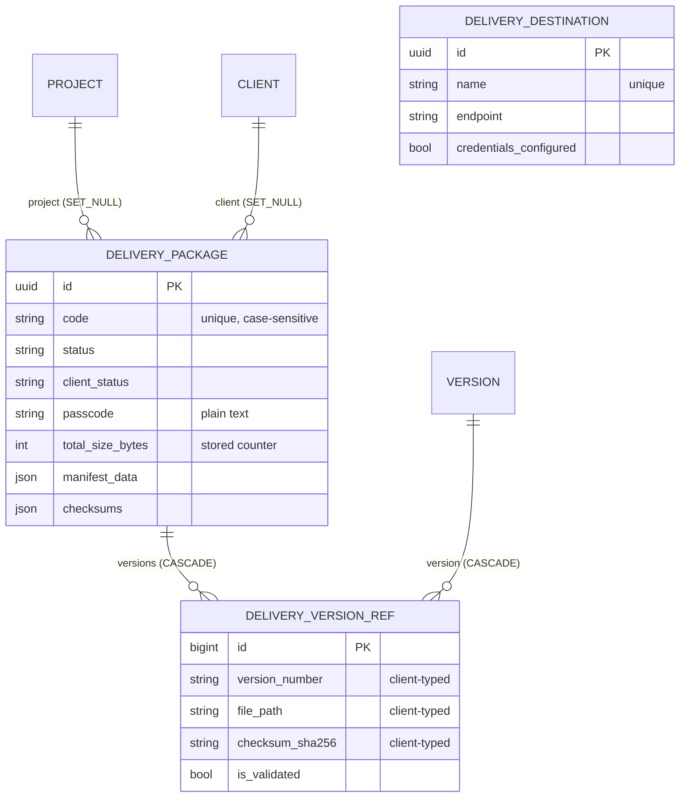

# Deliveries: Phase 1 audit

Date: 2026-10-27 · Base: `develop` @ `34168d6` · Docs only, no code changed.
Companions: `DECISIONS.md` (this folder), `docs/delivery-pipeline/ANALYSIS.md` (cross-app view, staging audit SQL).

## 1. Sources and method

* Every file of `backend/apps/deliveries` (2166 lines including tests; migrations 0001-0003) was read, plus the shared bases listed in `docs/publishing/ANALYSIS.md` §1 and the Production code that reads deliveries (`apps/production/selectors/{dashboard,project}.py`, `apps/production/api/views/project_scoped.py:500-506`).
* Frontend callers read in `../studiohub-react`: `RESTDeliveryAdapter.ts`, `modules/deliveries/services/DeliveryService.ts`, `src/types/production.ts:1226-1281`; not run.
* Claims marked *(probe)* were confirmed with throwaway tests on the pytest test database (2026-10-27). No other database was touched.
* No `signals/`, `tasks/`, `events/`, `validators/`, `filtersets` in this app.

## 2. What the app is today

A package ("turnover") of production versions for a client, with a hand-driven status, a JSON manifest and a passcode. Every step after creation is **simulated**: validation marks every item valid, preparation writes a placeholder checksum, submission does not transfer anything (`services/delivery.py:243` "Simulate submission"). Nothing checks what may move to what.

### 2.1 Models

**`DeliveryPackage`** (`apps/deliveries/models/__init__.py:12-197`, table `deliveries_package`), base `EntityModel` (UUID, audit columns, soft delete).

| Field | Type / rule | Line |
|---|---|---|
| `name` | Char 255 | 67 |
| `code` | Char 50, `unique=True` (**case-sensitive**, soft-deleted rows included) | 72-78 |
| `project` | FK `production.Project`, **`SET_NULL`**, nullable | 80-88 |
| `client` | FK `masterdata.Client`, `SET_NULL`, nullable | 90-98 |
| `status` | Draft, Validating, Prepared, Submitted, Approved, Rejected, Complete, Cancelled (default Draft) | 21-39, 100-106 |
| `client_status` | Pending, In Review, Approved, Rejected | 55-65, 108-114 |
| `delivery_method` | Aspera, S3, FTP, Web Download | 42-52, 116-121 |
| `delivery_destination` | **Text, free** (a URL or path; may hold credentials if a user types them) | 123-126 |
| `passcode` | **Char 64, plain text** | 128-132 |
| `expires_at` | DateTime, indexed; enforced nowhere | 134-139 |
| `total_size_bytes`, `total_frames` | stored counters | 141-149 |
| `notes`, `client_notes` | Text (no visibility rule between internal and client notes) | 151-159 |
| `manifest_data`, `checksums` | JSON | 161-171 |
| `is_archived` | Bool; **no code ever sets it** (only declared, serialized, filtered in the admin) | 173 |

Meta: ordering `-created_at`, **no constraints beyond `code`** (`178-182`). Properties `version_count` (count of the prefetched items) and `is_expired` (`184-197`).

**`DeliveryVersionRef`** (`:200-291`, table `deliveries_version_ref`): plain `models.Model`, **integer pk** (`BigAutoField`), no audit columns, no soft delete.

| Field | Rule | Line |
|---|---|---|
| `delivery` | FK `DeliveryPackage`, `CASCADE`, `related_name="versions"` | 205-211 |
| `version` | FK `production.Version`, **`CASCADE`** (a hard delete of a version erases delivery history) | 213-219 |
| `version_number`, `entity_type`, `entity_code`, `entity_name` | **typed by the client** at add time | 221-240 |
| `file_size_bytes`, `frame_count`, `file_path` | typed by the client | 241-255 |
| `checksum_md5` (32), `checksum_sha256` (64) | typed by the client, **format not validated** | 256-266 |
| `is_validated`, `validation_notes` | set by `validate` | 268-277 |
| `created_at` | | 278 |

Meta: `unique_together (delivery, version)`, ordering `version_number` (`283-289`).

**`DeliveryDestination`** (`:294-390`): `EntityModel`; type (7 choices), `endpoint`, `credentials_configured` flag (credentials are deliberately **not** stored, `:301-303`), rate, region, port, directory, `is_default`, `is_active`. Unique `name` (case-sensitive, includes soft-deleted, `383-388`); several defaults allowed.

**Migrations.** 0001 (initial), 0002 (destinations), 0003 (drops the `organization` columns; **drops and re-adds `client`**, so any client link stored before 0003 was lost when it ran: historical, nothing to do now).

### 2.2 ER diagram (today)

`CLIENT` is `masterdata.Client`, `PROJECT` and `VERSION` are Production models. Destinations are a dropdown with no relation to packages.

### 2.3 Services (`apps/deliveries/services/delivery.py`)

Every function loads with `objects.get` (a missing row is a 500 when not already resolved by the viewset), takes **no row lock**, and checks **no current status**.

| Function | Lines | Behaviour |
|---|---|---|
| `create_delivery` | 14-47 | **Dead code** (the viewset creates through the serializer, `api/serializers/delivery.py:189-197`) |
| `add_version_to_delivery` | 50-91 | `Version.objects.get(id=...)`: **any version of any project, any status**; the snapshot fields come from the request; totals updated by read-modify-write (`86-89`) |
| `remove_version_from_delivery` | 94-111 | hard-deletes the ref, recomputes totals; allowed in any status |
| `validate_delivery` | 114-166 | marks **every** item `is_validated=True`, "Auto-validated"; `all_valid` is always True; status → Validating; checksums echoed, not verified; audit `TARGET_BILLING` ("Reusing for delivery", `152`) |
| `prepare_delivery` | 169-228 | builds the manifest from refs; `checksums.manifest_md5 = "placeholder-manifest-checksum"` (`201`); status → Prepared |
| `submit_delivery` | 231-270 | "Simulate submission" (`243`); `submitted_at` = `updated_at` (the last edit, not now) (`248`); status → Submitted |
| `approve_delivery` | 273-302 | "Approve delivery by client": status → Approved and `client_status` → Approved, overwrites `client_notes` |
| `reject_delivery` | 305-334 | → Rejected; the reason overwrites `client_notes` and goes into the audit description |
| `complete_delivery` | 337-362 | → Complete |
| `cancel_delivery` | 365-392 | → Cancelled; the reason overwrites `client_notes` (internal reason in the client-facing field) |
| `retry_delivery` | 395-424 | → Prepared from **any** status (including Cancelled) |

### 2.4 Selectors

`DeliverySelector.get_queryset` (`selectors/delivery.py:19-35`): `select_related("project", "client")`, `prefetch_related("versions")` (so `version_count` adds no query per row). Like Publishing, `scope_by_request` never narrows (no `request.project` is ever set), so **every project's deliveries are visible**. The only membership-scoped read is Production's nested route `GET /organizations/projects/{id}/deliveries` (`apps/production/api/views/project_scoped.py:500-506`).

### 2.5 API (`/api/v1/deliveries/`, `config/v1_urls.py:45`)

Base `PlatformCrudViewSet` (`api/viewsets/base.py`, defined in this app and imported by Publishing, Scheduling and Production). Permission classes `IsAuthenticatedPermission` + `HasPermission`.

| Method | Path | Code | Observed |
|---|---|---|---|
| GET | `/deliveries/` | `delivery.view` | paginated; all projects *(probe)* |
| POST | `/deliveries/` | `delivery.create` | `DeliveryCreateSerializer.create` writes the model; any `project_id` / `client_id`, no membership check (same code shape as PUB-02, not separately probed); code duplicate check is case-sensitive (`181-187`): `DEL-A` and `del-a` both created *(probe)* |
| GET | `/deliveries/{id}/` | `delivery.view` | detail **includes `passcode`** for any project *(probe: a user in no project read `s3cret`)* |
| PATCH/PUT | `/deliveries/{id}/` | `delivery.update` | **500** (write serializer without `update()`, `200-212`) *(probe)* |
| DELETE | `/deliveries/{id}/` | `delivery.delete` | soft delete |
| POST | `/{id}/add-version/` | `delivery.update` | 201 for a draft version of another project with typed snapshot, `file_path` `../../etc/passwd`, `checksum_sha256` `nothex` *(probe)*; unknown version id **500** *(probe)* |
| POST | `/{id}/remove-version/` | `delivery.update` | integer `version_ref_id` |
| POST | `/{id}/validate/`, `/prepare/`, `/submit/` | `delivery.update` | any state |
| POST | `/{id}/approve/` | `delivery.update` | from Draft, by the delivery's creator *(probe)* |
| POST | `/{id}/reject/` | `delivery.update` | requires `rejection_reason`; **the frontend sends `reason`** → 400 *(probe)* |
| POST | `/{id}/complete/`, `/cancel/`, `/retry/` | `delivery.update` | cancel after approve, retry after cancel → "Ready" *(probe)*; the frontend's cancel `reason` is ignored (the view reads `cancellation_reason`, `232`) |
| CRUD | `/deliveries/destinations/` | `delivery.*` | studio-wide; aliases `rate`/`region` for the frontend |

Every action needs only `delivery.update`: there is no separate approve or send code. Search `name, code, client__name`; ordering `name, created_at, status`. Read shape maps Prepared → "Ready", Complete → "Completed" (`api/serializers/delivery.py:12-15`).

### 2.6 Admin (`admin/delivery.py`)

All three models editable and deletable; **`passcode` is a search field** (`:33`); status, client status, manifest and checksums editable (direct status-write path).

### 2.7 Tests (21, passing in Phase 0)

`tests/test_api.py` (15: one per endpoint, happy path) and `tests/test_destinations.py` (6). All item tests use a staff user with every code via `force_authenticate`. Missing: non-member / cross-project, passcode exposure, invalid transitions, separation of duties, published-only rule, snapshots, concurrency, PATCH, constraints.

### 2.8 Frontend contract (read, not run)

* Create (`RESTDeliveryAdapter.ts:117-148`): **code generated client-side** (`DEL-YYYYMMDD-<base36>`); method derived from the destination type; `expires_at` ← the form's `due_date`; `notes` ← description. No passcode is ever sent or shown by the deliveries module (the only passcodes in the frontend are playlist/review share links).
* Action bodies: approve `{notes}` (backend reads `client_notes`: ignored), reject `{reason}` (backend requires `rejection_reason`: 400), cancel `{reason}` (backend reads `cancellation_reason`: ignored).
* `addVersion` posts a `DeliveryVersionRef` object (`version_id`, `version_code`, `resolution`, `fps`, `files[]` ...; `src/types/production.ts:1265-1281`); the backend requires `version_number`, `entity_name` and `file_path`, so UI adds likely fail with 400 (**UNVERIFIED**: depends on what the form fills).
* Status union (`src/types/production.ts:1226-1235`): Draft, Packing, Ready, In Transit, Delivered, Accepted, Rejected, Failed, Archived. Only Draft, Ready, Rejected overlap with what the backend returns.

## 3. Feature classification

| Feature (brief's deliveries addendum) | Class | Evidence |
|---|---|---|
| Delivery package | PARTIAL | model and CRUD exist; PATCH 500 |
| Items linked to published versions | **DEFECTIVE** | any version, any state, any project (`services:69-70`) |
| Recipients (client/vendor contacts) | PARTIAL | `client` FK only; no vendor, no contact |
| Delivery spec / template | **MISSING** | |
| Manifest | **DEFECTIVE** | built from typed data, placeholder checksum, overwritable |
| QC checks with who/when/outcome | **DEFECTIVE** | `validate` auto-passes, no who or when per item |
| Transfer method | PARTIAL (a label) | `delivery_method`; nothing executes (Q4: tracking only) |
| Client feedback, revision requests | PARTIAL | `client_status`, `client_notes` overwritten by each action; no lineage |
| Acknowledgements | **MISSING** | |
| Guarded states (Approved, Sent immutable) | **MISSING** | *(probe)* |
| Snapshot at send | **MISSING** (snapshot is typed at add time, never frozen) | |
| Unique (delivery, item) | COMPLETE | `unique_together` |
| No duplicate sends (idempotency) | **MISSING** | |
| Race-free numbering | **MISSING** (client-generated codes) | |
| Re-delivery / revision lineage | **MISSING** | |
| Expiring, revocable download links | **MISSING** (out of scope by Q4) | |
| Passcode handling | **DEFECTIVE** | plain text, returned, searchable |
| Contact / contract / value data | N/A today (not linked) | |
| Internal vs client-visible notes | **DEFECTIVE** (internal reasons written into `client_notes`) | `services:379` |
| Separation of duties | **MISSING** | *(probe)* |
| Notifications | **MISSING** (`NotificationService.notify` is a placeholder, `apps/core/services/notifications.py`) | |
| Masterdata linked by public API | Y (FK to `masterdata.Client`; no private imports) | |

## 4. Common checklist

Columns: **P** = `DeliveryPackage`, **V** = `DeliveryVersionRef`, **D** = `DeliveryDestination`.

| # | Check | P | V | D | Evidence |
|---|---|---|---|---|---|
| 1b | Core base model | Y | **N** (int pk, no audit) | Y | `models:12,200,294` |
| 1c | `on_delete` protects history | **N** (`project`, `client` `SET_NULL`) | **N** (`version` `CASCADE`) | N/A | `models:82,92,207,215` |
| 1d | Natural-key uniqueness | partial (`code`, case-sensitive) | Y (`delivery, version`) | partial | |
| 1e | Check constraints | N | N | N | |
| 1g | Choices / safe `__str__` | Y / Y | Y / Y | Y / Y | |
| 1h | Migrations clean on empty DB | Y | Y | Y | Phase 0 |
| 2a | Rules in services | **N** (create in serializer; services have no rules) | N | N | |
| 2b | Atomic operations | partial (each action atomic, no locks) | | | |
| 2c | No N+1 | Y (prefetch) | Y | Y | `selectors/delivery.py:21-24` |
| 2d | Dependency direction | **N**: the viewset base here is imported by Production, Publishing, Scheduling; Production imports this app's models, serializer, selector and codes (see delivery-pipeline §3) | | | |
| 3 | Guarded state machine | **N** | N/A | N/A | *(probe)* |
| 4 | Concurrency (numbering, double send, counters) | **N** | **N** (counter updates without lock) | N | `services:86-89,106-108` |
| 5a | Explicit serializers | Y | Y | Y | |
| 5d | Correct status codes | **N** (PATCH 500, unknown version 500) | | Y | *(probe)* |
| 5e | Read-only fields silently ignored | Y (`status`, totals absent from write serializers); action bodies with wrong keys ignored | | | |
| 5f | OpenAPI accurate | **N** (empty action bodies, cancel body undeclared) | | partial | |
| 6a | Per-action authorization | **N**: one `update` code for prepare, approve, submit, complete | | Y | `api/viewsets/delivery.py:58-75` |
| 6b | Project membership / IDOR | **N** | **N** (any version) | N/A | *(probe)* |
| 6c | Separation of duties | **N** | | | *(probe)* |
| 7 | Codes enforced vs seeded | Y: `delivery.view/create/update/delete` enforced and seeded (full roles all; lead and artist `view`: `init_platform.py:174,243,265`) | | | |
| 8 | Audit and history | partial: change log tracks `DeliveryPackage` (`apps/audit/signals/change_tracking.py:231`); `AuditLog` rows use `TARGET_BILLING`; no status history; refs untracked | N | N | |
| 9 | Stored vs derived | `total_size_bytes`, `total_frames` stored counters from typed values | typed snapshot | | §6 |
| 10 | Sensitive data | **N**: passcode exposed; `delivery_destination` free text may hold credentials | | Y (no secrets stored) | |
| 11 | Tests (matrix, transitions, concurrency) | **N** | N | partial | §2.7 |
| 12 | Quality gates | ruff clean; formatting and type baselines as in Phase 0 | | | |

## 5. Findings

| ID | Sev | Finding | Evidence |
|---|---|---|---|
| DLV-01 | **High** | The delivery passcode is stored in plain text, returned by the detail endpoint to every holder of `delivery.view` (lead-artists and artists included) for every project, and searchable in the admin. | `models:128-132`; `api/serializers/delivery.py:133`; `admin/delivery.py:33`; *(probe)* |
| DLV-02 | **High** | No project scoping: list, detail and every action reach every project's deliveries. | `selectors/delivery.py:19-35`; *(probe)* |
| DLV-03 | **High** | `add-version` accepts any version of any project in any state, with a snapshot (number, entity, path, checksums, sizes) typed by the caller and not validated. | `services:50-91`; *(probe)* |
| DLV-04 | **High** | No state machine and no separation of duties: approve straight from Draft by the delivery's own creator, cancel after approval, retry a cancelled delivery back to Ready; "client approval" is recorded by any staff holder of `delivery.update`. | `services:273-424`; *(probe)* |
| DLV-05 | Medium | QC is fake: `validate` marks every item valid and reports `all_valid: true`; checksums are not checked. | `services:126-143` |
| DLV-06 | Medium | `prepare` writes a placeholder manifest checksum; the manifest can be regenerated after sending. | `services:199-209` |
| DLV-07 | Medium | `submit` is simulated, records the last edit time as `submitted_at`, is not idempotent and works on an empty Draft. | `services:243-252` |
| DLV-08 | Medium | `PATCH`/`PUT` is a 500; an unknown `version_id` on add-version is a 500. | `api/serializers/delivery.py:200-212`; *(probe)* |
| DLV-09 | Medium | A sent, approved or completed delivery can still gain and lose items; a hard-deleted version erases its delivery rows (`CASCADE`). | `services:50-111`; `models:215` |
| DLV-10 | Medium | `total_size_bytes` / `total_frames` are maintained by read-modify-write without a lock (lost updates under concurrent adds) from client-typed numbers. | `services:86-89,106-108` |
| DLV-11 | Medium | Contract drift with the frontend: approve/reject/cancel body keys differ (reject always 400 from the UI); status vocabularies differ; add-version payload shapes differ (UNVERIFIED in a browser). | §2.8; *(probe for reject)* |
| DLV-12 | Medium | Create accepts any `project_id`/`client_id` with no membership check (unknown id → 500 at commit, as PUB-02). | `api/serializers/delivery.py:169-197` |
| DLV-13 | Low | `code` unique only case-sensitively; codes are generated by the client. | `models:72-78`; `RESTDeliveryAdapter.ts:131-133`; *(probe)* |
| DLV-14 | Low | Audit rows use `target_type="billing"`; internal cancel/reject reasons are written into the client-visible `client_notes`; `notes` vs `client_notes` visibility is not enforced. | `services:152,320,379` |
| DLV-15 | Low | `is_archived` is never set by any code (dead column beside the soft delete). | repo search |
| DLV-16 | Low | `DeliveryVersionRef` has an enumerable integer id and no audit columns. | `models:200`; `api/serializers/delivery.py:233-234` |
| DLV-17 | Low | `expires_at` is stored but nothing enforces it. | `models:134-139` |
| DLV-18 | Low | Admin edits status, manifest and checksums and deletes rows. | `admin/delivery.py` |
| DLV-19 | Info | Dead code `create_delivery`. | `services:14-47` |
| DLV-20 | Info | Good: destinations store no credentials, only a flag. | `models:301-303,340` |

No Critical finding (the passcode protects nothing StudioHub checks today; it is rated High because it is a secret handed to external parties and exposed to every role).

## 6. Stored vs derived

| Column | Stored | Real source | Consumers |
|---|---|---|---|
| `DeliveryPackage.total_size_bytes`, `total_frames` | stored counters | client-typed per item; no files measured | list/detail; Production dashboard (UNVERIFIED which fields: `apps/production/selectors/dashboard.py:85`) |
| `version_count` | derived (prefetched count) | rows | list |
| `is_expired` | derived from `expires_at` | | list |
| `manifest_data`, `checksums` | stored JSON | built from typed refs; placeholder checksum | detail |
| `client_status` | stored | set by approve/reject | list/detail |
| Ref snapshot fields | stored | typed by the client, not by the version | detail, manifest |

Counts of non-default values need real data: `docs/delivery-pipeline/ANALYSIS.md` §8.

## 7. Duplicated responsibilities, dead code, free text

* `client_status` duplicates part of `status` (approve sets both to Approved).
* `notes` / `client_notes` used for three things (internal note, client feedback, cancellation reason).
* Dead: `create_delivery`, `is_archived`.
* Free text that should be references or validated: `delivery_destination` (a destination row exists but is not linked), `entity_*` and `version_number` on refs (derivable from the version), checksums (format).

## 8. What I cannot see

* Whether the passcode is used outside StudioHub (an Aspera or portal passcode given to clients): see Q17.
* Whether real deliveries exist and how many hold a passcode (staging query, delivery-pipeline §8).
* Whether anyone uses the backend's delivery statuses outside the frontend (reports, scripts).

## 9. Target direction (input to Phase 2)

Items reference a **published** `production.Version` of the delivery's project and snapshot its number, entity and registered files at send time; one transition map with guarded Approved and Sent, separation of duties on approve, QC records per item, server numbering, idempotent send, no public links (Q4). Detail in Phase 2.

## 10. Questions (non-blocking for Phase 2 drafting; needed before Phase 6 code)

**Q16. Two approvals or one?** Today "approve" means *client* approval and is clicked by staff. The brief wants an internal approval before sending, with separation of duties.
* **A. Both:** internal approval (by someone other than the preparer) before Sent; the client's answer (Accepted / Rejected with reason) recorded by staff afterwards as its own step. Keep `client_status` as the client's answer.
* B. Internal approval only; the client's answer stays a note.
* C. Client approval only (today's meaning), no internal gate.
Recommendation and default: **A**. Blocks: Phase 6-7 transition map.

**Q17. What is the passcode for?**
* **A. It is a secret for an external service** (Aspera/portal) that staff must read to pass to the client: encrypt at rest (same mechanism as the MFA secrets), omit it from responses unless the caller holds a new `delivery.view_secret`, never searchable, never in the admin list.
* B. Nobody uses it (the frontend never sends or shows it): stop accepting it, export then blank existing values, keep the column until a later approved drop.
* C. Hash it (only if StudioHub itself will check it; not the case under Q4).
Recommendation: **B** if you confirm no one uses it, else **A**. Default if "your call": **A** (it keeps the value usable and closes the exposure). Blocks: Phase 7 (the exposure itself can be closed in Phase 6).

**Q18. Frontend action bodies.** The UI sends `notes` (approve) and `reason` (reject, cancel).
* **A. Accept both spellings** (`reason` as an alias of `rejection_reason` / `cancellation_reason`, `notes` of `client_notes`); refuse unknown keys.
* B. Keep the backend names and ask for a frontend change.
Recommendation and default: **A** (fixes the UI's reject without a frontend release). Blocks: Phase 8.

Cross-app questions: Q23 (audit target types), Q24 (on-delete rules) in `docs/delivery-pipeline/ANALYSIS.md` §9.
