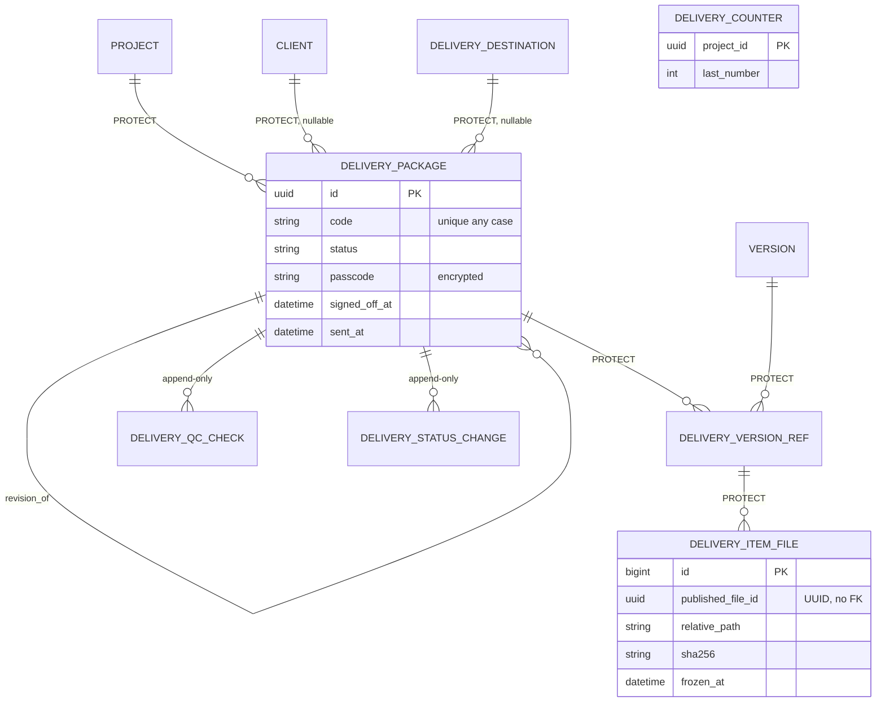

# Deliveries plan (Phases 6-8, all built)

Phase 2 design, 2026-10-27. Branch `feature/deliveries-improvement`, created at the start of Phase 6. Deliveries reads Publishing's `FileSnapshot` (X-04), so the branch starts from `develop` if you have merged `feature/publishing-improvement` by then, otherwise from the last commit of `feature/publishing-improvement` (its history then includes the publishing commits until you merge; I never merge). Scheduling does the same with the deliveries branch only if Phase 12's integration tests need it; Phases 9-11 depend only on Production. Contracts: `CONTRACTS.md`.

## 1. Current vs target

| Area | Today (`ANALYSIS.md`) | Target |
|---|---|---|
| Scoping | none (DLV-02) | project membership everywhere |
| Items | any version, typed snapshot (DLV-03) | published versions of the project with registered files; server snapshot; frozen at send |
| Workflow | none; approve from Draft by the creator (DLV-04) | one map; internal sign-off with separation of duties; guarded Submitted / Approved / Rejected / Complete |
| QC | auto-pass (DLV-05) | append-only QC rows from real checks |
| Manifest | placeholder checksum (DLV-06) | built from frozen rows, real SHA-256 |
| Send | simulated, not idempotent, wrong time (DLV-07) | real time, lock, repeat refused, `transfer_reference` |
| Passcode | plain text to everyone (DLV-01) | encrypted, `view_secret`, audited |
| Totals | stored, raced (DLV-10) | derived from snapshots |
| Notes | reasons in `client_notes` | own reason columns |
| History | change log only, `billing` target | `DeliveryStatusChange`, `delivery` target |
| Re-delivery | none | `revise` with `revision_of` |
| Codes | client, case-sensitive | server per project, any-case unique |
| Frontend body keys | reject always 400 | both spellings (Q18) |
| Production imports this app | yes | provider in core (X-05) |
| Specs / templates, notifications, client feedback loop | none | **LATER** (Q5) |

## 2. Target ER diagram

## 3. Work packages

| WP | Content | Phase |
|---|---|---|
| D-1 | Provider `deliveries.project_figures` (X-05); Production's dashboard, project selector and nested route switched to it; Production's imports of this app removed | 6 |
| D-2 | `PROTECT` on-delete for package, items, version, client, project (Q24; no SQL) | 6 |
| D-3 | Server codes with `DeliveryCounter`; any-case unique code (stop-and-list) | 6 |
| D-4 | Qualifying-version rule, server snapshots, `DeliveryItemFile`, `uid` on items | 6 |
| D-5 | QC rows and runs; manifest with real checksum; freeze at send; idempotent send under lock | 6 |
| D-6 | Derived totals; stored totals read-only (Q33) | 6 |
| D-7 | Passcode exposure closed now (omitted from responses and admin search) | 6 |
| D-8 | Transition map in one file, `DeliveryStatusChange`, new `Signed Off` state, sign-off / reopen / revise | 7 |
| D-9 | Separation of duties on sign-off, override | 7 |
| D-10 | Revocation handler (DOM-DLV-08) | 7 |
| D-11 | Passcode encryption with `DELIVERY_SECRET_KEY` (helper moved to core), `view_secret`, audited reads | 7 |
| D-12 | Q18 body aliases, reason columns, `notes` / `client_notes` split | 8 |
| D-13 | Project scoping, IDOR tests | 8 |
| D-14 | New codes seeded (Q34), matrix test | 8 |
| D-15 | `bulk-cancel` (Q36), admin hardening, OpenAPI, log capture | 8 |

Download links and the notification service of the brief's Phase 7 are not built (Q4, Q5; *Q30*). Phase 7 keeps the rest.

## 4. Phases, tests and gates

### Phase 6: core model and integrity (`deliveries(phase-6): core model and integrity`)

Migrations: `0004_protect_history` (no SQL), `0005_items_snapshot_qc` (new tables, `uid` with a data step filling UUIDs, then unique), `0006_package_fields` (new columns, counter), `0007_code_unique` (refuses and lists any-case duplicates, then the constraint). Each reversible.

Tests:
* `services/test_add_version.py`: draft version, unpublished, other project, deleted, no registered files, revoked or mismatching files, unknown id: all 400 with the right reason; snapshot keys in the body ignored.
* `services/test_snapshot.py`: unpublishing the version or revoking a file after send leaves items, files and manifest unchanged (frozen clock).
* `services/test_manifest.py`: checksum equals SHA-256 of the canonical JSON; no placeholder.
* `concurrency/test_send_pg.py` (PostgreSQL): two concurrent sends: one 200, one 409; fails without the lock.
* `concurrency/test_numbering_pg.py`: concurrent creates get distinct codes.
* `concurrency/test_add_version_pg.py`: concurrent adds keep totals right (derived).
* `migrations/test_0007_stop_and_list.py`, round-trip of 0004-0007.
* `production` tests: dashboard and nested route answer the same shapes through the provider; with the provider unregistered they answer empty shapes.

### Phase 6 as built

Everything above was built except where noted. Differences from the plan:

* **Test files.** The plan's names became `tests/services/{test_add_version,test_qc,test_prepare_and_send,test_numbering_and_create}.py`, `tests/api/test_core_api.py`, `tests/test_provider.py`, `tests/concurrency/test_races_pg.py` and `tests/migrations/test_phase6_migrations.py`. Snapshot immutability and the manifest checksum are covered in `test_prepare_and_send.py`.
* **PATCH/PUT pulled forward.** The plan gave `PATCH`/`PUT` (DLV-08) to no phase, so they are in Phase 6 (A-15).
* **QC checks built:** `has_items` (package), then per item `same_project`, `version_published`, `files_present`, `checksum_ok`, `snapshot_current`. `not_revoked` is covered by `files_present` (only Registered files count); spec checks stay LATER (Q5).
* **`send` works from Prepared** (the plan's target is Signed Off, which needs Phase 7's sign-off). It is single-use: `sent_at` set means closed (A-18).
* **Failed QC keeps its rows.** `prepare` and `send` commit the QC run and raise the 409 afterwards, so a refused attempt is on record (A-20).
* **Dashboard and nested route** read deliveries through a provider registered in `apps/core/providers.py`; Production no longer imports Deliveries (`tests/test_provider.py` checks this by parsing the imports).
* **Migration tests** run the chain 0003 to latest and back once. PostgreSQL never reuses the slot of a dropped column (limit 1600 per table), so repeated round trips use up a table; see the note in `docs/delivery-pipeline/DECISIONS.md` (A-22).
* **Races verified by removing the guard:** the package row lock (two sends) and the counter row lock (numbering) each make their tests fail when removed. The add-versus-send and double-add tests pass without the lock because the item save guard and the unique constraint also hold the invariant; they test the outcome, not the lock.

### Phase 7: workflow, approvals, secrets (`deliveries(phase-7): workflow, approvals and access`)

* `test_transition_map.py`: every (from, to) pair; allowed pass, others give the Q27 status; actions, PATCH and bulk use the same map.
* `test_separation_of_duties.py`: creator, item adder, preparer each refused on sign-off; after changing `created_by` in the DB the history still refuses; API key of the preparer refused; override with reason allowed and recorded; override without reason 400.
* `test_revocation.py`: unsent loses QC, Signed Off back to Prepared, sent unchanged with `has_revoked_content`.
* `security/test_passcode.py`: encrypted in the DB; absent without `view_secret`; read audited; missing key → 503 on write; not searchable; admin list hides it; migration encrypts and reverse decrypts.
* `security/test_logs.py`: no passcode, reason text or path in logs.

### Phase 7 as built

* **Test files:** `services/test_transition_map.py` (every pair of statuses, per-move codes, history, the override, "only the service writes the status"), `services/test_separation_of_duties.py` (creator, adder, preparer, reassigned creator, override with and without code or reason, the endpoint, no bulk route), `services/test_workflow_actions.py` (client answer, complete, cancel, reopen, retry, revise, the flow through the API), `services/test_revocation.py` (also through the event bus), `security/test_passcode.py`, `security/test_logs.py` (with a canary proving the capture works), `migrations/test_phase7_migrations.py`. The plan's `test_revocation.py` and `security/` names are kept.
* **Passcode on the detail** became its own endpoint (A-24).
* **Send does not refresh** the snapshot (A-27), so a late file stops the send instead of joining it.
* **Override** is service-only (A-28); the SoD override is reachable through `sign-off` with `override_reason`.
* **Role grants** wait for Phase 8 (A-31); the new codes are in the catalog only.
* **Phase 6 tests** that assumed free movement now start from the state the map requires (A-33).
* **Verified by removing the guard:** separation of duties (12 tests fail), passcode encryption (8), the transition map (70), revocation (7), the passcode permission (fails only when both the viewset gate and the service check are removed, which is why there are two).

### Phase 8: sensitive data, API, hardening (`deliveries(phase-8): sensitive data, api and hardening`)

* `api/test_access_matrix.py` (anonymous, member/non-member, each code, platform admin, API key scopes, disabled user).
* `api/test_frontend_bodies.py`: `reason` / `notes` aliases; both spellings at once with different values → 400.
* `api/test_bulk_cancel.py`: 200 all ok, 207 partial, identical `not_found` for foreign and unknown ids, max batch size.
* `test_permission_matrix.py`, admin tests, OpenAPI schema test.

Every gate: as publishing (`docs/publishing/PLAN.md` §4).

### Phase 8 as built

* **Test files:** `api/test_access_matrix.py` (scoping, IDOR on every action, create-side checks, every action's code, scoped keys), `api/test_frontend_bodies.py`, `api/test_bulk_cancel.py`, `api/test_destinations_rules.py`, `api/test_admin.py`, `api/test_openapi.py`, `test_permission_matrix.py`, `migrations/test_phase8_migrations.py`. The plan's names are kept.
* **Destination text kept writable** while no destination is chosen (A-34), instead of read-only at once.
* **Project by code** is accepted on create, as in publishing (A-35).
* **`init_platform` withdraws grants** (Q40 = A, a follow-up commit): `WITHDRAWN_GRANTS` removes the codes Q34 takes from the vfx-supervisor on every run.
* **Verified by removing the guard:** selector scoping (27 tests fail), bulk-cancel scoping (2), the alias conflict check (3), the vfx-supervisor withheld grants (3), the create-side project check (1), the destination name rule (1).
* **Done in Phase 12:** "a disabled user loses access" across the three apps (`apps/core/tests/integration/test_disabled_user_three_apps.py`, A-14) and removal of the `deliveries/api/viewsets/base.py` re-export (X-02).

## 5. Frontend flows that assume free movement (Q27)

Read from `../studiohub-react` (not run):

| Flow | Where | After this plan |
|---|---|---|
| Draft → Prepare button | `modules/deliveries/components/DeliveryCard.tsx:210-219` | works (prepare runs QC; fails with 409 if a version has no registered files) |
| Ready → Submit button | `DeliveryCard.tsx:221-231` | **409** until signed off; the UI needs a "Sign off" button (Ready) shown to holders of `delivery.approve` |
| Submitted → Client Approve / Reject | `DeliveryCard.tsx:233+`, `DeliveryApprovalModal.tsx` | works; reject starts working (Q18) |
| Cancel with reason | `useDeliveries.ts:81` | works before sending; after sending → 409 |
| Retry | `useDeliveries.ts:69` | only from Validating |
| Approved count includes "Completed" | `pages/DeliveriesPage.tsx:87` | unchanged |
| Add version modal | `components/AddVersionModal.tsx` | extra snapshot keys ignored; unpublished versions refused |

## 6. Role-to-code proposal (Q34)

| Code | platform-admin | org-admin | production-admin | vfx-supervisor | lead-artist | artist | org-member |
|---|---|---|---|---|---|---|---|
| `delivery.view` | Y | Y | Y | Y | Y | Y | — |
| `delivery.create` | Y | Y | Y | Y | — | — | — |
| `delivery.update` | Y | Y | Y | Y | — | — | — |
| `delivery.delete` | Y | Y | Y | — | — | — | — |
| **`delivery.approve`** | Y | Y | Y | Y | — | — | — |
| **`delivery.send`** | Y | Y | Y | — | — | — | — |
| **`delivery.view_secret`** | Y | Y | Y | — | — | — | — |
| **`delivery.status.override`** | — | — | — | — | — | — | — |
| **`delivery.sod.override`** | — | — | — | — | — | — | — |

Changes from today: vfx-supervisor loses `delivery.delete` and does not get `send` / `view_secret` (supervisors sign off; producers send); artists keep `delivery.view` but now only for their projects. Separation of duties needs two people holding `delivery.approve` or `delivery.update` per project: a studio with one producer cannot sign off its own deliveries without the override.
