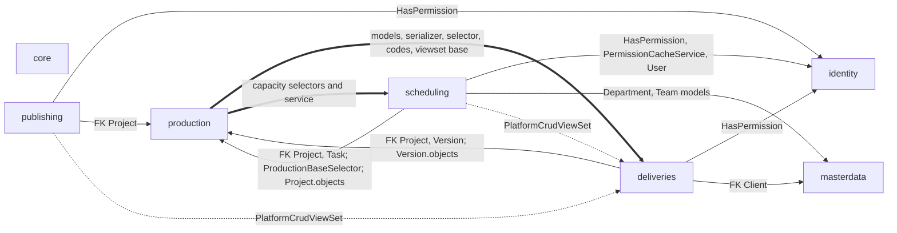
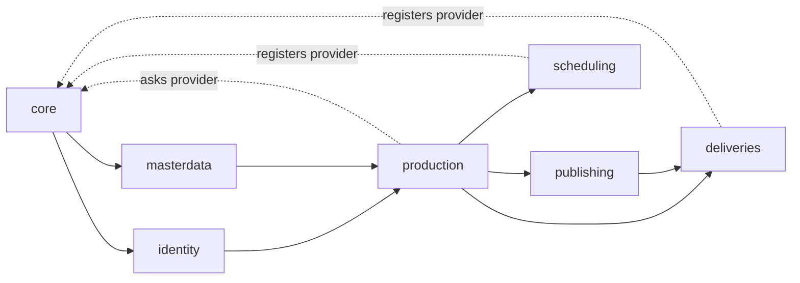
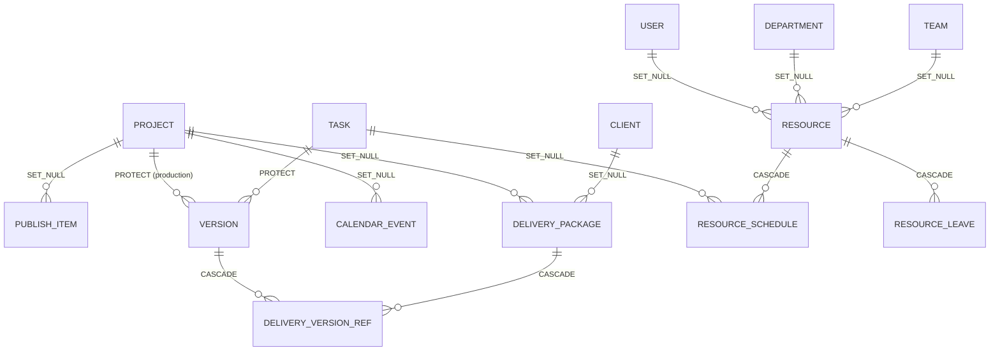

# Delivery pipeline: Phase 1 cross-app audit

Date: 2026-10-27 · Base: `develop` @ `34168d6` · Docs only, no code changed.
Per-app audits: `docs/publishing/ANALYSIS.md`, `docs/deliveries/ANALYSIS.md`, `docs/scheduling/ANALYSIS.md`. Decisions: `DECISIONS.md` (this folder) and each app's `DECISIONS.md`.

## 1. Method

All three apps were read in full, with the Production, Identity, Masterdata, Core and Audit code they touch and the frontend callers in `../studiohub-react` (read, not run). Behaviour was confirmed with throwaway probe tests on the pytest test database (2026-10-27; 10 probes plus a syntax run of the §8 queries; kept in the session scratchpad, not committed). No other database was used.

## 2. Summary

| App | Tests (Phase 0) | High | Medium | Low | Info | What it really is |
|---|---|---|---|---|---|---|
| Publishing | 14 | 2 | 7 | 5 | 2 | DCC export-job tracker, not linked to versions |
| Deliveries | 21 | 4 | 8 | 6 | 2 | client package with simulated QC, prepare and send |
| Scheduling | 102 | 1 | 7 | 5 | 2 | calendar, resources, bookings, leave (hardened in D-20 to D-22) |

No Critical finding. The Highs share three causes:
1. **No project scoping in Publishing and Deliveries** (PUB-01, DLV-02): `BaseSelector.scope_by_request` narrows by `request.project` (`apps/core/selectors/base.py:36-59`), and nothing in the code base ever sets `request.project`.
2. **No state machine or separation of duties in Deliveries** (DLV-04), and items that can be any version (DLV-03).
3. **Secrets and hidden fields leak**: the delivery passcode is returned to every viewer (DLV-01); hidden leave reasons and booking notes can be read back through `?search=` (SCH-01).

## 3. Dependency direction

### 3.1 Today



Thick arrows break the rule you set (Production must not import these apps); dotted arrows are a wrong home for a shared base class.

| From → To | Where | Kind |
|---|---|---|
| Production → Deliveries | `apps/production/selectors/dashboard.py:85,573,772`, `apps/production/selectors/project.py:73` | `DeliveryPackage` model (lazy imports) |
| Production → Deliveries | `apps/production/api/views/project_scoped.py:43-45` | `DeliveryListSerializer`, `DeliveryPermissions`, `DeliverySelector` (module level) |
| Production → Deliveries | `apps/production/api/viewsets/task_template.py:13` | `PlatformCrudViewSet` |
| Production → Scheduling | `apps/production/api/viewsets/scheduling.py:57,75,96` | capacity selectors and `resolve_overbooking` |
| Publishing, Scheduling → Deliveries | `apps/publishing/api/viewsets/{publish,destination}.py`, `apps/scheduling/api/viewsets/__init__.py:10` | `PlatformCrudViewSet` |
| Deliveries → Production | `apps/deliveries/services/delivery.py:67` | `Version.objects.get` (model, not a selector) |
| Scheduling → Production | `apps/scheduling/selectors/scope.py:34` (selector: allowed); `apps/scheduling/api/serializers/__init__.py:188,203` (`Project` model) | |
| Scheduling → Identity / Masterdata | `apps/scheduling/api/serializers/__init__.py:368-429` | `User`, `Department`, `Team` models for existence checks |

* **Identity and Masterdata import none of the three apps** (repo search: no match).
* **No import-time cycle:** `manage.py check` passes and the Production → Deliveries imports in selectors are lazy. There is a logical cycle (Deliveries reads Production's `Version`, Production reads Deliveries' models).
* Masterdata is never imported through private modules; scheduling reads its models directly for FK existence checks (Low; Phase 2 decides whether selectors are required).

### 3.2 Target (Q2 = A)



`PlatformCrudViewSet` / `PlatformReadViewSet` move to `apps/core/api/viewsets/`. Production's dashboard and nested routes get delivery and schedule figures through a small provider registry in Core, filled by Deliveries and Scheduling at app load. References between apps are by UUID through public selectors or services.

## 4. Cross-app ER diagram (today)



Missing edges that the business needs: `PUBLISH_ITEM` → `VERSION`, published files → `VERSION`, `DELIVERY_VERSION_REF` → published files, milestones → `PROJECT` / `DELIVERY_PACKAGE`.

## 5. Shared problems

| Problem | Apps | Evidence |
|---|---|---|
| No project-membership scoping | Publishing, Deliveries | §2 |
| Write serializers without `update()` (PATCH/PUT 500) | Publishing, Deliveries | `apps/publishing/api/serializers/publish.py:177-182`; `apps/deliveries/api/serializers/delivery.py:200-212` (scheduling's were fixed in D-22) |
| Create writes straight from the serializer; unknown FK ids → 500 at commit | Publishing, Deliveries | PUB-02, DLV-12 |
| Simulated behaviour reported as success | Publishing (validation), Deliveries (QC, manifest checksum, send) | PUB-05, DLV-05 to DLV-07 |
| `AuditLog` rows under unrelated targets (`video`, `billing`) | Publishing, Deliveries | `apps/audit/models/audit_log.py:85,89`; Q23 |
| Scheduling not in the change log | Scheduling | `apps/audit/signals/change_tracking.py:219-248` |
| Admin can edit status and decision fields and delete rows | all three | each app §2.6 |
| History lost on hard delete (`CASCADE`) | Deliveries (refs from versions), Scheduling (bookings, leave from resources) | Q24 |
| Two archive markers | Publishing (`is_archived` written), Deliveries (`is_archived` never written) | |
| Codes generated by the client, not unique ignoring case | Publishing, Deliveries | |
| Shared viewset base in the wrong app | all three plus Production | §3.1 |
| No notification channel (`NotificationService.notify` is a placeholder) | all | `apps/core/services/notifications.py` |
| Object storage configured but unused (`MINIO_*` read, nothing uses them; default `FileSystemStorage`) | Publishing, Deliveries | `config/env.py:136-144`; no `STORAGES` setting anywhere in `config/`, `MEDIA_ROOT` at `config/settings/components/storage.py:9` |

## 6. Duplicated responsibilities and data with no source

| Item | Where | Note |
|---|---|---|
| "Published" | `production.Version` (D-29) and `PublishItem` Validated/Exported read as "Published" | Q1, Q15 |
| Destinations | `PublishDestination` (type "Client Delivery Ingest") and `DeliveryDestination` | two lists for overlapping targets; neither is linked to items or packages |
| Delivery due date | the frontend sends its `due_date` as `expires_at` (`studiohub-react/src/api/repositories/adapters/rest/RESTDeliveryAdapter.ts:141`, read back at `:71`); `Project.delivery_date`, `Episode.delivery_date` also exist | expiry and due date are different things |
| Project milestones | fabricated by Production (`apps/production/api/views/project_scoped.py:122-128` phase names, `:579-617` interpolated dates) | Q22 |
| Utilization | stored in Masterdata (omitted from its API), computed per request in Scheduling | masterdata Phase 6 decision 1 waits for a scheduling selector |
| Delivery snapshot | typed by the client at add time | should come from the version at send time |

## 7. Permission codes

| Code | Enforced at | Seeded to | Orphan? |
|---|---|---|---|
| `publishing.view` / `create` / `update` / `delete` | `apps/publishing/api/viewsets/{publish,destination}.py` | full roles all; lead-artist, artist `view` (`apps/core/management/commands/init_platform.py:175,244,266`) | no |
| `delivery.view` / `create` / `update` / `delete` | `apps/deliveries/api/viewsets/{delivery,destination}.py`; `delivery.view` also on Production's nested route | full roles all; lead, artist `view` (`:174,243,265`) | no |
| `schedule.view` / `view_rates` / `create` / `update` / `delete` | `apps/scheduling/api/viewsets/__init__.py`, `selectors/__init__.py:62,106`, Production's scheduling endpoints and nested route | full roles all; lead, artist `view` (`:168,239,261`) | no |

No enforced code is granted to no role, and no seeded code is never enforced. What is missing is **granularity**: one `update` code covers editing, approving, sending and revoking in Deliveries and Publishing, and booking plus leave decisions in Scheduling. The role matrix is Phase 2 work (brief item 10).

## 8. Staging audit queries (read only, for you to run on a staging copy)

Counts only; no values are printed (no passcodes, reasons, notes or paths). All statements were executed against the empty pytest test database to check the syntax (11 statements, all ran).

```sql
-- P1 publish items by status and archive markers
SELECT status, is_archived, is_deleted, count(*) AS n
FROM publishing_item GROUP BY status, is_archived, is_deleted ORDER BY status;

-- P2 publish codes used more than once (any case, deleted rows included)
SELECT count(*) AS duplicated_codes FROM (
  SELECT lower(code) FROM publishing_item GROUP BY lower(code) HAVING count(*) > 1) d;

-- P3 publish items without a project, with a non-UUID entity_id, with '..' in a path
SELECT
  count(*) FILTER (WHERE project_id IS NULL) AS no_project,
  count(*) FILTER (WHERE entity_id !~* '^[0-9a-f]{8}-[0-9a-f]{4}-[0-9a-f]{4}-[0-9a-f]{4}-[0-9a-f]{12}$') AS entity_id_not_uuid,
  count(*) FILTER (WHERE source_file LIKE '%..%' OR export_path LIKE '%..%') AS dotdot_paths
FROM publishing_item;

-- D1 deliveries by status, client status, passcode present (count only)
SELECT status, client_status, (passcode <> '') AS has_passcode, is_deleted, count(*) AS n
FROM deliveries_package GROUP BY 1, 2, 3, 4 ORDER BY 1;

-- D2 delivery codes equal ignoring case
SELECT count(*) AS duplicated_codes FROM (
  SELECT lower(code) FROM deliveries_package GROUP BY lower(code) HAVING count(*) > 1) d;

-- D3 delivery items whose version belongs to another project, or is not published
SELECT
  count(*) FILTER (WHERE v.project_id IS DISTINCT FROM p.project_id) AS other_project,
  count(*) FILTER (WHERE NOT v.is_published) AS unpublished_version,
  count(*) FILTER (WHERE r.checksum_sha256 <> '' AND r.checksum_sha256 !~ '^[0-9a-fA-F]{64}$') AS bad_sha256,
  count(*) FILTER (WHERE r.version_number <> v.version_number) AS number_differs_from_version
FROM deliveries_version_ref r
JOIN deliveries_package p ON p.id = r.delivery_id
JOIN production_version v ON v.id = r.version_id;

-- D4 stored totals that differ from the sum of their items
SELECT count(*) AS totals_differ FROM (
  SELECT p.id
  FROM deliveries_package p LEFT JOIN deliveries_version_ref r ON r.delivery_id = p.id
  GROUP BY p.id, p.total_size_bytes, p.total_frames
  HAVING p.total_size_bytes <> coalesce(sum(r.file_size_bytes), 0)
      OR p.total_frames <> coalesce(sum(r.frame_count), 0)) t;

-- S1 overlapping live bookings of the same resource (pairs)
SELECT count(*) AS overlapping_pairs
FROM scheduling_resource_schedule a
JOIN scheduling_resource_schedule b
  ON a.resource_id = b.resource_id AND a.id < b.id
 AND a.start_time < b.end_time AND b.start_time < a.end_time
WHERE NOT a.is_deleted AND NOT b.is_deleted;

-- S2 rows whose end precedes the start; negative rates
SELECT
  (SELECT count(*) FROM scheduling_calendar_event WHERE end_time < start_time) AS events_backwards,
  (SELECT count(*) FROM scheduling_resource_schedule WHERE end_time < start_time) AS bookings_backwards,
  (SELECT count(*) FROM scheduling_resource_leave WHERE end_date < start_date) AS leaves_backwards,
  (SELECT count(*) FROM scheduling_resource WHERE hourly_rate_usd < 0) AS negative_rates;

-- S3 leave rows holding a reason (count only), by status
SELECT status, count(*) FILTER (WHERE reason <> '') AS with_reason, count(*) AS n
FROM scheduling_resource_leave GROUP BY status;

-- S4 resources typed "On Leave" vs resources with an approved leave covering today
SELECT
  (SELECT count(*) FROM scheduling_resource WHERE status = 'On Leave' AND NOT is_deleted) AS typed_on_leave,
  (SELECT count(DISTINCT resource_id) FROM scheduling_resource_leave
    WHERE status = 'Approved' AND NOT is_deleted
      AND current_date BETWEEN start_date AND end_date) AS on_approved_leave_today;
```

What the answers decide: P2 / D2 show whether the case-insensitive code constraints of Phases 3 and 6 can be added without a stop-and-list migration; D1 how many passcodes Q17 affects; D3 how many existing delivery items would break the "published, same project" rule (they will be kept as history, not deleted); S1 how many overlaps a booking constraint would meet.

## 9. Questions

All Phase 1 questions in one list (Q1-Q12 were answered "your call" and are recorded in `DECISIONS.md`). Each app's `ANALYSIS.md` §10 / §9 has the options and trade-offs for its own questions. None blocks Phase 2 drafting; each must be answered before the code phase named.

| Q | App | Question | Recommendation (default on "your call") | Needed by |
|---|---|---|---|---|
| Q13 | Publishing | Fate of `PublishItem` | A: keep as export-job record, link to the version it produced | Phase 3 |
| Q14 | Publishing | Simulated validation | A: honest checks, "not checked" instead of "passed" | Phase 4 |
| Q15 | Publishing | `Validated` reads "Published" | A: keep the words now, change with a frontend update in Phase 5 | Phase 5 |
| Q16 | Deliveries | Internal approval and client acceptance | A: both, separation of duties on the internal one | Phase 6 |
| Q17 | Deliveries | What the passcode is for | A: encrypted, shown only with a new `delivery.view_secret` (B if nobody uses it) | Phase 6 |
| Q18 | Deliveries | Frontend action-body keys | A: accept both spellings | Phase 8 |
| Q19 | Scheduling | Leave for others; artists filing their own | A: own leave for all, others only with a new `schedule.manage` | Phase 11 |
| Q20 | Scheduling | Leave days | A: working days once calendars exist | Phase 9 |
| Q21 | Scheduling | Holiday calendars | A: studio default plus per-office work calendars | Phase 9 |
| Q22 | Scheduling / Production | Fabricated project milestones | A: replace with real milestones, same shape | Phase 10 |

**Q23. Audit target types (touches `apps/audit`).** Publishing and Deliveries write `AuditLog` rows as `video` and `billing`.
* **A. Add `publishing`, `delivery` and `scheduling` targets** (choices-only migration in `apps/audit`, no SQL, as done for masterdata in commit `1b25b4e`), and use them from now on; old rows stay as they are.
* B. Keep the borrowed targets.
Recommendation and default: **A**. Needed by: Phase 3.

**Q24. On-delete rules that erase history.** `DeliveryVersionRef.version` and `.delivery`, `ResourceSchedule.resource` and `ResourceLeave.resource` are `CASCADE`; `project` links are `SET_NULL`.
* **A. Make them `PROTECT`** (Django-level only, no SQL, as production did in D-24); the API only soft-deletes, so nothing a user does changes; a hard delete of a version, resource or project with history is refused.
* B. Keep them.
Recommendation and default: **A**, in each app's first phase. Needed by: Phases 3, 6, 9.

## 10. Things for you to check (I cannot see them)

1. Search your pipeline and DCC plug-in repositories for `/api/v1/publishing/` and `/api/v1/deliveries/`: does any tool other than the web UI call them?
2. Is the delivery passcode given to clients anywhere (Aspera, a portal, e-mail templates)? (Q17)
3. Run §8 on a staging copy and send the numbers.
4. Which offices and time zones the studio works in, and whether their holidays differ. (Q21)
5. Where exported files live (storage roots such as `/mnt/projects` or `\\nas\show`). (Q3, assumed register-only)
