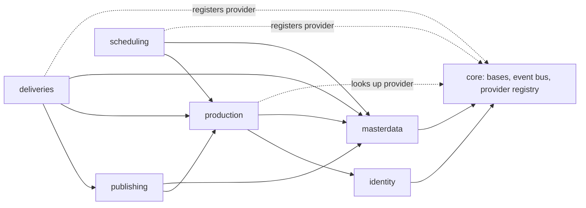

# Delivery pipeline: cross-app contracts

Phase 2 target design, 2026-10-27. Status: **PROPOSED** until the Phase 2 gate questions (Q25-Q38, `DECISIONS.md`) are answered. Per-app contracts: `docs/publishing/CONTRACTS.md`, `docs/deliveries/CONTRACTS.md`, `docs/scheduling/CONTRACTS.md`. Plans: each app's `PLAN.md`.

Contract IDs: `X-nn` cross-app (this file), `DOM-PUB-nn` / `API-PUB-nn` / `SEC-PUB-nn` publishing, `DOM-DLV-*` / `API-DLV-*` / `SEC-DLV-*` deliveries, `DOM-SCH-*` / `API-SCH-*` / `SEC-SCH-*` scheduling. A change to an `API-*` contract after approval updates the owning `CONTRACTS.md`; a change to a `SEC-*` or `DOM-*` invariant that alters the trust model needs an ADR (as in identity).

## X-01 Dependency direction



Rules (checked by an import test in Phase 12, `apps/core/tests/test_dependency_direction.py`, AST scan of every non-test module):

1. `apps.production`, `apps.identity`, `apps.masterdata` import nothing from `apps.publishing`, `apps.deliveries`, `apps.scheduling`, at module level or inside functions.
2. `apps.publishing` imports nothing from `apps.deliveries` or `apps.scheduling`; `apps.scheduling` imports nothing from `apps.publishing` or `apps.deliveries`.
3. A consumer reads another app only through the modules named in X-03 to X-07 (selectors, services, providers, events, permission constants). Reading another app's **models** to declare a `ForeignKey` is allowed (Django needs the model); querying them directly is not.
4. Every cross-app reference in a request or response is a UUID. Codes are accepted where the frontend already sends them (project code on create) and resolved to the UUID at the boundary.
5. Identity permissions are the only authorization mechanism: `HasPermission` plus `PermissionCacheService.has_permission` for checks inside services. No app keeps its own permission table.
6. No organization foreign keys anywhere in the three apps.

## X-02 Moving the shared viewset base (Q2)

`PlatformCrudViewSet` and its read-only sibling move from `apps/deliveries/api/viewsets/base.py` to `apps/core/api/viewsets/platform_crud.py`, unchanged in behaviour. The old module keeps a re-export for one release (removed in Phase 12) so nothing breaks in between. Importers to update: `apps/publishing/api/viewsets/{publish,destination}.py`, `apps/scheduling/api/viewsets/__init__.py:10`, `apps/production/api/viewsets/task_template.py:13`. Done in Phase 3 (the first implementation phase).

## X-03 What Publishing, Deliveries and Scheduling read from Production

All through `apps/production/selectors/` (additive methods; no Production model is queried from the three apps).

| Function (new unless noted) | Returns | Used by |
|---|---|---|
| `ProductionBaseSelector.visible_project_ids(request)` (exists, `apps/production/selectors/base.py:60`) | list of project UUIDs, or `None` for platform admins | list scoping in all three apps |
| `ProductionBaseSelector.user_has_project_access(request=, project=)` (exists, `:138`) | bool | write checks |
| `ProductionBaseSelector.is_platform_admin(user)` (exists, `:53`) | bool | |
| `ProjectSelector.resolve_visible(request, value) -> Project \| None` (**built**, `apps/production/selectors/project.py`) | the project named by UUID, code or mock id, if the caller may use it | publish jobs from Phase 5, deliveries, milestones, events |
| `VersionSelector.resolve_visible(request, version_id) -> Version \| None` (**built**) | the live version, if the caller may use its project | publishing file registration |
| `VersionSelector.resolve_in_project(project_id, version_id)` and `VersionSelector.resolve(version_id)` (**built**) | a live version of that project / by id alone (no caller check) | export job links, delivery items |
| `VersionSelector.publication_state(version_ids) -> dict[UUID, VersionPublication]` | frozen dataclass `VersionPublication(version_id, project_id, code, version_number, version_index, entity_type, entity_id, entity_code, entity_name, task_id, is_published, published_at, published_by_id, is_deleted)` | delivery QC, snapshots |
| `TaskSelector.resolve_in_projects(project_ids, task_id) -> Task \| None` | a live task of one of the projects | bookings (replaces the direct query in scheduling) |
| `ProjectSelector.contract_dates(project_id) -> ProjectDates` | `start_date`, `delivery_date` | milestones defaults |

Unknown, foreign and malformed ids all give `None`, so callers answer the same 400 for each (no existence oracle, as in production D-22).

## X-04 What Deliveries reads from Publishing

`apps/publishing/selectors/files.py`:

```python
@dataclass(frozen=True)
class FileSnapshot:
    file_id: UUID
    version_id: UUID
    project_id: UUID
    storage_root_code: str
    relative_path: str        # normalized POSIX, relative to the root (DOM-PUB-03)
    role: str                 # main | proxy | thumbnail | sidecar
    file_type_code: str       # masterdata MasterFileType.code, "" when unknown
    size_bytes: int
    sha256: str               # 64 lower-case hex (DOM-PUB-04)
    frame_start: int | None
    frame_end: int | None
    status: str               # Registered | Deprecated | Revoked

class PublishedFileSelector:
    @classmethod
    def files_for_versions(cls, version_ids: Iterable[UUID]) -> dict[UUID, list[FileSnapshot]]: ...
    @classmethod
    def deliverable_files(cls, version_ids: Iterable[UUID]) -> dict[UUID, list[FileSnapshot]]:
        """Registered files of published, live versions only."""
```

Deliveries never imports Publishing models or services. It snapshots `FileSnapshot` values into its own rows at send time (DOM-DLV-05).

Publishing publishes one domain event Deliveries subscribes to (core event bus, dispatched after commit, payload ids only):

| Event | Payload | Subscriber behaviour |
|---|---|---|
| `publishing.PublishedFileRevoked` | `file_id`, `version_id`, `project_id`, `actor_id`, `reason_present` (bool, never the text) | Deliveries: unsent deliveries holding the version lose QC and approval (DOM-DLV-08); sent ones are unchanged and report `has_revoked_content` (Q29). |

## X-05 What Production reads from Deliveries and Scheduling (provider registry)

Production must not import these apps (X-01). It asks a provider registered in Core:

```python
# apps/core/providers.py (new, ~40 lines, no domain logic)
def register(name: str, provider: object) -> None: ...
def get(name: str) -> object | None: ...   # None when the app is not installed
```

| Name | Registered by (`AppConfig.ready`) | Interface | Production consumer |
|---|---|---|---|
| `deliveries.project_figures` | deliveries | `counts_by_project(project_ids) -> dict[UUID, DeliveryCounts]`; `recent_for_project(project_id, limit) -> list[dict]` (already-serialized list rows); `list_for_project(request, project_id) -> list[dict]` | `apps/production/selectors/dashboard.py:85,573,772`, `project.py:73`; nested route `GET /organizations/projects/{id}/deliveries` (`project_scoped.py:500-506`) |
| `scheduling.project_schedule` | scheduling | `milestones_for_project(project_id) -> ProjectScheduleView` (same shape as today's response) | `GET /organizations/projects/{id}/schedule` (`project_scoped.py:579-617`, Q22) |

When a provider is missing, Production answers the empty shape (zero counts, empty list), never a 500. Response shapes of those Production routes do not change.

Production's three scheduling endpoints (`/scheduling/capacity/`, `/scheduling/overbooking/`, `/scheduling/resolve-overbooking/`, `apps/production/api/viewsets/scheduling.py`) move to the scheduling app's own URL module, **mounted at the same paths** with the same permission codes (D-09) and responses. No provider is needed for them. Done in Phase 9.

## X-06 What the three apps read from Masterdata

| Need | Through | Notes |
|---|---|---|
| File type of a published file | `MasterFileTypeSelector.resolve_active(value)` (**built** on `LookupSelector`, `apps/masterdata/selectors/catalog.py`) | by UUID or code; archived types refused on new rows |
| Client of a delivery | `ClientSelector` (`apps/masterdata/selectors/directory.py:114`) | FK kept; financial fields never copied |
| Department, team of a resource | `DepartmentSelector`, `TeamSelector` (`directory.py:47,55`) | replaces the model lookups at `apps/scheduling/api/serializers/__init__.py:368-429` |
| Office time zone (default for a work calendar) | `OfficeSelector` (`directory.py:63`) | `Office.timezone` (`apps/masterdata/models/office.py:25`) |

Masterdata is never changed beyond additive selector methods, and Masterdata imports none of the three apps.

## X-07 Identity

* Authentication: the existing chain (`SessionBoundJWTAuthentication`, `PersonalAccessTokenAuthentication`, `APIKeyAuthentication`). A token or key acts as its owner and is limited by its scopes; a disabled user loses access on the next request (identity contract; re-tested for all three apps in Phase 12).
* Authorization: `HasPermission` with a fail-closed `permission_map` per action; services call `PermissionCacheService.has_permission(user, code)` for in-service checks (separation-of-duties overrides, secret fields).
* Override codes follow production D-03 / D-04: granted to no seeded role, not implied by superuser, a scoped credential must list them, and every use writes a history row with `override_kind` and a reason.

## X-08 Shared error vocabulary

| Situation | Status | Body |
|---|---|---|
| Validation of input | 400 | DRF field errors |
| Unknown, foreign or invisible referenced id in a body | 400 | `{"<field>": ["Unknown <thing>."]}` (same text for each case) |
| Record outside the caller's projects, or unknown | 404 | same body for both |
| Missing permission code | 403 | standard envelope |
| Separation of duties | 403 | `{"code": "separation_of_duties", ...}` (production D-04 shape) |
| Move not allowed by the transition map, including the loser of a race | per Q27 (recommended **409** `invalid_transition`) | `{"code": "invalid_transition", "from": "...", "to": "..."}` |
| Immutable field on a frozen record | 400 | `{"<field>": ["Cannot be changed once ..."]}` |
| Write to a read-only or derived field with a different value | 400 `"Cannot be set directly."`; echo of the current value accepted (production D-01) | |

## X-09 Audit

* `AuditLog` target types `publishing`, `delivery`, `scheduling` are added by a choices-only migration in `apps/audit` (Q23); old rows keep `video` / `billing`.
* Each app keeps its own append-only status history table (publishing files, delivery packages; scheduling relies on leave decision columns plus the change log). Production's `StatusHistory` is **not** reused: it belongs to Production and has a `project` FK with `CASCADE`.
* Scheduling models are added to the change log (`apps/audit/signals/change_tracking.py:219-248`) with `reason`, `notes`, `hourly_rate_usd` masked.
* Nothing logs passcodes, file contents, tokens or leave reasons (log-capture tests in Phases 5, 8, 11).

## X-10 Phase 12 integration checks (what "done" means across apps)

| Check | Test |
|---|---|
| Publish, deliver, schedule the delivery milestone | `apps/deliveries/tests/integration/test_pipeline_flow.py`: register files on a published version, add it to a delivery, sign off as a second user, send, link a milestone, read the project schedule through Production's route |
| Revoke a file after send | snapshot unchanged, `has_revoked_content` true, unsent delivery loses approval |
| Archive a shot with versions, publishes and deliveries | refused while a published version exists (production D-29), history stays readable |
| Disabled user | 401 on every endpoint of the three apps on the next request |
| Production imports none of the three apps | X-01 test |
| Migrations | forward, backward, forward on a disposable database (Q10 B) |
