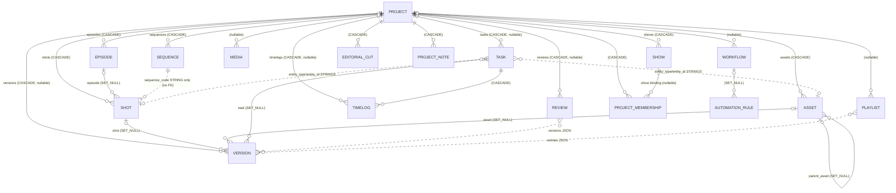

# Production Domain Analysis (ShotGrid-style comparison)

- **Scope:** `backend/apps/production` (read-only analysis, no code changed)
- **Branch / HEAD:** `analysis/production-shotgrid` created from `develop` at `4a5d1345f17630d99d36fd3083b800c90b72b225`, clean working tree
- **Date:** 2026-10-24
- **Reference model:** ShotGrid / Flow Production Tracking, used as a design reference only. Every recommendation is weighed against this repository's rules and has to fit them.

Conventions: `path:line` paths are relative to `backend/` unless they start with `docs/`. **UNVERIFIED** marks a claim not proven by reading code or running a command. Behavior claims come from reading the code (static). No probe requests were run against the API, because the task allows writes only to these two documents and probes need test files.

---

## 0. Files read

Mandatory (all present):
`AGENTS.md`, `backend/AGENTS.md`, `backend/.ai/ARCHITECTURE.md`, `backend/.ai/PROJECT_RULES.md`, `backend/.ai/CODING_GUIDELINES.md`, `backend/.ai/DEVELOPMENT_WORKFLOW.md`, `docs/APP_ARCHITECTURE_TEMPLATE.md`, `CLAUDE.md`. `backend/.roo/rules/` does not exist (the DEVELOPMENT_WORKFLOW reference is optional, "when present").

Architecture / decisions: `docs/adr/ADR-0033-canonical-authorization-model.md`, `docs/03-domain/shot-domain.md` (header).

Production app (all of it): every file under `apps/production/models/`, `constants/`, `services/`, `selectors/` (except `dashboard.py`, outlined only), `api/viewsets/`, `api/urls.py`, `api/urls_project_scoped.py`, `api/views/project_scoped.py` (lines 1-440 read, rest outlined). Serializers for shot, sequence, episode, project, task, version, review, timelog-create, common. Filterset `shot.py`. Admin registrations (grep). Migration `0022` (dependencies and operation counts).

Core and other apps (only the parts the analysis depends on): `apps/core/models/bases/{__init__,entity,soft_delete,orderable,scopes,audit}.py`, `apps/core/models/querysets/soft_delete.py`, `apps/core/models/managers/soft_delete.py`, `apps/core/services/{soft_delete,business}.py` (create/update), `apps/core/api/viewsets/{service,generic,base}.py`, `apps/core/api/mixins/{service,bulk,audit}.py`, `apps/core/api/serializers/base.py`, `apps/core/api/exceptions/handlers.py` (IntegrityError branch), `apps/audit/signals/change_tracking.py:117-230`, `apps/identity/resolvers/permission.py` (outline), `config/settings/components/database.py`, `config/env.py` (DB engine lines only; no `.env` file was opened), `.github/workflows/ci.yml` (grep), `pyproject.toml` (grep).

---

## 1. Phase 0: Preflight and baseline

| Command | Exit | Result |
|---|---|---|
| `git status` | 0 | clean, on `develop` → new branch `analysis/production-shotgrid` |
| `uv run python manage.py check` | 0 | 1 warning: `identity.W003` (MFA_ENCRYPTION_ENABLED is false) |
| `uv run python manage.py makemigrations --check --dry-run` | 0 | `No changes detected` (same W003 warning) |
| `uv run pytest apps/production --cov-reset --cov=apps/production --cov-fail-under=0` | 0 | **243 passed** in 46 s; production line coverage **79%** (5182 stmts, 1093 missed) |
| `uv run pytest` (full suite) | 0 | **3296 passed, 1 skipped**, 0 failed, 0 errors, 316.6 s; total coverage **82.13%** (gate 72%) |
| `uv run ruff check apps/production` | 0 | All checks passed |
| `uv run ruff format --check apps/production` | 1 | 105 files would be reformatted, 125 already formatted (pre-existing) |
| `uv run basedpyright apps/production` | 1 | 74 errors, 9197 warnings (pre-existing) |

There are no pre-existing test failures. The single skip's reason was not captured (`-q`), so which test it is remains **UNVERIFIED**. Tests ran through `uv run pytest`, which uses the separate test database (project memory, verified 2026-10-23), never the live dev database.

Production files under 60% coverage: `api/viewsets/version.py` 40%, `api/viewsets/review.py` 49%, `api/viewsets/playlist.py` 51%, `services/project_scoped.py` 46%, `api/views/project_scoped.py` 56%, `api/filtersets/workflow.py` 51%, `api/filtersets/editorial_track.py` 56%, `management/commands/seed_production_mocks.py` 0%.

**Environment:** Python 3.13.5, Django 6.0.6, DRF 3.17.1. Engines: PostgreSQL by default, SQLite when `DB_ENGINE=sqlite` (`config/env.py:106`, `:211-217`). CI runs Postgres 17 with `DJANGO_ENV=testing` and Python 3.13 (`.github/workflows/ci.yml:21-22,36,51`). `ATOMIC_REQUESTS` is **not** set (`config/settings/components/database.py:7-21`), so every multi-write view without its own `transaction.atomic()` can leave partial state.

**Base model:** every production model inherits `apps.core.models.bases.EntityModel` (UUID pk, timestamps, `created_by/updated_by/deleted_by`, soft delete) (`apps/core/models/bases/entity.py:14-26`). `ProductionEntityModel` exists (`apps/production/models/base.py:8-19`) but **no model uses it**. Soft delete only flags the row (`apps/core/services/soft_delete.py:17-34`). Nothing cascades to children. `QuerySet.delete()` is **not** overridden (`apps/core/models/querysets/soft_delete.py:15-25`), so a queryset delete (for example Django admin "delete selected") is a hard delete that cascades through `on_delete=CASCADE`.

---

## 2. Phase 1: Inventory

### 2.1 Models (19, exported by `models/__init__.py:19-39`)

Status totals: COMPLETE 0, PARTIAL 10 (Project, Show, Asset, Media, Playlist, Workflow, EditorialCut, EditorialTrack, ProjectMembership, ProjectNote), DEFECTIVE 9 (Episode, Sequence, Shot, Task, Version, Review, Timelog, AutomationRule, AutomationAuditLog). MISSING compared with a ShotGrid-style model: 8 concepts (Shot↔Asset link, asset dependency, pipeline step, task template, task dependency, status/approval history, review participant / threaded note, playlist entry).

| Model | Purpose | Key fields / relations | Constraints / indexes | Status field | API (serializers / viewset) | Service | Tests | Class. |
|---|---|---|---|---|---|---|---|---|
| Project | top container | `code` globally unique (`models/project.py:27`), `type`, `status`, `workflow_type` standard/episodic (`:43-52`), fps/resolution/color (`:54-57`), stored counters `total_shots…total_assets` (`:64-67`), client/vendor free text + JSON (`:86-94`) | `code` unique | `ProjectStatus` enum, no transitions | CRUD + `statistics`, `dashboard` (`api/viewsets/project.py`) | empty `BusinessService` (`services/project.py`) | contract, scoping, dashboard | PARTIAL |
| Show | distributable cut of a project | FK Project CASCADE (`models/show.py:31-36`), `is_primary` (`:52`) | unique (project, code) (`:57`); **no single-primary constraint** | free-text `status` (`:46`) | CRUD | empty | 2 tests | PARTIAL |
| Episode | episodic grouping | FK Project CASCADE (`models/episode.py:22-27`), season/episode numbers, frame_in/out, duration (`:42-44`) | unique (project, code) (`:54`) | `ProductionStatus` | CRUD + bulk + archive | `BulkOperationService` | 12 | DEFECTIVE (global code lookup, F-H6) |
| Sequence | groups shots | FK Project CASCADE (`models/sequence.py:23-28`), `department` free text (`:44`), `lead_artist` + denormalized name (`:48-55`), tags/metadata JSON | unique (project, code) (`:63`) | `ProductionStatus` | CRUD + bulk + archive | `BulkOperationService` | 24 | DEFECTIVE (shots not linked by FK, F-H3) |
| Shot | unit of work | FK Project CASCADE (`models/shot.py:19-24`), FK Episode SET_NULL nullable (`:28-35`), **`sequence_code` CharField, no Sequence FK** (`:36`), frame_in/out IntegerField + `handle_frames` (`:48-50`), `current_version` string (`:55`), single `assigned_artist` (`:57-63`), approval booleans (`:65-66`), `pipeline` JSON (`:69-73`, defaulted in `save()` `:92-102`) | unique (project, code) (`:78`); no check constraints | `ShotStatus` | CRUD + bulk + archive + `approve` | `BulkOperationService` | 46 | DEFECTIVE |
| Asset | asset | FK Project CASCADE (`models/asset.py:19-24`), `category` enum (`:28-33`), `version` string (`:43`), FKs masterdata Department/Team (`:59-72`), `parent_asset` self FK SET_NULL (`:82-88`), `is_archived` **and** soft delete (`:94`), `versions`/`hierarchy` JSON (`:97-98`) | unique (project, code) (`:103`) | `ProductionStatus` | CRUD + bulk + archive | `BulkOperationService` | contract only | PARTIAL |
| Task | work item | FK Project CASCADE **nullable** (`models/task.py:19-26`), generic `entity_type/entity_id/entity_code/entity_name` strings (`:31-39`), `department` + `department_id` strings (`:41-42`), FK Team, single `assignee`, `reviewer` (`:44-65`), vendor strings (`:67-69`), `workflow/schedule/dependencies` JSON (`:72-74`), `is_archived` (`:93`), `due_date`, `estimated_hours`, `logged_hours` (`:96-98`) | unique (project, code) (`:103`) | `TaskStatus` | CRUD + bulk + `bulk-assign`, `bulk-status`, archive | `BulkOperationService` | 7 + contract | DEFECTIVE |
| Version | reviewable output | FK Project nullable (`models/version.py:15-22`), `version_number` string + `version_index` int default 1 (`:25-26`), generic entity strings (`:29-32`) **and** FKs shot/asset/task SET_NULL (`:34-54`), `is_published`, `is_hero`, `is_archived` (`:72-74`), 7 JSON blobs incl. `reviews`, `playlists`, `activity` (`:93-99`) | unique (project, code) (`:104`) | `ProductionStatus` | CRUD + publish/unpublish/promote/archive/add-to-playlist | empty | 0 dedicated, 40% coverage | DEFECTIVE |
| Review | review session | FK Project nullable (`models/review.py:14-21`), free-text `status` (`:31-35`), `supervisor_verdict` (`:36`), `lead_reviewer` FK + denormalized name (`:38-47`), versions/reviewers/comments/notes/annotations/activity JSON (`:52-59`) | **no unique** on code | free text | CRUD + 13 actions | empty | 2 (code) | DEFECTIVE |
| Timelog | time entry | FK Project nullable (`models/timelog.py:18-24`), FK Task CASCADE (`:25-30`), FK person CASCADE (`:32-37`), denormalized codes (`:40-42`), inline choices status (`:52-62`), approval (`:64-72`) | indexes only | inline choices | CRUD + approve/reject | empty | contract | DEFECTIVE |
| Media | file record | generic `entity_type/entity_id` (`models/media.py:22-23`), URLs | indexes | none | CRUD | empty | contract | PARTIAL |
| Playlist | dailies list | `entries` JSON (`models/playlist.py:29`), `share_settings`, `is_archived` | none | free text | CRUD + add/remove/reorder/share/archive/restore | empty | 51% coverage | PARTIAL |
| Workflow | pipeline graph | `nodes/transitions/automation_rules` JSON (`models/workflow.py:30-33`) | indexes | `is_active` | CRUD + simulate/clone/activate | empty | contract | PARTIAL (not enforced anywhere) |
| EditorialCut | turnover / cut | `sequence_code` string (`models/editorial.py:37`), counters (`:55-57`), `editor_name` string | unique (project, code) (`:75`) | `ProductionStatus` | read-only (project-scoped) | none | contract | PARTIAL |
| EditorialTrack | NLE track | `cut_id` string, not FK (`models/editorial.py:119`) | index | enum | CRUD | empty | 2 | PARTIAL |
| ProjectMembership | per-project access | FK Project, Show (nullable), User, `role` string, `roles` JSON, `role_ref` FK identity.Role (`models/project_membership.py:30-81`) | unique (project, user) (`:100`) | status choices | members GET/POST (project-scoped) | `ProjectMembershipService.add_member` | 8 + matrix | PARTIAL (`role_ref` unused for authz, F-H7) |
| ProjectNote | production note | generic entity strings (`models/project_note.py:45-48`), `author` FK + denormalized name/avatar/role (`:50-59`), `addressed_by` string (`:83`) | indexes | enum | list + create | `ProjectNoteService` | contract | PARTIAL |
| AutomationRule / AutomationAuditLog | automation | `models/automation.py:13-143` | indexes | free text | `/automations/rules/`, `/automations/audit-logs/` | `services/automation.py` | 10 | DEFECTIVE (no authz, F-C1) |

Admin: all 19 models are registered (`admin/*.py`). Per the task rules, admin registration is not evidence that a feature works.

Production has no `events/`, `validators/` (empty package), `querysets/` (empty), `managers/` (empty), `permissions/` or `signals/` (`ls apps/production`). No service sets `validator_class` or `event_map`, so `BusinessService.validate()`/`publish_event()` are no-ops (`apps/core/services/business.py:49-82`).

### 2.2 Entity relationship diagram (current)

Solid lines are real FKs. Dotted lines are string or JSON references with no referential integrity.

### 2.3 Hierarchy map (today)

| Child → parent | Mechanism | Nullable | on_delete | Ordering |
|---|---|---|---|---|
| Episode → Project | FK `models/episode.py:22-27` | no | CASCADE | `season_number, episode_number, code` (`:53`) |
| Sequence → Project | FK `models/sequence.py:23-28` | no | CASCADE | `code` (`:62`) |
| Sequence → Episode | **none** | none | none | none |
| Shot → Project | FK `models/shot.py:19-24` | no | CASCADE | `code` (`:77`) |
| Shot → Episode | FK `models/shot.py:28-35` | yes | SET_NULL | none |
| Shot → Sequence | **`sequence_code` string** `models/shot.py:36` | blank allowed | none (no FK) | none |
| Asset → Project | FK `models/asset.py:19-24` | no | CASCADE | `code` |
| Asset → Asset | `parent_asset` FK `models/asset.py:82-88` | yes | SET_NULL | none |
| Task → Shot/Asset | strings `models/task.py:31-39` | none | none | `-created_at` |
| Show → Project | FK `models/show.py:31-36` | no | CASCADE | `-is_primary, code` |

No model has a manual `order`/`sort_order` field. `apps/core/models/bases/orderable.py:6-17` (`OrderableModel`) exists but is unused by production.

### 2.4 Feature classification

| Feature | Class. | Evidence |
|---|---|---|
| Project CRUD, membership-scoped reads | COMPLETE | `api/viewsets/base.py:52-73`, `selectors/base.py:50-98`; security matrix tests |
| Project creator receives a membership | MISSING | `api/viewsets/base.py:310-315` saves Project directly; `api/viewsets/project.py:49-63` only bootstraps EP101. A non-admin creator then cannot read the project (**UNVERIFIED at runtime**) |
| Episodic bootstrap (EP101) | COMPLETE | `api/viewsets/project.py:53-63` (not atomic with project insert) |
| Episode / Sequence / Shot / Asset / Task bulk create, update, archive, restore, existence-check | PARTIAL | `services/bulk.py:113-368`, but bulk create skips serializer validation (F-H5) |
| Shot → Sequence relation | DEFECTIVE | string only (`models/shot.py:36`), rename orphans (F-H3) |
| Optional episode level | PARTIAL | `workflow_type` gate (`api/viewsets/episode.py:64-78`, `api/viewsets/shot.py:130-133`); Sequence cannot belong to an Episode |
| Code uniqueness per project | PARTIAL | DB unique is case-sensitive (`models/shot.py:78`); bulk upper-cases (`services/bulk.py:51-52`), single create does not (F-M1) |
| Code auto-numbering | MISSING | no counter; Task code = slug + random hex (`api/serializers/task/create.py:61-70`) |
| Manual ordering / reordering | MISSING | no order field |
| Shot frame range with constraints | PARTIAL | fields exist, no check constraints, no head/tail split |
| Archive / restore | PARTIAL | soft delete per row, no child policy (F-M8) |
| Clone sequence / episode | MISSING | no service or endpoint; only `workflow clone` |
| CSV / EDL import | MISSING | none; `EditorialCut` is read-only |
| Bulk status update | DEFECTIVE | Task only, `queryset.update` (`api/viewsets/task.py:128`) bypasses service, audit and transitions |
| Asset-to-shot links | MISSING | no through table |
| Asset variants / libraries | MISSING / PARTIAL | only `parent_asset`; no cross-project library |
| Asset dependencies | MISSING | no model |
| Pipeline steps / task templates | MISSING | `department` free text; `Workflow` JSON not applied to tasks |
| Task multi-assignee | MISSING | single `assignee` FK |
| Task dependencies with cycle check | MISSING | `dependencies` JSON (`models/task.py:74`) |
| Status workflow (transitions + who) | MISSING | enums only; status writable on every update serializer |
| Version numbering (race-free) | MISSING | client supplies `version_number` |
| Publish immutability | MISSING | published versions stay editable (`api/serializers/version/update.py:10`) |
| Latest / hero pointer | PARTIAL | `is_hero` flag, never cleared on siblings (`api/viewsets/version.py:82-88`) |
| Review notes (threaded, linked) | PARTIAL | JSON blobs on Review (`models/review.py:52-59`) |
| Approval history / self-approval prevention | MISSING | `api/viewsets/review.py:65-75`, `:114-130` |
| Playlists | PARTIAL | JSON `entries`, no FK to versions |
| Time logs | PARTIAL | model + approve/reject; cross-project defect (F-H4) |
| Deliveries / schedule milestones | out of scope | `apps.deliveries` (`DeliveryPackage`, `DeliveryVersionRef`), `apps.scheduling` (`CalendarEvent`, `ResourceSchedule`); project schedule is a computed template (`api/views/project_scoped.py:103-109`) |
| Rollups (progress, counts) | PARTIAL | dashboard derives counts (`selectors/dashboard.py:75-240`); `Project.total_*` stored and never written (F-M10) |
| Audit history | PARTIAL | signal ChangeLog for 6 models, FK swaps untracked (`apps/audit/signals/change_tracking.py:143-147,192-198`) |
| Domain events | MISSING | none published by production services |

---

## 3. Phase 2: Hierarchy analysis

### Q1 Structure
The hierarchy uses **explicit per-level models**, but the links are inconsistent: Project → Episode and Project → Sequence are FKs, Shot → Episode is a nullable FK, Shot → Sequence is a **string**, and Sequence → Episode does not exist (§2.3).

| Option | Queries | Validation | Flexibility | Migration cost |
|---|---|---|---|---|
| (a) Explicit FK per level (`Sequence.episode`, `Shot.sequence`) | simple joins, `select_related`, indexable counts | DB FKs + per-level fields and constraints | each level is fixed but can be optional | **low**: matches today's models; one data migration (sequence_code → FK) |
| (b) Self-referencing tree (adjacency list / MPTT / treebeard / ltree) | descendant queries need recursive CTE or a library; type-specific fields need polymorphism | type rules move into code; generic node loses per-level constraints | arbitrary depth | **high**: replaces 3 models, new dependency (ADR needed), breaks every API contract |
| (c) Hybrid: explicit FKs plus a denormalized `project` FK on each row (and optional `episode`) for scoping | as (a) plus single-column project scoping (already used by `selectors/base.py:94-96`) | needs a parent/denormalized consistency rule (service validation, optionally a composite FK) | as (a) | low-medium |

**Recommendation: (c), meaning explicit FKs per level and keeping `project` on every row.** Project scoping, unique constraints and the membership selector all key on `project_id` today (`selectors/base.py:94-96`, every `unique_together`). Removing it would rewrite authorization. A generic tree buys depth flexibility that ShotGrid itself does not use (Episode → Sequence → Shot is fixed there too). It also costs per-level constraints and needs an ADR plus a dependency. This decision is yours (OPEN QUESTION Q1).

### Q2 Optional levels
- Shows without episodes: supported via `workflow_type=standard` (`models/project.py:43-52`). Episode creation is rejected there (`api/viewsets/episode.py:71-77`).
- Shot directly under Project (no sequence): allowed (`sequence_code` blank, `models/shot.py:36`). Shot under Sequence: only by string.
- Sequence under Episode: **impossible**, so an episodic show cannot group sequences per episode. A shot's episode and sequence are unrelated values, so "SEQ010 of EP101" cannot be expressed.
- Nullable FKs allowing inconsistency: `Shot.episode` from another project is rejected only on the single create/update path (`api/viewsets/shot.py:122-125`). The bulk path never calls that check (F-H5). `Task.project`, `Version.project`, `Review.project` and `Timelog.project` are nullable (`models/task.py:19-26`, `models/version.py:15-22`, `models/review.py:14-21`, `models/timelog.py:18-24`). A row with `project = NULL` is invisible to non-admins (`selectors/base.py:94-96`) and has no tenant.

### Q3 Consistency invariants (drift points)
| Invariant | Enforced? | Evidence |
|---|---|---|
| shot.episode.project == shot.project | single path only | `api/viewsets/shot.py:122-125`; bulk path (`services/bulk.py:238-244`) skips it |
| shot.sequence_code names a live sequence of the project | single path only, when `sequence_id` is sent | `api/viewsets/shot.py:135-145`; `sequence_code` itself is writable directly (`api/serializers/shot/create.py:38`, `update.py:24`) |
| sequence rename keeps shots attached | **no** | `api/serializers/sequence/update.py:12` allows `code`; shots keep the old string |
| sequence archive affects shots | **no** | soft delete only flags the sequence; shots still name its code |
| shot.episode consistent with shot's sequence episode | n/a | no Sequence → Episode link |
| version.shot/asset/task belong to version.project | **no** | `api/serializers/version/create.py:18` exposes PK fields with unscoped querysets (F-H2) |
| timelog.task.project == timelog.project | **no** | task resolved globally (`api/serializers/timelog/create.py:92`), project taken from input (`:133`) (F-H4) |
| task.entity_id refers to an entity of task.project | **no** | free strings (`models/task.py:31-39`) |
| denormalized names (`task_code`, `project_code` on Timelog, `entity_code/name` on Task/Version/Note, `lead_artist_name`, `author_name`) | **no refresh** | copied once (`api/viewsets/timelog.py:47-58`) or client-supplied |
| `ProjectMembership.show.project == membership.project` | **no constraint** | `models/project_membership.py:36-47` |

### Q4 Naming and codes
- Scope: (project, code) for Episode, Sequence, Shot, Asset, Task, Version, EditorialCut, Show. Review has none (`models/review.py:61-67`). Project code is globally unique.
- Case-insensitivity: **not enforced in the DB**. Bulk upper-cases (`services/bulk.py:51-52`). Episode create upper-cases (`api/serializers/episode/create.py:84`). Shot, Sequence, Asset, Task and Version single create keep the client's case, and `_enforce_natural_key_uniqueness` compares exactly (`api/viewsets/base.py:351-362`). So `sh010` and `SH010` can coexist; get-by-code then returns whichever comes first (`api/viewsets/base.py:120`).
- Format validation: none (no regex for SH/SQ/EP codes; `docs/07-pipeline/naming.md` is not enforced).
- Immutability: codes are editable on every update serializer (`api/serializers/{project,episode,sequence,shot,task}/update.py`, `version/update.py:10`, `review/update.py:10`), including after publish. File paths and publishes that embed codes would drift (paths are outside this app, **UNVERIFIED**).
- Episode code derivation `EP{season}{episode:02d}` (`api/serializers/episode/create.py:69`) is **ambiguous**: S1E101 and S11E01 both produce `EP1101`. The second is rejected as a duplicate.
- Race-free numbering: none. Duplicate inserts race between the check (`api/viewsets/base.py:362`) and the insert. The DB unique turns the loser into an IntegrityError, which the exception handler maps to **409** (`apps/core/api/exceptions/handlers.py:314-320`). Integrity holds; the UX is a generic conflict.
- Global code lookup bug: `EpisodeSelector.resolve_by_lookup` resolves codes across **all** projects (`selectors/episode.py:42-51`). Every episodic project gets `EP101` (`api/viewsets/project.py:57-63`), so `episode_id=EP101` picks an arbitrary project's episode. On shot create that becomes a 400 "Episode does not belong…" (`api/viewsets/shot.py:119-125`). In the shot filter it returns wrong or empty results (`api/filtersets/shot.py:40-48`) (F-H6).

### Q5 Ordering
No `sort_order` on Episode, Sequence, Shot or Asset. Ordering is lexical by code (`models/sequence.py:62`, `models/shot.py:77`) or by season/episode numbers. Manual reordering and concurrency-safe reordering are **MISSING**. Playlist "reorder" replaces the whole JSON array (`api/viewsets/playlist.py:71-78`, last writer wins).

### Q6 Shot data
| ShotGrid concept | Here | Gap |
|---|---|---|
| cut_in / cut_out | `frame_in` / `frame_out` IntegerField (`models/shot.py:48-49`) | no `CHECK (frame_out >= frame_in)`; negatives allowed on Shot, while Sequence and Episode use PositiveIntegerField (`models/sequence.py:41-42`) |
| head_in / tail_out (handles) | single `handle_frames` (`:50`) | no separate head/tail |
| cut duration / working duration | `frame_count` property (`:88-90`) | returns 0 when `frame_in == 0`; working range not derived |
| fps / resolution | Project only (`models/project.py:54-57`); Version has its own (`models/version.py:83-84`) | no per-shot override |
| cut versions / edit data | `EditorialCut` (`sequence_code` string), no cut item per shot | no Shot ↔ Cut link |
| thumbnail | `thumbnail_url` URL string | no Media/attachment FK |
| status / priority | `status` (`ShotStatus`); no priority | priority missing |
| approvals | `supervisor_approved`, `client_approved` booleans (`:65-66`) | no who/when, writable on update (F-H1) |
| pipeline steps | `pipeline` JSON of 5 hard-coded stages (`:69-73`, `:92-102`) | duplicates what tasks should hold; never derived from tasks |

### Q7 Lifecycle
- Archive = soft delete (`api/viewsets/base.py:234-250`). It also sets `status="Archived"` (`apps/core/api/mixins/bulk.py:131-140`). Restore does **not** reset status for Shot, Sequence or Episode (`api/viewsets/base.py:252-268`), so a restored shot stays "Archived". Task restore forces "In Progress" (`api/viewsets/task.py:164-176`).
- Several "archived" notions coexist: `is_deleted` (core), `is_archived` flags on Asset, Task, Version, Playlist, Workflow, and `status="Archived"`. Version archive only sets `is_archived` and does not soft delete (`api/viewsets/version.py:74-80`). Playlist archive likewise (`api/viewsets/playlist.py:90-96`).
- Children: archiving a Project, Sequence or Episode leaves shots, tasks and versions live. Their parent is hidden, but their own rows are still listed (`selectors/base.py:94-96` filters by project id, not project liveness).
- Hard delete: every child FK to Project is CASCADE. Timelog → Task and Timelog → person are CASCADE (`models/timelog.py:25-37`), so deleting a user deletes their time history. Queryset/admin delete is a real delete (§1).
- Restore rules: recover by code during bulk create is implemented (`api/viewsets/base.py:157-192`).

### Q8 Copy / bulk
- Bulk create, update, archive, restore and existence-check exist for Episode, Sequence, Shot, Asset and Task (`services/bulk.py`). Per-item transactions, not batch-atomic (`:179-180`).
- Bulk create **skips serializer validation**: raw dict → `cls.create(**data)` (`services/bulk.py:238-244`). In the frontend-form path the whitelist allows every concrete column (`apps/core/api/mixins/bulk.py:114-129`), including `is_deleted`, `deleted_at`, `created_by_id`, `status`, approval booleans and `episode_id`. Exception text is returned to the client (`services/bulk.py:245-249`) (F-H5).
- Bulk status: Task only, `queryset.update` (`api/viewsets/task.py:128`).
- Clone sequence/episode with children: MISSING. CSV/EDL import: MISSING.

### Q9 Query performance
- `SequenceSerializer.get_shots_count` runs one COUNT per row (`api/serializers/sequence/base.py:59-65`), an N+1 on list.
- `ProjectSelector.summary_counts` runs about 12 separate COUNT queries (`selectors/project.py:85-112`). Acceptable for a detail view, but it could be one aggregate per table.
- `Task.department` is indexed free text (`models/task.py:110`). Descendant queries (shots of an episode's sequences) are impossible because there is no FK.
- Status indexes exist but no composite `(project, status)` on Shot/Task. Most list filters are project + status (**UNVERIFIED** with EXPLAIN on real volumes).
- The membership subquery is recomputed per request, and `_has_global_admin_role` queries per call (`selectors/base.py:29-48`), called from several places in one request (cost **UNVERIFIED**).
- A performance test exists (`tests/performance/test_production_performance.py`, 2 tests).

---

## 4. Phase 3: Asset analysis

1. **Model:** `category` is a hard-coded `AssetCategory` enum (`constants/asset.py:4-13`), while masterdata already owns a `MasterAssetType` catalog (masterdata models list), so it is not referenced. Code unique per project, case-sensitive. `status` uses the shared `ProductionStatus`. `thumbnail_url` and `turntable_video_url` are bare URLs. `tags` is JSON. `version` is a string (`models/asset.py:43`) that duplicates Version rows. `versions`/`hierarchy` JSON (`:97-98`) duplicate the real Version model and `parent_asset`.
2. **Hierarchy / variants:** only `parent_asset` (SET_NULL, `:82-88`). It has no same-project check, no cycle check and no "variant" vs "component" distinction. No library assets, and no sharing across projects or episodes (the asset belongs to exactly one project, `:19-24`).
3. **Asset ↔ Shot (ShotGrid "Shot.assets"):** **MISSING**. There is no through table and no M2M. The only trace is `Version.asset`/`Version.shot` on the same version row.
4. **Asset dependencies (rig depends on model):** **MISSING**.
5. **Lifecycle:** archive = soft delete plus a separate `is_archived` flag. Shots and versions referencing the asset are untouched. No replace/supersede.

---

## 5. Phase 4: Pipeline, task and review analysis

| ShotGrid concept | State | Evidence and gap |
|---|---|---|
| Pipeline Step | MISSING | `Task.department` free text plus `department_id` string (`models/task.py:41-42`). Masterdata `Department` exists and is used by Asset (`models/asset.py:59-65`), but Task does not use it. |
| Task Template (auto-create tasks by entity type) | MISSING | `Workflow.nodes` JSON (`models/workflow.py:30`) is never applied to entities. `Shot.pipeline` JSON hard-codes 5 stages. |
| Task → entity link | DEFECTIVE | free strings, no existence or same-project validation, `entity_type` default "Shot", no choices (`models/task.py:31-39`). |
| Step / task type | PARTIAL | masterdata `MasterTaskType` exists, unused. |
| Assignees (multiple) | MISSING | single `assignee` (`models/task.py:52-58`). `bulk-assign` checks assignee membership in *any* of the caller's projects, not the task's (`api/viewsets/task.py:82-92`). Single create/update accepts any user (`api/serializers/task/update.py:20`). |
| Dates / bid / actuals | PARTIAL | `due_date`, `estimated_hours`, `logged_hours` (`models/task.py:96-98`). `schedule` JSON duplicates dates. `logged_hours` is client-writable (`api/serializers/task/update.py:36`) and never derived from Timelog. |
| Reviewer | PARTIAL | `reviewer` FK, no rule that reviewer ≠ assignee. |
| Task dependencies + cycle prevention | MISSING | `dependencies` JSON (`models/task.py:74`). |
| Status workflow per entity | MISSING | six identical status enums (`constants/*.py`). Status is writable in every update serializer. Actions overwrite status directly (`api/viewsets/shot.py:147-157`, `version.py:82-88`, `review.py:65-130`, `task.py:128`). |
| Version numbering | MISSING | client-provided `version_number` string. `version_index` default 1, never computed (`models/version.py:25-26`). Uniqueness is only (project, code). |
| File / path references | PARTIAL | `file_path`, `source_file_url` strings. Publishes live in `apps.publishing.PublishItem` (not analysed; **UNVERIFIED** linkage). |
| Publish vs work, immutability | DEFECTIVE | `is_published` writable via update with only `version.update` (`api/serializers/version/update.py:10`). Publish merges arbitrary request keys into `publishing_info` (`api/viewsets/version.py:53-60`). Published rows stay editable. |
| Latest-version pointer | PARTIAL | `Shot.current_version` string (`models/shot.py:55`), never updated by version creation. `is_hero` set without clearing siblings (`api/viewsets/version.py:82-88`). |
| Notes (threaded, linked to versions) | PARTIAL | `ProjectNote` (generic strings), plus Review `comments`/`notes`/`annotations` JSON (`models/review.py:52-59`) with `replies` as a JSON array. Lost updates are possible (read-modify-write without lock). |
| Approvals + history | DEFECTIVE | free-text verdict (`api/viewsets/review.py:114-130`), no record of who decided, self-approval allowed (creator becomes `lead_reviewer`, `:60-63`). `participant-verdict` lets any `review.update` holder set *another* participant's verdict (`:205-229`). Author fields are client-spoofable (`:138`, `:154`, `:194`). Naive `datetime.now()` (`:72`, `:141`, `:158`, `:198`, `:222`). |
| Playlists / dailies | PARTIAL | `entries` JSON. `add-entry` spreads arbitrary request keys into the entry (`api/viewsets/playlist.py:53-58`). No check that the version belongs to the playlist's project. |
| Deliveries | exists elsewhere | `apps.deliveries` (`DeliveryPackage`, `DeliveryVersionRef`), not analysed here. |
| Schedule milestones | PARTIAL | computed template (`api/views/project_scoped.py:103-109`, `ProjectScheduleView` `:509`). `apps.scheduling` owns calendar and resources. |
| Time logs | PARTIAL / DEFECTIVE | F-H4. Self-approval allowed (`api/viewsets/timelog.py:60-68`). |
| Rollups | PARTIAL | dashboard derives (`selectors/dashboard.py`). `Project.total_shots…total_assets` are stored, never written, but serialized (`models/project.py:64-67`, `api/serializers/project/base.py:36-39`), so they are always 0. Shot status is not derived from tasks. |

**Minimum viable design for the missing parts** is in PLAN.md §3 and §4.

---

## 6. Phase 5: Service and code-quality checklist

Y / N / N/A / UNVERIFIED, evidence in brackets.

| Check | Project | Episode | Sequence | Shot | Asset | Task | Version | Review | Timelog |
|---|---|---|---|---|---|---|---|---|---|
| Core base model | Y | Y | Y | Y | Y | Y | Y | Y | Y |
| Deliberate on_delete (PROTECT/archive for history) | N CASCADE | N | N | N | N | N | N | N | N (person CASCADE) |
| Unique constraints correct | Y | Y (derived code ambiguous) | Y | partial (case) | partial | partial | N (only code) | N (none) | N/A |
| Check constraints | N | N | N | N | N | N | N | N | N (duration > 0) |
| Single responsibility (no JSON duplicates) | N stored counters | Y | Y | N `pipeline` | N `versions`, `hierarchy` | N `schedule`, `workflow`, `dependencies` | N 7 JSON blobs | N 8 JSON blobs | Y |
| Writes through service (single create) | N [`api/viewsets/base.py:333` `serializer.save`] | N | N | N | N | N | N | N | N |
| Writes through service (update) | Y [`apps/core/api/mixins/service.py:44-55`] but no `user` passed, so `updated_by` is never set | same | same | same | same | same | same | same | same |
| Custom actions through service | N/A | N/A | N/A | N [`shot.py:147`] | N/A | N [`task.py:62-176`] | N [`version.py:49-112`] | N [`review.py:65-229`] | N [`timelog.py:60-77`] |
| Atomic multi-step | N (project + EP101) | Y (service) | Y | N (approve) | Y | N (archive: 3 saves `task.py:153-162`) | N (add-to-playlist) | N (verdict: 2 saves `review.py:123-128`) | Y |
| Validators | N none | N | N | partial (view) | N | N | N | N | partial (serializer) |
| Domain events | N | N | N | N | N | N | N | N | N |
| Selectors N+1-free | Y | Y | N (`shots_count`) | Y | Y | Y | Y | UNVERIFIED | Y |
| State machine | N | N | N | N | N | N | N | N | N |
| Concurrency-safe numbering/order | N/A | N | N | N | N | N | N | N | N/A |

**Services that should exist but do not:** `create_shot`, `bulk_create_shots` (validated), `rename_entity_code`, `link_shot_to_sequence`, `apply_task_template`, `assign_task`, `transition_status`, `create_version` (numbered), `publish_version`, `set_hero_version`, `submit_review` / `record_verdict`, `approve_timelog`, `archive_entity` (with child policy), `restore_entity`, `clone_sequence` / `clone_episode`, `reorder_children`, `link_asset_to_shot`, `add_asset_dependency`, `log_time`, `recompute_rollups` (if anything is stored).

**Layering defects:** services import API serializers (`services/shot.py:1`, `asset.py:1`, `task.py:1`, `sequence.py:16`, `episode.py:16`), so the service depends on the API layer. `BusinessService` is deprecated per CLAUDE.md, yet every production service extends it. `apps/core/management/commands/seed_*` import production (core → domain, ADR-0026) (`grep` results). Business rules live in viewsets (`api/viewsets/shot.py:87-145`, `episode.py:64-78`, `project.py:53-63`).

**Integrity under concurrency:** duplicate codes end in IntegrityError → 409 (OK). Numbering and reordering: N/A (missing). Simultaneous approvals and JSON appends (comments, notes, playlist entries, version `playlists`) are read-modify-write without `select_for_update`, so lost updates are possible (`api/viewsets/review.py:132-162`, `playlist.py:50-61`). No `select_for_update` anywhere in production (`grep`).

**API:** versioned routes under `/api/v1/` (`config/v1_urls.py:24-25`), plus project-scoped routes under `/api/organizations/projects/
/` with no version (`config/api_urls.py:23`). Explicit serializers (no `__all__`), core pagination, filtersets, search, ordering. Defects:
- Silently ignored writes: Shot `sequence_code` is read-only in the read serializer but writable in create/update. Fields with no effect: `Project.total_*` (read-only, always 0). `Task.is_archived` writable without soft delete (`api/serializers/task/update.py:33`).
- Status codes: unknown project → 404 vs non-member → 403 on project-scoped routes (`api/views/project_scoped.py:122-146`). That leaks which project codes exist. ADR-0032/0033 posture is cross-tenant ⇒ 404.
- `archived?project_id=<non-uuid>` passes the raw value to a UUID filter (`api/viewsets/base.py:223-225`): 500 vs 400 **UNVERIFIED**.
- OpenAPI accuracy: custom actions use raw `request.data` with no request serializers. Automation and analytics views use `DummySerializer` with OBJECT types (`api/viewsets/scheduling.py:19-20`).
- Dead code: `SchedulingEventsView`, `SchedulingEventDetailView`, `SchedulingResourcesView`, `SchedulingHolidaysView` and `SchedulingLeavesView` echo stub data (`"evt-001"`, `"leave-001"`, `api/viewsets/scheduling.py:38-149`) and are not routed (`api/urls.py:20-27`). `ProductionEntityModel` is unused.

**Authorization:** see findings F-C1, F-H1, F-H2, F-H4, F-H7, F-M3, F-M4. Uses the canonical `HasPermission` chain (`api/viewsets/base.py:47-50`) plus a membership filter. Project-scoped views and automation/analytics views use only `IsAuthenticated` (`api/views/project_scoped.py:177`, `api/viewsets/scheduling.py:153`, `analytics.py:25`).

**Audit/history:** ChangeLog via signals for Project, Sequence, Shot, Asset, Task, Version only (`apps/audit/signals/change_tracking.py:192-198`). FK changes (assignee, reviewer, episode, artist) are explicitly untracked (`:143-147`). `queryset.update` paths are untracked. Review, Timelog, Episode, Playlist and ProjectMembership are not tracked. `created_by` is not set on single create (`api/viewsets/base.py:333`), and `updated_by` is not set on update (`apps/core/api/mixins/service.py:50-53` calls `update` without `user`). Recording failures are swallowed (`change_tracking.py:177-178`).

**Tests:** 243 production tests pass. They include a security access matrix (`tests/security/test_canonical_access_matrix.py`, 19), project scoping (11) and bulk task authorization (7). Missing: constraint tests (none to test), transition tests, PostgreSQL concurrency tests (no `transaction=True`/threading in production tests), cross-project FK injection tests (version shot/asset/task, timelog task, bulk episode), review and version action tests (40-49% coverage), migration tests.

**Quality gates:** §1. Ruff lint clean. Format and basedpyright have pre-existing debt in production (105 files / 74 errors).

**Free text that should be references:** `Task.department`/`department_id`, `Sequence.department`, `Version.department`, `Timelog.department`, `Shot.sequence_code`, `EditorialCut.sequence_code`, `EditorialTrack.cut_id`, `Task.entity_*`, `Version.entity_*`, `Media.entity_*`, `ProjectNote.entity_*`, `Task.vendor_*`, `Project.client_*`/`vendor_*` (masterdata Client/Vendor now exist), `Asset.category` (masterdata `MasterAssetType`), all status fields (masterdata `MasterStatus`), `ProjectNote.addressed_by`, `EditorialCut.editor_name`/`conformed_by`.

**Stored values that should be derived:** `Project.total_shots/approved_shots/in_progress_shots/total_assets`, `Task.logged_hours`, `Shot.current_version`, `Asset.version`, `Shot.pipeline`, `Sequence.lead_artist_name`, `Timelog.task_code/task_title/project_code`, `EditorialCut.total_shots_in_cut/matched/unmatched`, `EditorialTrack.clip_count`, `Episode.duration_frames`.

---

## 7. Findings by severity

### Critical

**F-C1 Automation rules and audit logs have no authorization or project scoping.**
Evidence: `_scoped_rules`/`_scoped_audit_logs` return `.objects.all()` (`api/viewsets/scheduling.py:23-28`). The views use only `IsAuthenticated` (`:153`, `:176`, `:222`). PATCH, PUT and DELETE act on any rule by id (`:186-218`).
Problem: any authenticated user (artist, vendor, client account) can read, create, change and delete every project's automation rules and read every execution log. That crosses the project tenant boundary (ADR-0033 D1).
Fix: add `automation.*` permission codes and membership scoping via `ProductionBaseSelector.scope_by_project_membership`, require `project` on create (or a platform permission for global rules), and add matrix tests.

### High

**F-H1 Approval and publish bypass through plain update (separation of duties).**
Evidence: Shot update/create accepts `status`, `supervisor_approved`, `client_approved`, `pipeline` (`api/serializers/shot/update.py:28,36-38`; `create.py:42,50-52`) with only `shot.update`/`shot.create`. `shot.approve` guards only the `approve` action (`api/viewsets/shot.py:44`). Version update accepts `is_published`, `is_hero`, `status` with `version.update` (`api/serializers/version/update.py:10`), while `version.publish` guards only the actions. Review update accepts `status`, `supervisor_verdict` with `review.update` (`api/serializers/review/update.py:10`).
Problem: approve and publish permissions are not enforced.
Fix: make these fields read-only on generic serializers. Route changes through `transition_status`/`publish_version` services that check the specific permission and the allowed transition.

**F-H2 Cross-project references accepted on Version create.**
Evidence: `VersionCreateSerializer` exposes `shot`, `asset`, `task`, `artist` as PK fields (`api/serializers/version/create.py:18`) with default unscoped querysets. `perform_create` checks only the version's `project` (`api/viewsets/base.py:324-328`).
Problem: a member of project A can attach a version to project B's shot, asset or task. The 400 vs 201 difference also confirms whether a foreign id exists.
Fix: resolve FKs inside the target project in the service. Reject a mismatch with the same error as "not found".

**F-H3 Shot → Sequence is a string. Rename and archive orphan shots.**
Evidence: `models/shot.py:36`; `api/serializers/sequence/update.py:12` (code editable); `SequenceSerializer.get_shots_count` counts by string (`api/serializers/sequence/base.py:59-65`). `sequence_code` is directly writable on shots (`api/serializers/shot/create.py:38`, `update.py:24`).
Problem: renaming SQ010 to SQ020 detaches all its shots. A shot can name a sequence that does not exist. No descendant queries are possible.
Fix: add `Shot.sequence` FK (PROTECT, nullable). Data migration maps (project, upper(sequence_code)) to a sequence. Keep `sequence_code` as a read-only derived field for the contract.

**F-H4 Timelog create accepts a task from another project and logs time as another user.**
Evidence: task resolved globally by UUID (`api/serializers/timelog/create.py:89-94`), project taken from input (`:133`), project is the only membership check (`api/viewsets/base.py:324-328`). `person_id` resolves any user (`:115-129`). Approval has no `approver ≠ person` rule (`api/viewsets/timelog.py:60-68`).
Fix: derive the project from the task and require task-project membership. Force `person = request.user` unless the caller holds a `timelog.manage` permission. Block self-approval.

**F-H5 Bulk create bypasses validation and the hierarchy chain.**
Evidence: `BulkOperationService.bulk_create` calls `cls.create(**data)` with raw items (`services/bulk.py:238-244`). The form path whitelists all concrete fields, including `is_deleted`, `created_by_id`, `episode_id` and approval booleans (`apps/core/api/mixins/bulk.py:114-129`). Errors return `str(exc)` (`services/bulk.py:245-249`).
Problem: the episodic-episode requirement, episode-project check, sequence resolution, field validation and permission-specific fields are skipped. A row can be created already soft-deleted or with a forged creator. Database error text leaks to the client.
Fix: validate each item with the entity's create serializer. Call the same `create_shot` service as the single path. Return a sanitized per-item error.

**F-H6 Episode code lookup is global (wrong episode across projects).**
Evidence: `selectors/episode.py:42-51` (no project filter), used by the shot chain (`api/viewsets/shot.py:119`) and the shot filter (`api/filtersets/shot.py:40-48`). Every episodic project gets `EP101` (`api/viewsets/project.py:57-63`).
Problem: as soon as two episodic projects exist, `episode_id=EP101` resolves to an arbitrary one. Shot create gets a 400 and filters return empty or wrong results (runtime **UNVERIFIED**; follows directly from the code).
Fix: an `EpisodeSelector.resolve_in_project(project, lookup)` like `SequenceSelector.resolve_in_project` (`selectors/sequence.py:14-41`).

**F-H7 Per-project roles are not used for authorization (ADR-0033 D1 incomplete).**
Evidence: `HasPermission → PermissionResolver` resolves `UserRole` and `GroupRole` only (`apps/identity/resolvers/permission.py:65-90`). `ProjectMembership.role_ref` is read only by production serializers and services (grep). Show-bound memberships see every shot of the project because entities carry no show (`selectors/base.py:94-96`).
Problem: one global role decides what a user may do in every project they belong to. You cannot be a supervisor on A and an artist on B. Show narrowing (ADR-0033 D2) is not enforced for entities.
Fix: needs a decision (Q9). Either a project-role permission resolver keyed on `ProjectMembership.role_ref`, or document that global roles plus membership is the intended model and update ADR-0033.

**F-H8 Version `add-to-playlist` writes into any playlist by id.**
Evidence: `Playlist.objects.get(pk=playlist_id)` unscoped, errors swallowed by `except Exception: pass` (`api/viewsets/version.py:101-110`).
Problem: a cross-project write (IDOR) into another project's playlist entries.
Fix: resolve the playlist through the membership-scoped selector and require `playlist.update` on it.

### Medium

**F-M1 Codes are not case-insensitively unique and remain mutable.** `services/bulk.py:51-52` vs `api/viewsets/base.py:351-362`, `models/shot.py:78`. Fix: `UniqueConstraint(Upper("code"), "project")`, normalize on input, freeze codes once published or referenced (Q4).

**F-M2 No frame-range or numeric check constraints.** `models/shot.py:48-50`, `models/version.py:81-82`, `models/timelog.py:46`. Fix: `CheckConstraint`s (`frame_out >= frame_in`, handles ≥ 0, duration > 0, hours ≥ 0).

**F-M3 Task bulk-assign membership check uses the wrong project set.** `api/viewsets/task.py:82-92`. Fix: check the assignee against each task's project. Also validate assignee/reviewer on single create and update.

**F-M4 Review actions: no transitions, spoofable authors, verdict impersonation, self-approval.** `api/viewsets/review.py:60-63,114-130,138,154,194,205-229`.

**F-M5 Status set directly everywhere with no state machine.** `api/viewsets/shot.py:147-157`, `task.py:128`, `version.py:82-88`, `review.py:65-75`. Fix: transition maps per entity in `constants/` and one `transition_status` service.

**F-M6 Single create bypasses the service layer, so audit fields are never set.** `api/viewsets/base.py:306-333` (`serializer.save`), `apps/core/api/mixins/service.py:50-53` (no `user`). `created_by` and `updated_by` stay NULL for API writes (static; **UNVERIFIED** at runtime).

**F-M7 Task generic link unvalidated.** `models/task.py:31-39`. Fix: `shot` and `asset` FKs plus `CheckConstraint` (exactly one set, or neither for a project-level task). See PLAN D.

**F-M8 Archive does not cascade or block, and archive states disagree.** §3 Q7. Restore leaves status "Archived" (`api/viewsets/base.py:252-268` vs `apps/core/api/mixins/bulk.py:131-140`).

**F-M9 Project create has no creator membership and is not atomic with the EP101 bootstrap.** `api/viewsets/project.py:49-63`, no `ATOMIC_REQUESTS`.

**F-M10 Stored rollups never maintained.** `models/project.py:64-67` (always 0 but serialized), `Task.logged_hours` client-written (`api/serializers/task/update.py:36`).

**F-M11 Ambiguous derived episode code.** `api/serializers/episode/create.py:69`.

**F-M12 Project-scoped routes: membership only, no permission codes, 404/403 existence oracle.** `api/views/project_scoped.py:122-177`. Notes POST requires no `note.create` (`:412-433`).

**F-M13 Analytics KPIs are platform-wide for any authenticated user.** `api/viewsets/analytics.py:25-50,79-98`. Counts across all projects leak to non-members.

**F-M14 Hard delete cascades all history.** Every child FK CASCADE, Timelog person CASCADE (`models/timelog.py:32-37`), queryset delete not overridden (§1).

### Low

- **F-L1** N+1 `shots_count` (`api/serializers/sequence/base.py:59-65`). About 12 count queries in `summary_counts` (`selectors/project.py:85-112`).
- **F-L2** Services import API serializers (layer inversion) (`services/shot.py:1` etc.). Core seed commands import production.
- **F-L3** Dead stub views echo `request.data` with fake ids (`api/viewsets/scheduling.py:38-149`, unrouted). `ProductionEntityModel` unused.
- **F-L4** Naive `datetime.now()` in review JSON (`api/viewsets/review.py:72` etc.).
- **F-L5** Task archive/restore require `task.update` while every other entity requires `*.delete` (`api/viewsets/task.py:46,53-54`).
- **F-L6** `Show.is_primary` has no "one per project" constraint (`models/show.py:52-60`). `ProjectMembership.show` can point at another project's show (`models/project_membership.py:36-47`).
- **F-L7** Frontend mock-id maps hard-coded in selectors (`selectors/project.py:18-27`, `selectors/episode.py:13-17`).
- **F-L8** `publish` merges arbitrary request keys into `publishing_info` (`api/viewsets/version.py:53-60`). `add-entry` and `share` likewise (`api/viewsets/playlist.py:53-58,84-86`).
- **F-L9** `archived?project_id=` unvalidated UUID (`api/viewsets/base.py:223-225`). Possible 500 (**UNVERIFIED**).

**Totals:** Critical 1, High 8, Medium 14, Low 9.

---

## 8. What could not be verified

- Runtime behavior of every finding (no probe requests were run). Each finding is derived from the code at the cited lines.
- Existing data shape on any non-test database: how many shots carry a `sequence_code` with no matching sequence, case-variant duplicate codes, `frame_out < frame_in` rows, tasks with `project IS NULL`. These queries were deliberately not run. PLAN.md §6 lists the read-only SQL for you to run.
- Frontend reliance on writable `status`/approval fields, on `sequence_code` writes, and on JSON blob shapes. The frontend repo was not inspected.
- `apps.publishing`, `apps.deliveries` and `apps.scheduling` internals.
- Which test is the single skip in the full suite.

---

## OPEN QUESTIONS (for your decision)

1. **Hierarchy structure:** explicit FKs per level plus a denormalized `project` (recommended, option c), a pure FK chain, or a generic tree?
2. **Episodes optional:** keep the per-project `workflow_type` switch? Should a Sequence belong to an Episode (`Sequence.episode` FK) so shot.episode is derived from its sequence?
3. **Shot without sequence:** allowed (ShotGrid allows it) or every shot must have a sequence?
4. **Code rules:** case-insensitive uniqueness (recommended)? Format regex per entity (e.g. `SQ\d{3,4}`, `SH\d{4}`)? Codes frozen after first publish, after first version, or never?
5. **Asset variants and libraries:** need variants (character → costume variants)? A cross-project asset library? Or project-only assets?
6. **Task template ownership:** global templates (studio) and/or per-project overrides? Should pipeline steps reuse masterdata `Department` or `MasterTaskType`, or be a production-owned `PipelineStep`?
7. **Status workflow:** fixed transition maps in code per entity (MVP), or configurable per project (ShotGrid-style status lists)? Should masterdata `MasterStatus` become the source of status values?
8. **Shot status derivation:** derived from tasks (rollup) or set manually by supervisors?
9. **Per-project roles (F-H7):** should `ProjectMembership.role_ref` drive permissions per project (needs an ADR and identity work), or is global role plus membership the intended model?
10. **ShotGrid features you do NOT need:** e.g. per-project custom fields, Cut / Cut Item, multi-assignee tasks, task dependencies, Playlists, client review portal, asset libraries, Notes threading.
11. **JSON blobs on Version and Review (`reviews`, `playlists`, `comments`, `notes`, `annotations`, `activity`):** replace with relational models (breaking the response shape unless serializers rebuild it), or keep them as frontend contract caches?
12. **Automation (F-C1):** are automation rules project-scoped only, or can platform admins own global rules? Which permission codes?
