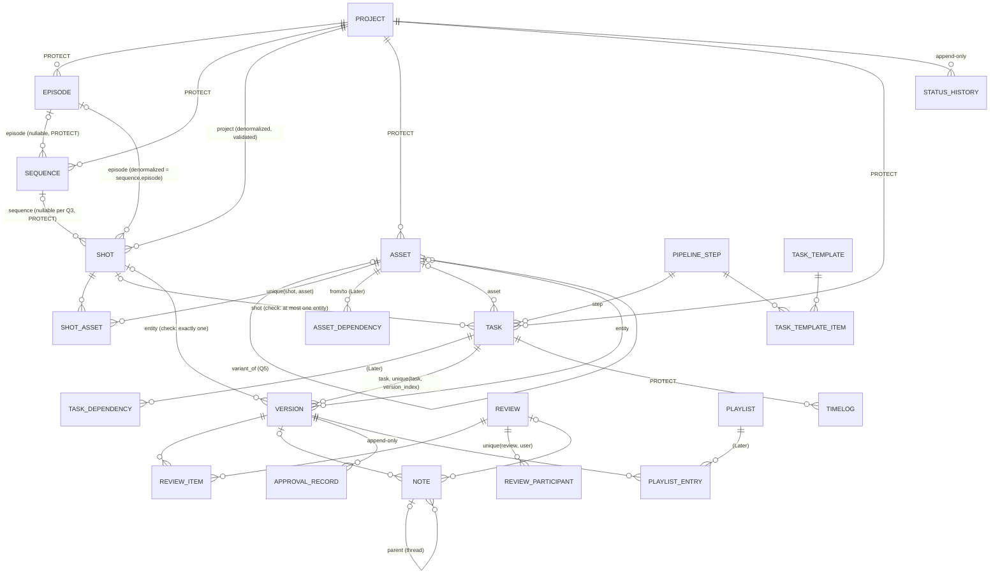

# Production Domain Improvement Plan

- **Input:** `docs/production/ANALYSIS.md` (finding IDs `F-*` refer to it)
- **Status:** P1 and P2 committed, P3 implemented on `feature/production-hardening` (contract changes in `CONTRACTS.md`). Answered: Q13 = 400 (see CONTRACTS Phase 2 for the status/pipeline refinement), Q17 = yes. P4 onwards not started; the other open questions are unanswered (P3 used the MVP defaults for Q7 and Q14).
- **Branch:** `analysis/production-shotgrid` (docs only)
- **Approach:** fix integrity and authorization first, then reshape the hierarchy, then add pipeline features. Each phase is one commit. Every schema change follows **expand → migrate → contract** so each phase can be rolled back and the frontend contract keeps working while the new structure lands.

Ground rules this plan follows (from `AGENTS.md`, `backend/AGENTS.md`, `backend/.ai/*`):
- Layering stays `View → Serializer → Service → Validator/Selector → Model`. New write logic goes into production services (`apps/production/services/`), not views or serializers. Services stop importing API serializers (F-L2).
- New services do **not** extend the deprecated `BusinessService`. They compose core `CRUDService`/`SoftDeleteService`/`AuditService` and own `transaction.atomic()`.
- `apps/core` stays domain-free. Domain events go in `apps/production/events/`. Validators go in `apps/production/validators/`.
- Authorization reuses `HasPermission → PermissionCacheService → PermissionResolver` plus `ProductionBaseSelector` membership scoping. No parallel mechanism.
- The API contract (URLs, field names, response shapes) is preserved unless a decision below says otherwise. Contract changes are recorded in a new `docs/production/CONTRACTS.md` (same pattern as `docs/identity/CONTRACTS.md`).
- ORM stays database-portable. PostgreSQL-only constraints are added only with a SQLite skip path, as masterdata did with `btree_gist`.
- ShotGrid is a reference. Features listed in OPEN QUESTION Q10 are built only if you want them.

---

## 1. Work packages

Legend: **Sev** = severity of the problem fixed (C/H/M/L). **Eff** = S (≤1 day), M (2-4 days), L (5+ days). **Mig** = migration risk: *none*, *schema* (additive), *constraint* (can fail on bad rows), *data* (rewrites existing rows), *destructive* (drops columns or tables). **Scope** = MVP or Later.

### A. Integrity and authorization fixes (no hierarchy change)

| WP | Goal | Affects | Mig | Eff | Sev | Tests | Scope |
|---|---|---|---|---|---|---|---|
| **A1** Automation authz | Membership-scope rules and audit logs. Add `automation.view/create/update/delete` codes. Require a project unless the caller holds a platform permission (Q12). | `api/viewsets/scheduling.py` automation views, new `selectors/automation.py`, `constants/permissions.py`, permission seed | data (permission rows only) | S | C (F-C1) | anon/member/non-member/admin matrix; cross-project PATCH/DELETE → 404 | MVP |
| **A2** Lock privileged fields | Make `status`, `supervisor_approved`, `client_approved`, `pipeline` (Shot), `is_published`, `is_hero`, `status` (Version), `status`, `supervisor_verdict` (Review) and `is_archived`, `logged_hours` (Task) read-only on generic create/update. Writes go through dedicated actions and services (A2 → D5/E3). Contract decision Q13: 400 when sent, or ignored. | update/create serializers of shot, version, review, task | none | S | H (F-H1) | update with `shot.update` only cannot approve; action with `shot.approve` can | MVP |
| **A3** Same-project reference guard | One helper `resolve_in_project(model, project, ref)` used for every FK on write: Version shot/asset/task/artist, Timelog task (project derived from the task), Playlist from version, Task assignee/reviewer (must be an active member), bulk-assign per task project. Timelog `person` forced to `request.user` unless the caller holds `timelog.manage` (new). | `api/serializers/version/create.py`, `timelog/create.py`, `api/viewsets/version.py:91-112`, `task.py:62-111`, new `validators/references.py` | none | M | H (F-H2, F-H4, F-H8, F-M3) | injection tests: foreign shot/task/playlist id → 400 with the same message as unknown id | MVP |
| **A4** Validated bulk create | Bulk create validates each item with the entity's create serializer and calls the same create service as single create (hierarchy chain included). The form-path whitelist is reduced to serializer fields. Per-item errors are sanitized (no `str(exc)`). | `services/bulk.py:172-259`, `apps/core/api/mixins/bulk.py:114-129` (core change, generic: whitelist by serializer instead of model fields) | none | M | H (F-H5) | bulk item with `is_deleted`, `created_by`, foreign `episode_id`, episodic without episode → per-item invalid | MVP |
| **A5** In-project episode resolution | `EpisodeSelector.resolve_in_project(project, ref)` used by the shot chain and filters. The global code lookup is removed from write paths. | `selectors/episode.py`, `api/viewsets/shot.py:112-126`, `api/filtersets/shot.py:40-48` | none | S | H (F-H6) | two episodic projects both with EP101: create and filter resolve the right one | MVP |
| **A6** Single create through services | `ProductionEntityViewSet.perform_create` calls `service.create(user=…)`. `perform_update` passes `user`. Project create is atomic, creates the creator's membership (role decision Q14), then bootstraps EP101. | `api/viewsets/base.py:306-333`, `project.py:49-63`, `services/project.py` | none | M | M (F-M6, F-M9) | `created_by`/`updated_by` set; project creator can read the project; failure leaves no partial project | MVP |
| **A7** Project-scoped routes and analytics | Project-scoped views check the matching `*.view`/`note.create` codes. Unknown project and non-member both return 404 (ADR-0032/0033 posture). Analytics KPIs are scoped to member projects. | `api/views/project_scoped.py:112-177,412`, `api/viewsets/analytics.py` | none | S | M (F-M12, F-M13) | matrix tests; non-member gets 404 not 403 | MVP |
| **A8** Remove dead code and layer inversions | Delete unrouted stub views (`scheduling.py:38-149`). Services stop importing API serializers (bulk update validation moves to a service-level validator). Decide `ProductionEntityModel` (adopt or delete). | as listed | none | S | L (F-L2, F-L3) | existing suite | MVP |

### B. Hierarchy and codes

| WP | Goal | Affects | Mig | Eff | Sev | Tests | Scope |
|---|---|---|---|---|---|---|---|
| **B1** Shot → Sequence FK | Add `Shot.sequence` FK (nullable per Q3, `on_delete=PROTECT`). Data migration maps `(project_id, upper(sequence_code))` to the sequence. Unresolved rows: fail loudly or keep NULL plus report (Q15). `sequence_code` stays in responses as a derived read-only field. Writes use `sequence_id`. Direct `sequence_code` writes are rejected or ignored (Q13). Sequence `shots_count` becomes an annotation. | `models/shot.py`, serializers, `api/viewsets/shot.py`, `api/filtersets/shot.py` (filter `sequence_code` via join), `selectors/sequence.py` | **data** | M | H (F-H3) | rename sequence keeps shots; archive policy (B9); migration test for mapping and ambiguous case | MVP |
| **B2** Sequence → Episode FK | `Sequence.episode` nullable FK (PROTECT). Invariant: `shot.episode == shot.sequence.episode` when the sequence has an episode. `Shot.episode` stays as a denormalized, service-maintained column (fast filter, contract field) or becomes derived (Q2). Data migration: infer `sequence.episode` when all its shots share one episode; otherwise leave NULL and report. | `models/sequence.py`, `models/shot.py`, shot and sequence services | **data** | M | M | invariant tests; mixed-episode sequence report | MVP if Q2 = yes |
| **B3** Case-insensitive codes | `UniqueConstraint(Upper("code"), "project", name=…)` on Episode, Sequence, Shot, Asset, Task, Version (and Review if Q4 requires codes). Inputs normalized to upper case in validators. Includes soft-deleted rows, so recreate means restore (AGENTS §22). | models + validators | **constraint** (fails on case-variant dupes; preflight SQL §6) | S | M (F-M1) | `sh010` after `SH010` → 400; race test → 409 | MVP |
| **B4** Code policy | `rename_code` service: allowed until the entity has a published version (Q4), audited, updates denormalized copies. Optional format regex per entity type in `constants/naming.py`. Episode code derivation fixed to `EP{season:02d}{episode:03d}` or similar (Q4) for new rows only. | services, validators, episode serializer | none (new rows only) | S | M (F-M11) | rename blocked after publish; ambiguous derivation impossible | MVP |
| **B5** Race-free numbering | `allocate_codes(parent, prefix, count, step=10, padding=4)` locks the parent row (`select_for_update`) and reads the max existing number (ShotGrid-style SH0010, SH0020). Used by bulk create from a list. Reserved ranges are optional (Later). | `services/numbering.py` | none | M | M | PostgreSQL concurrency test: two allocations never overlap | MVP for bulk import, else Later |
| **B6** Manual ordering | Reuse core `OrderableModel` (`order` field) on Episode, Sequence, Shot. `reorder_children(parent, ordered_ids)` locks the parent row and rewrites orders in one transaction. Default order = code. | models, `services/ordering.py`, `reorder` action | schema + data (backfill order by code) | M | L | concurrent reorder test; foreign id in list → 400 | Later |
| **B7** Frame data | Keep `frame_in`/`frame_out` (contract) as cut in/out. Split `handle_frames` into `head_handles` and `tail_handles` (backfill both from `handle_frames`). Derived `cut_duration`, `work_in = frame_in - head`, `work_out = frame_out + tail`. `CheckConstraint`s: `frame_out >= frame_in`, handles ≥ 0. Optional per-shot `fps` override (NULL = project fps). The same constraints apply to Episode, Sequence and Version (`end_frame >= start_frame`). | models, serializers | **constraint + data** | S | M (F-M2) | constraint tests; serializer exposes derived fields | MVP |
| **B8** Remove stored duplicates | Stop serializing or drop `Project.total_*` (derive from selector). `Shot.pipeline` derived from tasks once D lands (kept as a read-only computed dict for the contract). | models, serializers, selectors | destructive (Later, contract phase) | S | M (F-M10) | derived values match dashboard | MVP (derive), Later (drop) |
| **B9** Lifecycle policy | Per Q16: archiving a parent with live children is either **blocked** (409 with child counts) or **cascade-archives** children in one transaction, with a matching cascade restore. Restore resets status to the pre-archive value (stored in the archive record) instead of leaving "Archived". FKs from history-bearing rows (Task, Version, Timelog, Review, Note) to Project become `PROTECT`. `Timelog.person` becomes PROTECT. Production admin classes disable hard delete (`has_delete_permission`). One archive flag only: retire `is_archived` in favor of soft delete (contract keeps `is_archived` as a derived field). | models (on_delete), `services/lifecycle.py`, admin | schema (on_delete), data (is_archived → is_deleted reconciliation) | M | M (F-M8, F-M14) | archive parent with children per policy; restore round-trip; admin cannot hard-delete | MVP |

### C. Assets and asset links

| WP | Goal | Affects | Mig | Eff | Sev | Tests | Scope |
|---|---|---|---|---|---|---|---|
| **C1** ShotAsset link | Through table `ShotAsset(shot FK PROTECT, asset FK PROTECT, quantity ≥ 1, notes, created_by)`, `UniqueConstraint(shot, asset)`, same-project invariant in the service. Reverse lookups via indexes on both FKs. Endpoints: `GET/POST/DELETE /shots/{id}/assets/` and `GET /assets/{id}/shots/`. | new model, services, viewset actions | schema | M | M | duplicate link → 400; cross-project → 400; N+1-free lists | MVP |
| **C2** Asset type reference | `Asset.asset_type` FK to masterdata `MasterAssetType`. `category` kept as a derived string for the contract. Data migration maps enum values to catalog rows (seed missing ones). | models, serializers | **data** | S | L | mapping test | Later (Q5/Q7) |
| **C3** Variants | Per Q5: `Asset.variant_of` FK (same project, depth 1) plus `variant_name`, or keep `parent_asset` as "component of" with a cycle check. | models, services | schema | S | L | cycle and cross-project rejected | Later |
| **C4** Asset dependencies | `AssetDependency(from_asset, to_asset, kind)`, unique pair, cycle prevention by graph walk under a project-level advisory lock (the masterdata Phase 6 pattern: take the advisory lock before row locks). | new model, service | schema | M | L | cycle test; concurrent edge insert test | Later |
| **C5** Asset lifecycle | Archiving an asset linked to live shots returns a warning list (or blocks, per Q16). `versions`/`hierarchy` JSON and `Asset.version` become derived from Version / ShotAsset. | services, serializers | destructive (Later contract phase) | S | L | archive with links | Later |
| **C6** Asset library | Per Q5: a library is a `Project` with `type=Library` whose assets can be linked into other projects through `ShotAsset` (read-only across projects, gated by a library membership). | models, selectors, authz | schema | L | L | cross-project read rules | Later / maybe never |

### D. Tasks, templates and status workflow

| WP | Goal | Affects | Mig | Eff | Sev | Tests | Scope |
|---|---|---|---|---|---|---|---|
| **D1** Pipeline steps | Per Q6: either reuse masterdata `Department` / `MasterTaskType` as the step catalog (no new model), or a production-owned `PipelineStep(code, name, entity_type, order, color)`. `Task.step` FK. `department` string becomes derived. | models, serializers | data (map department strings → step) | M | M | unmapped strings reported | MVP |
| **D2** Task entity link | Replace `entity_type/entity_id` strings with `shot`, `asset` FKs (and optionally `sequence`, `episode`) plus `CheckConstraint`: at most one set (none = project-level task). Same-project invariant in the service. `entity_*` stay as derived response fields. Data migration parses `entity_id` UUIDs in the same project; unresolved rows are reported. | `models/task.py`, serializers, filters | **data + constraint** | M | M (F-M7) | constraint tests; cross-project entity → 400 | MVP |
| **D3** Task templates | `TaskTemplate(name, entity_type, project NULL = global)` plus `TaskTemplateItem(template, step, name, order, default_bid_hours)`. `apply_task_template(entity, template)` is idempotent (unique `(entity, step, name)` on Task). Optional auto-apply on `create_shot` / `create_asset` by project default template (Q6). | new models, services | schema | M | M | idempotent re-apply; per-type template selection | MVP |
| **D4** Status workflow | Transition maps per entity in `constants/workflow.py` (MVP) or per-project status lists (Later, Q7). One `transition_status(entity, to_status, actor, reason)` service checks the transition, the required permission (e.g. `shot.approve` for → Approved) and separation of duties. It writes an append-only history row (D5) and publishes `StatusChanged`. All direct status writes are removed (A2, `api/viewsets/task.py:128`, `shot.py:147-157`, `version.py:82-88`, `review.py:65-130`). | services, constants, viewsets | none | M | M (F-M5) | allowed/denied transitions; permission per transition; bulk status uses the service per item | MVP |
| **D5** History and audit | Status, approval and assignment history are **domain records**: `StatusHistory(entity_type, entity_id, project, from, to, actor, at, reason)` append-only (no update or delete paths, `save()` rejects updates). Generic field diffs stay in `apps/audit` ChangeLog. Episode, Review, Timelog and ProjectMembership are added to `_TRACKED_MODEL_PATHS` and FK changes get tracked (needs approval to touch `apps/audit`, Q17). | new model, `apps/audit/signals/change_tracking.py` | schema | M | M | rows written per transition; update or delete of history raises | MVP |
| **D6** Assignment | MVP: single `assignee`, validated as an active member of the task's project (A3), plus an `assign_task` service with history. Later (Q10): `TaskAssignment` through table for multiple assignees. | services | none / schema | S/M | M | membership validation; history row | MVP / Later |
| **D7** Task dependencies | `TaskDependency(predecessor, successor, kind)`, same project, cycle prevention like C4. The `dependencies` JSON becomes derived. | new model | schema | M | L | cycles; cross-project | Later (Q10) |
| **D8** Actuals | `logged_hours` derived as `Sum(timelogs.duration_hours)` (approved only, or all, per Q18) in the selector. The client-writable field is removed from serializers. | selectors, serializers | none (drop column in contract phase) | S | M (F-M10) | sum matches | MVP |

### E. Versions, publishes and reviews

| WP | Goal | Affects | Mig | Eff | Sev | Tests | Scope |
|---|---|---|---|---|---|---|---|
| **E1** Version numbering | `create_version(task, …)` locks the task row (or the entity row when there is no task), sets `version_index = max + 1`, derives `version_number = f"v{index:03d}"` and code `<entity_code>_<step>_v###`. `UniqueConstraint(task, version_index)` (and `(shot, version_index)` / `(asset, version_index)` when there is no task). Data migration parses existing `version_number` into `version_index` and reports duplicates. | `models/version.py`, `services/version.py` | **data + constraint** | M | M | PostgreSQL concurrency: N parallel creates → 1..N with no gaps or dupes | MVP |
| **E2** Version entity consistency | `CheckConstraint`: exactly one of `shot`/`asset` set (or derived from task). Task entity must equal version entity. `project` NOT NULL. `entity_*` derived. | models, services | **data + constraint** | S | H (F-H2 follow-up) | invalid combos rejected | MVP |
| **E3** Publish and hero | `publish_version` (needs `version.publish`, version status must be Approved, or per Q7) sets `published_at`, `published_by`. Published rows are immutable except notes and tags (service guard plus serializer read-only). `set_hero_version` unsets siblings in the same transaction, backed by a partial `UniqueConstraint(shot, condition=is_hero)` and the same for asset. `Shot.current_version` becomes derived (latest or hero, Q19). | services, models | constraint (fails if multiple heroes exist) | M | H (F-H1) | edit after publish → 400; two heroes impossible | MVP |
| **E4** Reviews relational | `ReviewItem(review, version FK, order)`, `ReviewParticipant(review, user, role, verdict, decided_at)`, `Note(project, entity FK fields like D2, version FK nullable, review FK nullable, parent FK for threads, author = request.user, frame, timecode, client_visible, resolved_at/by)`. `ApprovalRecord` (append-only: subject, verdict, actor, at, notes). Serializers rebuild the current JSON shapes (`versions`, `reviewers`, `comments`, `notes`, `annotations`) so the contract survives (Q11). Data migration converts JSON arrays into rows (best effort, report unparseable entries). | new models, services, serializers | **data** | L | M (F-M4) | author cannot be spoofed; verdict only by the participant themselves; self-approval blocked (approver ≠ version artist ≠ task assignee, configurable); concurrent comment appends lose nothing | MVP (participants, approvals, notes), Later (annotations) |
| **E5** Playlists relational | `PlaylistEntry(playlist, version FK, order)`, same project, reorder via B6 pattern. `share_settings` validated by a serializer. | new model | data | M | L (F-L8) | cross-project version → 400 | Later |

### F. Rollups, bulk operations, cloning

| WP | Goal | Affects | Mig | Eff | Sev | Tests | Scope |
|---|---|---|---|---|---|---|---|
| **F1** Derived rollups | Selectors annotate shots per sequence/episode, % complete (by shot status, or by task status per Q8), task counts per step. Never stored. Optional short TTL cache through core cache only if measured slow. | selectors | none | S | M | values match fixtures; query count bounded | MVP |
| **F2** Bulk status and assign | Bulk endpoints loop through `transition_status` / `assign_task` per item with per-item results (ADR-0028 bulk pattern). No `queryset.update`. | viewsets, services | none | S | M | per-item denied transitions reported | MVP |
| **F3** Clone | `clone_sequence(sequence, target_project_or_episode, *, new_code, include_shots=True, include_tasks=False, code_map)` copies sequence plus shots (new codes via B5), never versions or history. Re-applies templates instead of copying tasks when chosen. Atomic. | services, action | none | M | L | clone into another project only with membership in both | Later |
| **F4** Import | `import_shots(project, rows, *, dry_run)` from CSV (and later EDL/OTIO via EditorialCut). Validated through `bulk_create_shots`, per-row report, dry run first. | services, endpoint | none | M | L | dry run creates nothing; row errors are precise | Later |

### G. API, performance, tests, docs

| WP | Goal | Mig | Eff | Scope |
|---|---|---|---|---|
| **G1** Indexes and N+1 | Composite indexes `(project, status)` on Shot/Task/Version, `(project, sequence)` on Shot. `shots_count` annotation. `summary_counts` as grouped aggregates. Verify with `assertNumQueries` and EXPLAIN on PostgreSQL. | schema (indexes) | S | MVP |
| **G2** Request serializers for actions | Every custom action gets an input serializer, so OpenAPI is accurate and arbitrary keys are rejected (F-L8). `DummySerializer` removed. | none | S | MVP |
| **G3** Test suites | Per new endpoint: anonymous / member / non-member / privileged matrix. Cross-project injection tests. Constraint tests. Transition tests. PostgreSQL concurrency tests (`transaction=True`, threads, repeated runs since races are probabilistic) for numbering, hero, reorder and approvals. Migration tests for every data migration, with forward mapping and an ambiguous case (these can be dropped once applied, as `1348ca4` did for masterdata). | none | M | MVP |
| **G4** Docs | `docs/production/CONTRACTS.md` (API changes), `docs/production/DECISIONS.md` (answers to the open questions), ADR-0038 hierarchy model, ADR-0039 status workflow and approvals, ADR for per-project roles if Q9 = yes. `docs/03-domain/*` updated to the real model. | none | S | MVP |

---

## 2. Target entity model



### Current vs target per entity

| Entity | Current | Target (MVP) | Later |
|---|---|---|---|
| Project | stored counters, mutable code, CASCADE children, no creator membership | derived counters, creator membership, atomic create, children PROTECT | client/vendor FKs to masterdata |
| Episode | global code lookup, ambiguous derived code | in-project resolution, unambiguous code, upper-case unique, order | none |
| Sequence | no episode link, renamable code orphans shots | `episode` FK, shots by FK, rename service, derived `shots_count` | order |
| Shot | `sequence_code` string, writable approvals, single handle, no constraints | `sequence` FK, approvals via service, head/tail handles, check constraints, derived `sequence_code`, `current_version`, `pipeline` | order, per-shot fps, priority |
| Asset | enum category, `parent_asset` only, JSON duplicates | ShotAsset links, single archive flag | asset type FK, variants, dependencies, library |
| Task | string entity link, free-text department, JSON deps, writable `logged_hours` | `shot`/`asset` FKs plus check, `step` FK, templates, transition service, derived actuals | multi-assignee, dependencies |
| Version | client numbering, cross-project FKs, editable after publish | numbered per task, entity check, publish immutability, single hero | publish-file records (coordinate with `apps.publishing`) |
| Review | JSON blobs, spoofable authors, free verdicts | participants, items, notes, approval records (JSON shapes rebuilt by serializers) | annotations relational |
| Timelog | cross-project task, impersonation, self-approval | project from task, person = actor, approver ≠ person | none |
| Playlist | JSON entries | input validation | PlaylistEntry |
| Automation | unscoped, no codes | membership-scoped, permission codes | none |
| ProjectMembership | `role_ref` unused for authz | per Q9 | project-role resolver |

---

## 3. Service catalogue

All services are `@classmethod`s on a per-aggregate service class in `apps/production/services/`, keyword-only, typed, and open their own `transaction.atomic()`. Each takes an `actor` (User) and returns the model instance. Authorization happens in the view (`HasPermission` plus membership scoping). Services re-check object-level rules that depend on data (membership of referenced users, separation of duties). Every service publishes a domain event from `apps/production/events/` with `on_commit=True` when handlers need committed state.

| Service | Signature | Invariants enforced |
|---|---|---|
| `ShotService.create_shot` | `(*, actor, project, code, sequence=None, episode=None, frame_in, frame_out, head_handles=0, tail_handles=0, name="", description="", assigned_artist=None, apply_template=True) -> Shot` | code upper-case, unique per project (case-insensitive); sequence and episode belong to the project; episode == sequence.episode when set; episodic project ⇒ episode required; frame_out ≥ frame_in; artist is an active member; template applied idempotently |
| `ShotService.bulk_create_shots` | `(*, actor, project, items, dry_run=False) -> list[ItemResult]` | each item goes through `create_shot`; per-item atomic; sanitized errors; existing/soft-deleted rows reported, never duplicated |
| `CodeService.allocate_codes` | `(*, parent, prefix, count, step=10, padding=4) -> list[str]` | parent row locked; no overlap under concurrency |
| `CodeService.rename_code` | `(*, actor, entity, new_code) -> Entity` | allowed only before the first published version (Q4); uniqueness; denormalized copies refreshed; history row |
| `HierarchyService.move_shot` | `(*, actor, shot, sequence) -> Shot` | same project; episode recomputed; audit |
| `OrderingService.reorder_children` | `(*, actor, parent, ordered_ids) -> None` | ids are exactly the live children; parent locked; contiguous order |
| `LifecycleService.archive` / `restore` | `(*, actor, entity, cascade: bool) -> ArchiveResult` | policy per Q16; previous status remembered and restored; children handled atomically |
| `CloneService.clone_sequence` | `(*, actor, sequence, target_project, target_episode=None, new_code, include_shots=True, include_tasks=False) -> Sequence` | membership in both projects; new codes allocated; no versions copied |
| `AssetLinkService.link_asset_to_shot` / `unlink` | `(*, actor, shot, asset, quantity=1, notes="") -> ShotAsset` | same project; unique pair; asset not archived |
| `AssetDependencyService.add_dependency` | `(*, actor, from_asset, to_asset, kind) -> AssetDependency` | same project; no self-edge; no cycle (advisory lock) |
| `TaskTemplateService.apply_task_template` | `(*, actor, entity, template=None) -> list[Task]` | template entity_type matches; idempotent; tasks belong to the entity's project |
| `TaskService.assign_task` | `(*, actor, task, assignee, reviewer=None) -> Task` | assignee and reviewer are active members of the task's project; reviewer ≠ assignee (configurable); history row |
| `WorkflowService.transition_status` | `(*, actor, entity, to_status, reason="") -> Entity` | transition allowed for the entity type; actor holds the transition's permission; separation of duties for approve transitions; `StatusHistory` row; event |
| `VersionService.create_version` | `(*, actor, task=None, entity=None, files=…, notes="") -> Version` | exactly one entity; task.entity == entity; parent locked; `version_index = max + 1` |
| `VersionService.publish_version` | `(*, actor, version) -> Version` | `version.publish`; status eligible (Q7); sets `published_at/by`; afterwards immutable |
| `VersionService.set_hero_version` | `(*, actor, version) -> Version` | single hero per entity (partial unique); version published (Q19) |
| `ReviewService.record_verdict` | `(*, actor, review, verdict, notes="") -> ReviewParticipant` | actor is the participant; verdict in the allowed set; actor ≠ version artist (configurable); `ApprovalRecord` appended |
| `NoteService.add_note` | `(*, actor, project, subject, body, entity=None, version=None, review=None, parent=None, frame=None, timecode="") -> Note` | author = actor (never from the payload); parent in the same thread and project |
| `TimelogService.log_time` | `(*, actor, task, date, duration_hours, person=None) -> Timelog` | project = task.project; person = actor unless actor holds `timelog.manage`; duration > 0 |
| `TimelogService.approve` / `reject` | `(*, actor, timelog, reason="") -> Timelog` | `timelog.approve`; actor ≠ person; state Submitted → Approved/Rejected only |
| `AutomationService.create_rule` etc. | existing functions moved behind scoped selectors | rule.project in the actor's membership (or platform permission) |

Selectors to add: `ShotSelector.list_for_sequence`, `SequenceSelector.with_counts`, `EpisodeSelector.resolve_in_project`, `ProgressSelector.for_project/episode/sequence` (F1), `TaskSelector.with_actuals` (D8), `VersionSelector.latest_for_entity`.

---

## 4. Phased implementation sequence (one commit per phase; do not start until approved)

| Phase | Content | Migrations | Gate |
|---|---|---|---|
| **P1** Authorization hot fixes — **DONE (committed)** | A1, A5, A7 | permission seed only | security matrix + targeted tests |
| **P2** Write-path integrity — **DONE (committed)** | A2, A3, A8, G2 (action input serializers) | none | injection tests; contract notes in CONTRACTS.md |
| **P3** Services first — **DONE (committed)** | A4, A6, D4 (code transition maps, no new tables), F2, D5 history table | 1 additive (`StatusHistory`) | per-item bulk tests, transition tests |
| **P4** Constraints — **DONE (committed)**; the handles split of B7 was not done | B3, B7 | constraint + data (handles split); preflight SQL must be clean first | migration tests on a seeded test DB |
| **P5** Hierarchy — **DONE (committed)**; F1 rollups partly (D-15, D-16) | B1, B2, F1 (counts), G1 indexes | **data** (`sequence_code` → FK, sequence → episode) | mapping report reviewed by you before running on shared DBs |
| **P6** Codes and lifecycle — **DONE** (D-23, D-24, D-25; the `is_archived` column itself drops in P12) | B4, B5, B9 | on_delete changes, archive reconciliation | concurrency tests (numbering) |
| **P7** Asset links — **DONE** (C1 only, D-26; C2 to C6 not) | C1 | additive | link tests |
| **P8** Tasks and templates — **P8a DONE** (D1 via the masterdata catalog, D3, C2, parent-asset checks; D-27); **P8b DONE** (D2 entity links, D-28) | D1, D2, D3, D6, D8 | **data** (entity strings → FKs, department → step) | template idempotency, constraint tests |
| **P9** Versions | E1, E2, E3 | **data + constraint** | concurrency tests (numbering, hero) |
| **P10** Reviews and notes | E4 | **data** (JSON → rows) | contract-shape snapshot tests |
| **P11** Later items you choose | B6, B8 drop, C2-C6, D7, E5, F3, F4 | various | per item |
| **P12** Contract phase and verification | drop legacy columns kept during expand (`sequence_code` column, `entity_*` columns, `is_archived`, `Project.total_*`, JSON blobs) once the frontend no longer writes them; full suite; docs | destructive | full suite, ruff, check, makemigrations |

Per-phase gate (from CLAUDE.md and project memory): `uv run ruff check .`, `uv run python manage.py check`, `uv run python manage.py makemigrations --check`, targeted tests (full suite only if you ask), no new `ruff format` / `basedpyright` violations in changed files. Never run `ruff format` on applied migrations.

---

## 5. Risks and rollback

| Risk | Mitigation | Rollback |
|---|---|---|
| Frontend writes fields that become read-only (status, approvals, `sequence_code`, `is_published`) | Q13 decides 400 vs ignore. CONTRACTS.md lists every change. The frontend change list goes out before P2. | revert the serializer commit (no schema change in P2) |
| `sequence_code` values that match no sequence, or match ambiguously by case | preflight SQL (§6); migration fails loudly by default (masterdata 0005 pattern) or keeps NULL and writes a report (Q15) | reverse migration drops the FK column; the `sequence_code` column is kept until P12 |
| Case-variant duplicate codes block B3 | preflight SQL; you choose merge or rename per row before migrating | `RemoveConstraint` is reversible |
| Changing CASCADE to PROTECT breaks admin or test cleanup that hard-deletes projects | tests use soft delete; fixtures that hard-delete get updated in the same phase | reversible `AlterField` |
| JSON → relational conversion loses unparseable entries | dry-run report first; originals stay in the JSON columns until P12 | data migration reverse = delete new rows |
| Concurrency features behave differently on SQLite | `select_for_update` is a no-op on SQLite; concurrency tests are PostgreSQL-only (skip on SQLite) | n/a |
| Per-project roles (Q9) change who can do what | separate ADR and phase; the permission matrix contract test is updated, not deleted | feature flag on the resolver path |
| Touching `apps/core` (bulk whitelist, A4) or `apps/audit` (D5) | needs your explicit approval; changes stay generic, with no domain logic in core | revert the commit |
| Long data migrations on large tables | batch updates (`iterator()` + `bulk_update` in chunks); run outside peak hours; separate schema and data migrations | per-migration reverse |

### Data-migration strategy for existing rows
1. **Expand:** add new nullable columns and tables. Nothing is removed. Old fields keep working.
2. **Migrate:** a data migration fills the new columns from the old ones and writes unresolved rows to a report (log output, not a table). It fails loudly when the rule is "must resolve".
3. **Switch:** services and serializers read and write the new columns. Old columns are derived from them for responses, so the contract stays stable.
4. **Contract (P12 only, after frontend sign-off):** drop the old columns.

Every data migration is reversible (reverse = clear the new columns), idempotent, and has a migration test with an ambiguous case.

---

## 6. Preflight checks you should run (read-only; not run by me)

I did not run these on any non-test database. Run them yourself (or allow me to) before P4, P5, P8 and P9:

```sql
-- P4: case-insensitive duplicate codes per project (repeat for production_sequence, _episode, _asset, _task, _version)
SELECT project_id, upper(code) AS code, count(*) FROM production_shot GROUP BY 1, 2 HAVING count(*) > 1;
-- P4: invalid frame ranges
SELECT count(*) FROM production_shot WHERE frame_out < frame_in;
SELECT count(*) FROM production_version WHERE end_frame < start_frame;
-- P5: shots whose sequence_code matches no sequence (case-insensitive) in the same project
SELECT s.project_id, s.sequence_code, count(*) FROM production_shot s
LEFT JOIN production_sequence q ON q.project_id = s.project_id AND upper(q.code) = upper(s.sequence_code)
WHERE s.sequence_code <> '' AND q.id IS NULL GROUP BY 1, 2;
-- P5: shots whose episode is in another project
SELECT count(*) FROM production_shot s JOIN production_episode e ON e.id = s.episode_id WHERE e.project_id <> s.project_id;
-- P5: sequences whose shots span several episodes (cannot infer sequence.episode)
SELECT project_id, sequence_code, count(DISTINCT episode_id) FROM production_shot
WHERE sequence_code <> '' GROUP BY 1, 2 HAVING count(DISTINCT episode_id) > 1;
-- P8: task entity references
SELECT entity_type, count(*) FROM production_task GROUP BY 1;
SELECT count(*) FROM production_task WHERE project_id IS NULL;
-- P8 / A3: cross-project rows already present
SELECT count(*) FROM production_timelog t JOIN production_task k ON k.id = t.task_id WHERE t.project_id IS DISTINCT FROM k.project_id;
SELECT count(*) FROM production_version v JOIN production_shot s ON s.id = v.shot_id WHERE s.project_id <> v.project_id;
-- P9: duplicate version numbers per task
SELECT task_id, version_number, count(*) FROM production_version WHERE task_id IS NOT NULL GROUP BY 1, 2 HAVING count(*) > 1;
-- P9: several heroes per shot
SELECT shot_id, count(*) FROM production_version WHERE is_hero GROUP BY 1 HAVING count(*) > 1;
```

---

## 7. Top 10 improvements by value and risk

| # | WP | Why | Risk |
|---|---|---|---|
| 1 | A1 automation authz | closes the only Critical finding | low (no schema) |
| 2 | A2 lock approval/publish fields | restores separation of duties | low, contract-visible |
| 3 | A3 same-project reference guard | closes three cross-project write paths | low |
| 4 | A4 validated bulk create | closes forged and inconsistent rows through bulk | medium (touches core mixin) |
| 5 | A5 in-project episode resolution | fixes a functional bug that grows with each episodic project | low |
| 6 | B1 Shot → Sequence FK | the core hierarchy fix; enables counts, rename, clone | medium (data migration) |
| 7 | D4/D5 transition service + history | one place for status rules, audit and events | medium |
| 8 | E1/E3 version numbering, publish immutability, single hero | ShotGrid-grade version integrity | medium (data + constraint) |
| 9 | C1 ShotAsset links | the most visible missing ShotGrid feature | low (additive) |
| 10 | D2/D3 task entity FKs + templates | removes string links, auto-creates tasks | medium (data migration) |

---

## OPEN QUESTIONS (for your decision)

Q1 to Q12 are listed in `ANALYSIS.md`. Plan-specific additions:

13. **Contract for now read-only fields:** when the client still sends `status`, approval flags, `sequence_code`, `is_published` or `logged_hours` on PATCH, return **400** (masterdata precedent) or silently ignore them?
14. **Project creator membership:** which role does the creator get (`role_ref`), and is it only for non-admin creators?
15. **Unresolvable `sequence_code` on migration:** fail the migration (you fix the data first) or keep `sequence = NULL` and report?
16. **Archive policy:** block archiving a parent with live children, or cascade-archive and cascade-restore?
17. **`apps/audit` changes (D5):** may I add Episode, Review, Timelog and ProjectMembership to change tracking and record FK changes? **`apps/core` change (A4):** may the generic bulk whitelist switch from model fields to serializer fields?
18. **Actuals:** should `logged_hours` sum all timelogs or only approved ones?
19. **Current version pointer:** latest version, hero version, or latest published?
20. **Phase order:** is the sequence in §4 acceptable, and should P1-P3 (no data migrations) ship before any hierarchy work?
21. **Tests:** targeted tests per phase only, or a full suite at the end of each phase?
