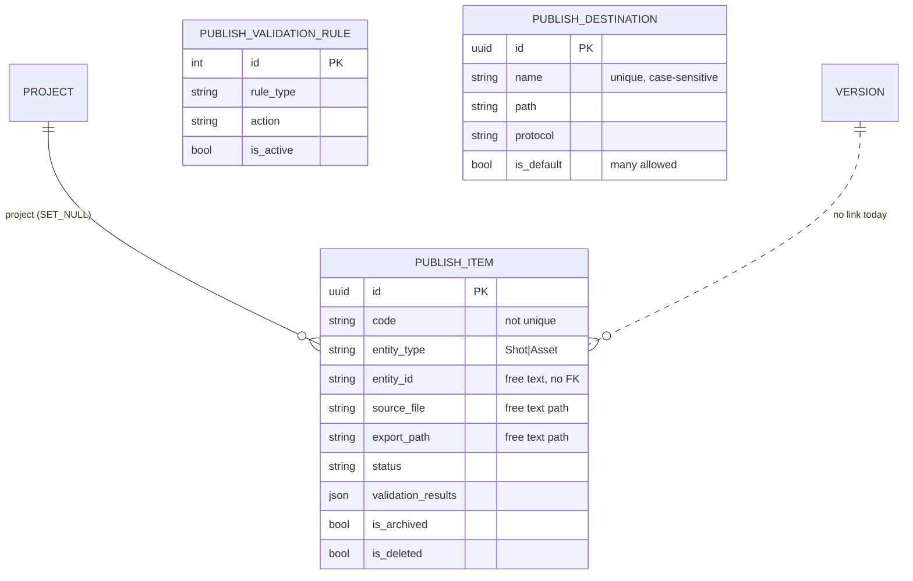

# Publishing: Phase 1 audit

Date: 2026-10-27 · Base: `develop` @ `34168d6` · Docs only, no code changed.
Companions: `DECISIONS.md` (this folder), `docs/delivery-pipeline/ANALYSIS.md` (cross-app view, dependency graph, staging audit SQL).

## 1. Sources and method

* Every file of `backend/apps/publishing` (1563 lines including tests; migrations 0001-0005) was read, plus the shared bases it uses: `apps/deliveries/api/viewsets/base.py`, `apps/core/api/viewsets/{platform,base}.py`, `apps/core/selectors/base.py`, `apps/core/admin/base.py`, `apps/audit/services/background_job.py`.
* The frontend callers were read in `../studiohub-react` (`src/api/repositories/adapters/rest/RESTPublishingAdapter.ts`, `src/types/production.ts:1124`); not run.
* **Probes.** Claims marked *(probe)* were confirmed by running throwaway tests against the pytest test database on 2026-10-27 (file kept in the session scratchpad, not in the repo). Nothing was run against any other database.
* There are no `signals/`, `tasks/`, `events/`, `validators/`, `managers/`, `querysets/` or `filtersets` in this app.

## 2. What the app is today

The app is a **tracker of DCC export jobs** ("publish items": a Maya/Houdini/Nuke file exported to a path), not a registry of published versions or files. It has no link to `production.Version`, which already owns version numbering, the publish action, the publish freeze and the hero flag (production D-29). Deliveries reference `production.Version` directly (`apps/deliveries/models/__init__.py:213-214`), never a publish item.

### 2.1 Models

**`PublishItem`** (`apps/publishing/models/__init__.py:11-208`, table `publishing_item`), base `EntityModel` (UUID pk, `created_*`/`updated_*`, soft delete with `objects` hiding deleted rows, `all_objects` showing all: `apps/core/models/bases/soft_delete.py:40-48`).

| Field | Type / rule | Line |
|---|---|---|
| `name` | Char 255, required | 70 |
| `code` | Char 50, indexed, **not unique** | 75-79 |
| `project` | FK `production.Project`, **`SET_NULL`**, nullable | 82-90 |
| `entity_type` | Char 20, choices Shot/Asset | 92-97 |
| `entity_id` | **Char 100, free text** (no FK to Shot/Asset/Version) | 99-103 |
| `entity_code`, `entity_name` | Char 255, free text copies | 105-113 |
| `dcc_tool` | Char 20, choices (9 tools) | 115-119 |
| `dcc_version`, `source_version`, `export_format` | free text | 121-148 |
| `source_file`, `export_path` | **Char 500, free text paths** | 127-142 |
| `status` | Char 20, choices Pending, Validating, Validated, Exporting, Exported, Failed, Cancelled; default Pending | 150-156 |
| `validation_rules`, `validation_results`, `export_options` | JSON | 158-174 |
| `error_message` | Text | 176 |
| `retry_count` | PositiveInt | 181 |
| `is_archived` | Bool (second archive marker beside the soft delete) | 186-189 |

Meta: ordering `-created_at`; **no constraints, no composite indexes** (`191-195`). `__str__` = code and name (`197`), no sensitive data.

**`PublishValidationRule`** (`:211-293`, table `publishing_validation_rule`): plain `models.Model` with integer pk, **no audit fields, no soft delete, no `updated_at`**; `name`, `rule_type` (7 choices), `action` (warn/error/block), `config` JSON, `is_active`, `order`, `created_at`. No constraints. No API: managed in the Django admin only.

**`PublishDestination`** (`:296-390`, table `publishing_destination`): `EntityModel`; `name`, `destination_type` (7 choices), `path` (free text), `protocol` (5 choices), `is_default`, `region`, `is_active`. Constraint `uniq_publish_destination_name` on `name`, **case-sensitive and including soft-deleted rows** (`382-387`). Several rows may be `is_default`.

**Migrations.** 0001 (initial), 0002 (adds then backfills `organization` on rules), 0003 (destinations), 0004 (`dcc_tool` choices), 0005 (drops every `organization` column and the per-org name constraint, adds the global one). All applied and additive in effect; nothing to edit.

### 2.2 ER diagram (today)

`PublishValidationRule` is read by `validate_publish` (all active rules, globally); `PublishDestination` is a dropdown list with no relation to items.

### 2.3 Services (`apps/publishing/services/publish.py`)

| Function | Lines | What it does | Notes |
|---|---|---|---|
| `create_publish_item` | 14-51 | Creates an item | **Dead code**: no caller (the viewset creates through the serializer, `api/serializers/publish.py:166-174`) |
| `validate_publish` | 54-136 | Runs active rules, sets Validated or Failed, writes an `AuditLog` | Atomic; **no row lock; any current status accepted**; `FILE_EXISTS` only checks that the text is non-empty (`83`); `FILE_SIZE` and `FRAME_RANGE` are hard-coded passes (`88-98`, comment "Simulated"); the other four rule types pass silently (no branch). Audit target `TARGET_VIDEO` ("Reusing for publishing", `122`) |
| `republish` | 139-184 | Copies an item as a new Pending item | Code `f"{code}_v{retry_count + 2}"` (`152`): **republishing the same item twice gives two rows with the same code** *(probe: codes `P3_v2`, `P3_v2`)*; `source_version` becomes `"<old>+1"` (`165`). No lock. |
| `unpublish` | 187-213 | Sets `Cancelled` and `is_archived=True` | Any status; reason from the client is not read |
| `retry_publish` | 216-246 | Failed to Pending, `retry_count + 1` | Raises a bare `ValueError` when not Failed (`228-229`): **500** *(probe)* |

### 2.4 Selectors

`PublishSelector.get_queryset` (`selectors/publish.py:19-34`) selects `project` and applies the view's filterset if one exists (none is declared). `scope_by_request` (`apps/core/selectors/base.py:36-59`) narrows by `request.project`, **but nothing in the code base sets `request.project`** (repo-wide search for `request.project =` / `setattr(request, "project"`: no match), so the queryset is every live item of every project. `DestinationSelector` returns all destinations (`selectors/destination.py:19-21`).

### 2.5 API (`/api/v1/publishing/`, `config/v1_urls.py:47`)

Viewset base: `PlatformCrudViewSet` **imported from the deliveries app** (`api/viewsets/publish.py:11`). Permission classes `IsAuthenticatedPermission` + `HasPermission` (fail-closed `permission_map`).

| Method | Path | Code | Serializer / service | Observed |
|---|---|---|---|---|
| GET | `/publishing/` | `publishing.view` | `PublishListSerializer` | paginated; **all projects** *(probe: a user in no project lists another project's item)* |
| POST | `/publishing/` | `publishing.create` | `PublishCreateSerializer.create` (`166-174`) writes the model directly | any `project_id` accepted without membership check; an unknown id passes validation and fails at commit (**500** under autocommit; *probe* saw the deferred FK error at teardown) |
| GET | `/publishing/{id}/` | `publishing.view` | `PublishDetailSerializer` | any project |
| PATCH/PUT | `/publishing/{id}/` | `publishing.update` | `PublishUpdateSerializer` is a plain `Serializer` with no `update()` (`177-182`) | **500** *(probe)* |
| DELETE | `/publishing/{id}/` | `publishing.delete` | soft delete (`deliveries/api/viewsets/base.py:87-96`) | |
| POST | `/{id}/validate/` | `publishing.update` | `validate_publish` | from any state; after `unpublish` it returns `"status": "Published"` while the row stays archived *(probe)* |
| POST | `/{id}/republish/` | `publishing.update` | `republish` via `BackgroundJobService.enqueue_and_run` (runs inline, `apps/audit/services/background_job.py:61`) | 201; duplicate codes *(probe)* |
| POST | `/{id}/unpublish/` | `publishing.update` | `unpublish` | the frontend's `reason`, `user_name` are ignored |
| POST | `/{id}/retry/` | `publishing.update` | `retry_publish` | **500** unless Failed *(probe)* |
| CRUD | `/publishing/destinations/` | `publishing.view/create/update/delete` | `DestinationListSerializer` (ModelSerializer, explicit fields) | studio-wide |

Search `name, code, entity_code, entity_name`; ordering `name, created_at, status` (`api/viewsets/publish.py:62-63`). Action bodies are empty serializers that accept any keys (`185-214`). Read shape maps backend words to the frontend's (`STATUS_OUTPUT_MAP`, `api/serializers/publish.py:13-21`): **Validated and Exported both read as "Published"**, Pending reads "Queued", Cancelled or archived read "Unpublished".

### 2.6 Admin (`admin/publishing.py`)

All three models registered on `PlatformScopedModelAdmin`, which only marks the audit columns read-only (`apps/core/admin/base.py:24-45`). **Status, validation results, paths and `is_archived` are editable in the admin, and rows can be deleted** (a direct status-write path).

### 2.7 Tests (14, all passing in Phase 0)

`tests/test_api.py` (9: list, create, detail, soft delete, validate, republish, unpublish, retry, validate-reads-as-published) and `tests/test_destinations.py` (5, including two "regular user is forbidden"). Every item test uses a staff user holding **every known code** with `force_authenticate` (`tests/conftest.py:17-32`). Missing: anonymous, member vs non-member, cross-project, PATCH, invalid transitions, concurrency, constraints, migrations.

### 2.8 Frontend contract (read, not run)

`RESTPublishingAdapter.ts:47-77` maps the create form onto the backend fields and **generates the code client-side** (`PUB-YYYYMMDD-<base36>`), sends `entity_id` = the entity code or `"unknown"`, `project_id` only when it looks like a UUID. `republish` sends `comment`, `artist_name`; `unpublish` sends `reason`, `user_name`: all ignored. It never calls PATCH on items. Status union (`src/types/production.ts:1124`): Published, Pending, Validating, Failed, Unpublished, Republished, or any string.

## 3. Feature classification

| Feature (brief's publishing addendum) | Class | Evidence |
|---|---|---|
| Publish record linked to entity, task, version number | **MISSING** here; COMPLETE in Production | `production.Version` (D-29); `PublishItem` has free-text entity only (`models:92-113`) |
| Published files / representations | **MISSING** | no file model; two free-text path columns |
| File type and software from Masterdata | **MISSING** | `dcc_tool` is a local choice list (`models:49-59`); Masterdata has software and file-type catalogs |
| Publisher (Identity user) | PARTIAL | only `created_by` from the base model |
| Status draft/published/deprecated/revoked | **MISSING** (export-job statuses instead) | `models:20-36` |
| Latest-version pointers | n/a here (Production derives current version, D-16, and hero, D-29) | |
| Upstream/downstream dependencies | **MISSING** | |
| Thumbnails, metadata | **MISSING** / PARTIAL (`export_options` JSON) | |
| Race-free numbering, unique (entity, name, version) | **DEFECTIVE** (republish codes collide) | `services:152`, no constraint |
| Immutability of published records | **MISSING** | admin and services write any field in any state |
| SHA-256 checksum stored and verified | **MISSING** | no field |
| Size and type validation | **DEFECTIVE** (simulated) | `services:88-98` |
| Storage abstraction, safe paths | **MISSING** | free text; `../../../../etc/shadow` accepted *(probe)* |
| Lifecycle deprecate / revoke / restore / archive | PARTIAL / DEFECTIVE | `unpublish` only; no restore; two archive markers |
| Parent shot/asset archived | **MISSING** | no FK to shot/asset |
| Validation rules | **DEFECTIVE** | simulated, global, admin-only |
| DCC export-job tracking (what the app actually is) | PARTIAL | create/list/retry work; PATCH 500; retry 500 |
| Destinations dropdown | COMPLETE (for its purpose) | minor: case-sensitive name, many defaults |
| Permissions: publish, approve, revoke, view files | PARTIAL | four CRUD codes only; actions all use `publishing.update` |

## 4. Common checklist

Y = yes, N = no, N/A, U = UNVERIFIED. Columns: **I** = `PublishItem`, **R** = `PublishValidationRule`, **D** = `PublishDestination`.

| # | Check | I | R | D | Evidence |
|---|---|---|---|---|---|
| 1a | Single responsibility | Y (export job) | Y | Y | |
| 1b | Core base model | Y | **N** (`models.Model`, int pk) | Y | `models:11,211,296` |
| 1c | Deliberate `on_delete` for history | **N** (`project` `SET_NULL`) | N/A | N/A | `models:84` |
| 1d | Natural-key uniqueness | **N** (`code`) | **N** (`name`) | partial (case-sensitive, includes deleted) | `models:75-79,247,382-387` |
| 1e | Check constraints | N | N | N | none declared |
| 1f | Indexes fit the queries | partial (single-column only) | N | Y | |
| 1g | Choices / safe `__str__` | Y / Y | Y / Y | Y / Y | |
| 1h | Migrations clean on empty DB | Y (Phase 0: `makemigrations --check` clean; suite migrates) | Y | Y | |
| 2a | Rules in services, not serializers/admin | **N** (create in serializer; admin edits status) | N | N (ModelSerializer CRUD) | `serializers/publish.py:166-174` |
| 2b | Atomic multi-step operations | partial (actions atomic; create not, single insert) | N/A | N/A | |
| 2c | Selectors without N+1 | Y (`select_related("project")`) | N/A | Y | |
| 2d | Dependency direction | **N**: imports the viewset base from Deliveries | | | `api/viewsets/publish.py:11` |
| 3 | State machine with guards | **N**: any action from any state; admin writes status | N/A | N/A | §2.3 |
| 4 | Concurrency (numbering, double submit) | **N** | N/A | N | no locks anywhere |
| 5a | Explicit serializers (no `__all__`) | Y | N/A (no API) | Y | |
| 5b | Thin views | Y | | Y | |
| 5c | Pagination / filtering / ordering | Y / **N** (no filterset) / Y | | Y / N / Y | |
| 5d | Correct status codes | **N** (500 on PATCH, retry, unknown project) | | Y | *(probe)* |
| 5e | Read-only fields silently ignored on write | Y: `status`, `retry_count` etc. are absent from the write serializers (ignored, not refused); action bodies accept any key | | Y | |
| 5f | OpenAPI accurate | **N** (empty action bodies, no error responses) | | partial | |
| 6a | Per-action authorization | partial (4 codes; every action is `update`) | admin only | Y | `api/viewsets/publish.py:49-60` |
| 6b | Project membership / IDOR | **N** | N/A | N/A (studio-wide) | §2.4, *(probe)* |
| 6c | Separation of duties | N (none defined) | | | |
| 6d | Disabled users lose access | Y (identity auth classes; not re-tested here) | | | U for this app |
| 7 | Codes enforced vs seeded | Y: `publishing.view/create/update/delete` are enforced and seeded (full roles all four, lead and artist `view`: `apps/core/management/commands/init_platform.py:175,244,266`); no orphan either way | | | |
| 8 | Audit and history | partial: change log tracks `PublishItem` (`apps/audit/signals/change_tracking.py:232`); actions write `AuditLog` with the wrong target (`TARGET_VIDEO`); no status history | N | N | |
| 9 | Stored vs derived | `retry_count` stored and also used for numbering; `is_archived` duplicates the soft delete | | `is_default` unconstrained | |
| 10 | Sensitive data | paths only (internal); nothing personal | | | |
| 11 | Tests (matrix, constraints, concurrency, auth) | **N** | N | partial | §2.7 |
| 12 | Quality gates | ruff clean; 44 of 65 files in the three apps need formatting; basedpyright errors in the three apps: 15 (Phase 0) | | | |

## 5. Findings

| ID | Sev | Finding | Evidence |
|---|---|---|---|
| PUB-01 | **High** | No project scoping: any holder of `publishing.view` reads, and any holder of `publishing.update` changes, every project's publish items. | `selectors/publish.py:19-34`, `apps/core/selectors/base.py:36-59`; *(probe)* |
| PUB-02 | **High** | Create accepts any project id with no membership check; an unknown id is a 500 at commit. `entity_id` accepts any text (`"not-a-shot"`). | `api/serializers/publish.py:148,153,166-174`; *(probe)* |
| PUB-03 | Medium | `PATCH`/`PUT` on an item is a 500 (write serializer without `update()`). | `api/serializers/publish.py:177-182`; *(probe)* |
| PUB-04 | Medium | `retry` on a non-Failed item is a 500 (bare `ValueError`). | `services/publish.py:228-229`; *(probe)* |
| PUB-05 | Medium | Validation is simulated: size and frame range always pass, four rule types are never evaluated, "file exists" only checks the text is non-empty, and the result is reported as "Passed"/"Published". | `services/publish.py:81-98`; `serializers/publish.py:16` |
| PUB-06 | Medium | No state machine: validate, unpublish, republish work from any state; validating an unpublished item answers "Published" while it stays archived; the admin edits status freely. | `services/publish.py`; `admin/publishing.py`; *(probe)* |
| PUB-07 | Medium | Republish numbering collides (two `P3_v2`) and is not locked; `code` is not unique; the frontend generates codes client-side. | `services/publish.py:152`; `models:75-79`; `RESTPublishingAdapter.ts:58-61`; *(probe)* |
| PUB-08 | Medium | Not linked to what it publishes: no FK to `production.Version`, Shot or Asset; free-text entity copies; no checksum or size. Deliveries cannot use it. | `models:92-148` |
| PUB-09 | Medium | Paths are free text with no storage root or normalisation; traversal sequences are stored as given. | `models:127-142`; *(probe)* |
| PUB-10 | Low | Audit rows carry `target_type="video"`; reasons sent by the frontend are dropped. | `services/publish.py:122,175,206,239` |
| PUB-11 | Low | Two archive markers (`is_archived` and the soft delete), as in Production before D-25. | `models:186`; `services:200` |
| PUB-12 | Low | `PublishValidationRule` has no audit columns, no soft delete, no uniqueness and no API; managed in the admin only. | `models:211-293` |
| PUB-13 | Low | Admin can edit status, results and paths and delete rows for all three models. | `admin/publishing.py` |
| PUB-14 | Low | Destination `name` unique case-sensitively and across soft-deleted rows; several defaults allowed. | `models:361,382-387` |
| PUB-15 | Info | Dead code `create_publish_item`. | `services/publish.py:14-51` |
| PUB-16 | Info | Viewset base class lives in the deliveries app. | `api/viewsets/publish.py:11` |

No Critical finding: no secret or personal data is exposed and no authentication bypass exists.

## 6. Stored vs derived

| Column | Stored? | Real source? | Consumers |
|---|---|---|---|
| `PublishItem.status` | stored | written by services and admin | list/detail, frontend |
| `PublishItem.retry_count` | stored | incremented by retry and republish | republish numbering (wrongly) |
| `PublishItem.is_archived` | stored | `unpublish` only | read shape ("Unpublished") |
| `PublishItem.entity_code/name` | stored copies | none (typed by the client) | list, search |
| `PublishDestination.is_default` | stored | typed | frontend dropdown |

Row counts with non-default values need real data; the read-only query is in `docs/delivery-pipeline/ANALYSIS.md` §8 for you to run on a staging copy.

## 7. Duplicated responsibilities, dead code, free text

* **Duplicate:** "publishing" exists twice: `production.Version.publish` (approved → published, frozen, hero) and `PublishItem` statuses Validated/Exported reading as "Published".
* **Dead code:** `create_publish_item`.
* **Free text that should be references:** `entity_type`/`entity_id`/`entity_code`/`entity_name` (Shot/Asset/Version), `dcc_tool`/`dcc_version` (Masterdata software catalog and versions), `export_format` (Masterdata file types).

## 8. What I cannot see

* Whether any DCC plug-in or pipeline tool calls this API (search your pipeline repos for `/api/v1/publishing/`).
* Real row counts and whether `code` duplicates already exist (staging query, `docs/delivery-pipeline/ANALYSIS.md` §8).
* Where the exported files actually live (Q3 assumed register-only; tell me the storage roots, e.g. `/mnt/projects`, `\\nas\show`).

## 9. Target direction (input to Phase 2, not decided here)

Per Q1/Q3: keep `PublishItem` as the export-job record, link it to the `production.Version` it produced, and add a registry of the version's files (storage root + relative path, SHA-256, size, Masterdata file type) with deprecate/revoke/restore and immutability once registered. Detail is Phase 2 work.

## 10. Questions (non-blocking for Phase 2 drafting; needed before Phase 3 code)

**Q13. What happens to `PublishItem` (the export-job record)?**
Why: it is the only data in the app, and Q1 puts publish state in Production.
* **A. Keep it as the export-job record**, add a nullable link to the `production.Version` it produced (old rows stay unlinked), stop showing Validated/Exported as "Published" only in a later contract change. Least disruptive.
* B. Replace it with the new file registry and convert rows (rows have free-text entities, so most cannot be linked).
* C. Retire it (keep the table read-only, hide the endpoints).
Recommendation and default: **A**. Blocks: Phase 3 model work.

**Q14. Simulated validation rules.**
Why: the API tells users a publish passed checks that never ran (PUB-05).
* **A. Make validation honest:** rules the server can check without reading files (metadata present, declared format allowed, declared size within limit, checksum present and well-formed) are evaluated; the others report "not checked" instead of "passed".
* B. Remove the validate action and the rules (a contract change: the frontend calls it).
* C. Keep as is.
Recommendation and default: **A**. Blocks: Phase 4.

**Q15. Read-shape words.** `Validated` currently reads "Published", which collides with Production's meaning of published.
* **A. Keep the current words for now** (contract-safe), document the collision, change it together with a frontend update in Phase 5.
* B. Change now: `Validated` reads "Validated".
Recommendation and default: **A**. Blocks: nothing until Phase 5.

Cross-app questions that also affect this app: Q23 (audit target types), Q24 (on-delete rules), in `docs/delivery-pipeline/ANALYSIS.md` §9.
