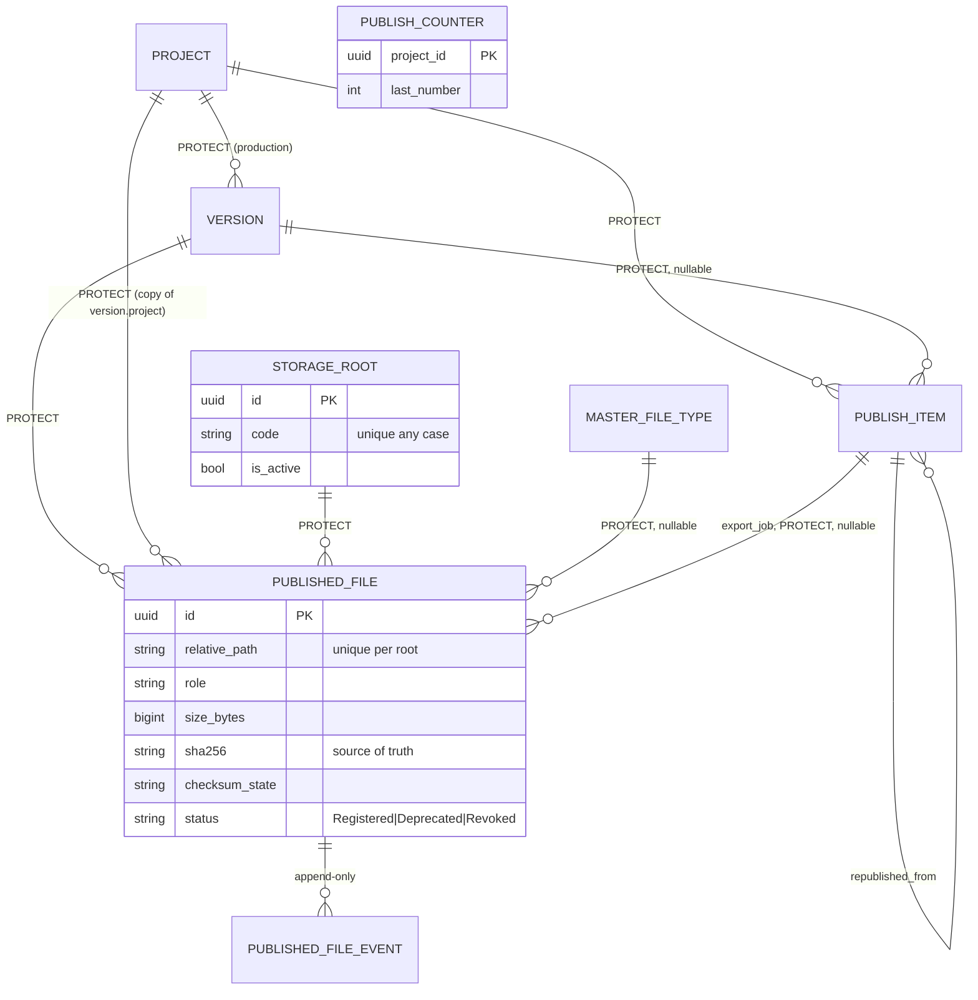

# Publishing plan (Phases 3-5)

**Status:** Phase 3 implemented 2026-10-27 (see "Phase 3 as built" at the end); Phases 4 and 5 not started.

Phase 2 design, 2026-10-27. Branch `feature/publishing-improvement`, created at the start of Phase 3 from `develop`. One commit per phase after its gate. Contracts: `CONTRACTS.md`. Decisions: `DECISIONS.md`, `docs/delivery-pipeline/DECISIONS.md`.

## 1. Current vs target

| Area | Today (evidence in `ANALYSIS.md`) | Target |
|---|---|---|
| What a publish is | `PublishItem`, an export job, unlinked to versions | `production.Version` (D-29) + `PublishedFile` registry; `PublishItem` linked to its version |
| Files | two free-text path columns | `PublishedFile` rows under a `StorageRoot`, normalized relative paths |
| Checksums | none | `sha256` on each file, single source of truth; optional verification on mounted roots |
| Immutability | any field, any time, admin too | registered files immutable except lifecycle fields; model guard + read-only admin |
| Lifecycle | `unpublish` only, two archive markers | files: deprecate / restore / revoke; jobs: one map; archive = soft delete |
| Numbering | client codes, republish collisions | server codes per project under a lock; unique any case |
| Scoping | none (PUB-01) | project membership on every read and write |
| Validation | simulated | honest results with `not_checked` |
| PATCH / retry | 500 | 200 / 409 |
| Permissions | 4 CRUD codes | + `deprecate`, `revoke`, `storage.manage`, `status.override` |
| Audit | `target_type="video"` | `publishing` target, file event table |
| Viewset base | from deliveries | from core (X-02) |
| Dependencies between publishes | none | **not built** (Q5: Later) |

## 2. Target ER diagram

`PUBLISH_COUNTER` (table `publishing_counter`, one row per project, locked with `select_for_update` during code allocation) avoids locking Production's project row from another app.

## 3. Work packages

| WP | Content | Phase |
|---|---|---|
| P-1 | Move the viewset base to core (X-02) with a re-export | 3 |
| P-2 | `StorageRoot`, path rules (DOM-PUB-03), settings key `PUBLISHING_STORAGE_MOUNTS` in `config/env.py` | 3 |
| P-3 | `PublishedFile`, `PublishedFileEvent`, register / bulk-register, idempotent retry, 409 on conflict | 3 |
| P-4 | Immutability guard (service + model `save()` + admin) | 3 |
| P-5 | Lifecycle services deprecate / restore / revoke; `PublishedFileRevoked` event | 3 |
| P-6 | `PublishItem`: `version`, server codes with `PublishCounter`, `PROTECT`, `republished_from`, `cancel_reason`; `is_archived` derived; any-case unique code (stop-and-list migration) | 3 |
| P-7 | Checksum verification task for mounted roots | 3 |
| P-8 | `AuditLog` targets (Q23, touches `apps/audit`, choices only) | 3 |
| P-9 | Transition maps for files and jobs in one file; services refuse other moves; PATCH fixed through the service | 4 |
| P-10 | Honest validation (Q14) | 4 |
| P-11 | Latest pointers: **derived** (latest live Registered `main` file per version; current version stays Production's, D-16/D-29) | 4 |
| P-12 | Project scoping (selectors + write checks), IDOR tests | 5 |
| P-13 | New codes seeded per Q34; permission matrix test (no orphan codes) | 5 |
| P-14 | Admin hardening, OpenAPI bodies, log-capture test, `job_status` field | 5 |

The brief's "publish-to-publish dependencies with cycle prevention" (Phase 4) is **not built**: Q5 put dependencies in LATER. If you want them now, say so at this gate and they join Phase 4 as `PublishedFileDependency(upstream, downstream)` with a cycle check under a lock.

## 4. Phases, tests and gates

### Phase 3: integrity and storage (`publishing(phase-3): integrity and storage`)

Migrations (all additive, each with a reverse):
1. `0006_storage_root_published_file`: new tables, constraints, indexes.
2. `0007_publish_item_links`: `version`, `republished_from`, `cancel_reason`, `PublishCounter`; `project` on-delete `PROTECT` (no SQL).
3. `0008_publish_item_code_unique`: **checks first and refuses, changing nothing,** if two rows share a code in any case (prints them; staging query P2 tells you beforehand); then the `upper(code)` unique constraint.
4. `0009_destination_name_default`: same stop-and-list for destination names and defaults, then the new constraints.

Tests (new files under `apps/publishing/tests/`):
* `domain/test_paths.py`: traversal corpus refused on every write path; normalized values accepted unchanged.
* `services/test_file_register.py`: published-only, project match, idempotent retry (200, same id), conflicting retry (409), inactive root / file type, checksum format.
* `services/test_file_immutability.py`: every non-lifecycle field refused through service, serializer and model save.
* `services/test_file_lifecycle.py`: deprecate / restore / revoke, reason required, event published after commit only.
* `concurrency/test_numbering_pg.py` (PostgreSQL, `transaction=True`): eight concurrent job creates in one project get eight distinct codes; fails without the counter lock.
* `concurrency/test_register_pg.py`: two concurrent registrations of the same path: one 201, one 200 (identical) or 409 (different).
* `tasks/test_verify.py` with a temporary directory as mount: verified, mismatch, missing, symlink escaping the mount refused.
* `migrations/test_0008_stop_and_list.py`: duplicate codes make the migration refuse; round-trip of 0006-0009 on the test database.

### Phase 4: workflow (`publishing(phase-4): workflow`)

* `constants/workflow.py` with `FILE_TRANSITIONS`, `JOB_TRANSITIONS`; `test_transition_maps.py` generates every (from, to) pair: allowed pairs pass, all others give the Q27 status; same map for single actions, PATCH and bulk.
* Direct status writes refused on PATCH (400 unless echoed) and in the admin (read-only).
* `concurrency/test_revoke_pg.py`: two concurrent revokes: one 200, one 409.
* `services/test_validation.py`: each rule type gives `passed` / `failed` / `not_checked` as documented; no rule reports `passed` without a check.

### Phase 5: authorization and hardening (`publishing(phase-5): authorization and hardening`)

* `api/test_access_matrix.py`: anonymous 401; member with/without each code; non-member 404 on detail, absent from lists, 400 "Unknown project." on create; platform admin; API key with and without scopes; disabled user 401.
* `test_permission_matrix.py`: seeded codes = enforced codes; no orphan either way; override code granted to no role.
* `security/test_logs.py`: `caplog` over register, revoke, verify: no path of revoked files, no reason text, no checksum.
* Admin tests: read-only fields, no delete on files.
* OpenAPI: schema generation test lists the action bodies.

Every gate: `manage.py check`, `makemigrations --check --dry-run`, `pytest apps/publishing`, the full suite against the Phase 0 baseline (4340 passed, 1 skipped), `ruff check`, `ruff format --check` and `basedpyright` on changed files (no new violations, Q9).

## 5. Risks and rollback

| Risk | Mitigation |
|---|---|
| Existing duplicate job codes block 0008 | stop-and-list migration; staging query P2 first |
| Pipeline tools outside the web UI call `/publishing/` (unknown, ANALYSIS §8) | only additive fields on existing endpoints; scoping is the one behaviour change; check before Phase 5 |
| Versions published before Phase 3 have no files | deliveries of them need files registered first (Q29); `bulk-register` makes backfilling one call per batch |
| Verification of large sequences is slow | runs from `manage.py verify_published_files`, chunked; never on the request path |
| Rollback | each migration reverses; new tables can be dropped by reversing (they hold only new data) |

## 6. Role-to-code proposal (Q34)

Roles are the seeded ones (Q8). **Bold** = new code.

| Code | platform-admin | org-admin | production-admin | vfx-supervisor | lead-artist | artist | org-member |
|---|---|---|---|---|---|---|---|
| `publishing.view` | Y | Y | Y | Y | Y | Y | — |
| `publishing.create` | Y | Y | Y | Y | **Y** | — | — |
| `publishing.update` | Y | Y | Y | Y | — | — | — |
| `publishing.delete` | Y | Y | Y | — | — | — | — |
| **`publishing.deprecate`** | Y | Y | Y | Y | — | — | — |
| **`publishing.revoke`** | Y | Y | Y | Y | — | — | — |
| **`publishing.storage.manage`** | Y | Y | — | — | — | — | — |
| **`publishing.status.override`** | — | — | — | — | — | — | — |

Changes from today: lead-artist gains `publishing.create` (registering files of their own published versions from a DCC); vfx-supervisor loses `publishing.delete` (deleting job records is an admin task). Pipeline service accounts use an API key of a user holding `publishing.create`, scoped to it.

## 7. Phase 3 as built

Done as planned: P-1 (viewset base moved to `apps/core/api/viewsets/platform_crud.py`, re-export left in
`apps/deliveries/api/viewsets/base.py`, importers in publishing, scheduling and production repointed),
P-2 (`StorageRoot`, `domain/paths.py`, `PUBLISHING_STORAGE_MOUNTS`), P-3 (`PublishedFile`,
`PublishedFileEvent`, register and bulk-register, idempotent retry), P-4 (immutability: service,
model `save()`/`delete()`, queryset `update()`/`delete()`, DB checks; admin not registered, so nothing to
harden yet), P-5 (deprecate, restore, revoke with the transition map and the revoke event), P-6 (job
`version` link, `PublishCounter` codes, `PROTECT`, `republished_from`, `cancel_reason`, any-case unique
code, `is_archived` no longer written), P-8 (audit targets `publishing` and `scheduling`; `delivery`
already existed).

Differences from the plan, each recorded in `docs/delivery-pipeline/DECISIONS.md` ("While implementing"):

| Plan said | Built | Why |
|---|---|---|
| P-7: Celery task verifies checksums | `verify_published_files` management command (`tasks/verify.py` has the functions) | the repository defines no Celery app (`config/celery.py` is empty); wiring one is new architecture |
| Phase 3 migrations 0006 to 0009 | same four, plus `audit` 0008 | as planned |
| Job create: project required | unknown project is a 400; required and membership-checked in Phase 5 | existing tests and the frontend send jobs without membership; scoping is P-12 |
| Seeding in Phase 5 (P-13) | `deprecate`, `revoke`, `storage.manage`, `status.override` seeded now | the new endpoints would otherwise be unusable; the role *changes* (vfx-supervisor loses `delete`, lead-artist gains `create`) stay in Phase 5 |
| Permission matrix test in Phase 5 | the existing production matrix pin updated now | the new grants broke it |
