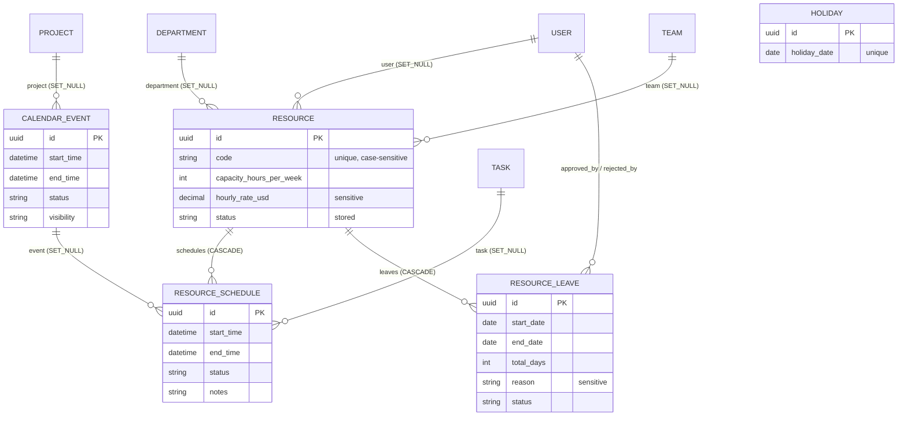

# Scheduling: Phase 1 audit

Date: 2026-10-27 · Base: `develop` @ `34168d6` · Docs only, no code changed.
Companions: `DECISIONS.md` (this folder), `docs/delivery-pipeline/ANALYSIS.md`. **Earlier work on this app** (production D-09, D-20, D-21, D-22 in `docs/production/DECISIONS.md`) already fixed leave decisions, event visibility, pay-rate hiding, scoped links, validated statuses and times, and the PATCH 500s. This audit builds on those decisions; it does not reopen them.

## 1. Sources and method

* Every file of `backend/apps/scheduling` (4064 lines including tests; migrations 0001-0003) and the production endpoints that use it (`apps/production/api/viewsets/scheduling.py`, `apps/production/api/views/project_scoped.py:579-600`).
* Frontend: `../studiohub-react/src/modules/scheduling/repositories/SchedulingRepository.ts`; not run.
* Claims marked *(probe)* were confirmed with throwaway tests on the pytest test database (2026-10-27).
* No `signals/`, `tasks/`, `events/`, `validators/` in this app.

## 2. What the app is today

A studio calendar (events), bookable resources (people, equipment, rooms) with time-slot bookings, leave requests with a decided-once workflow, and a single studio holiday list. Capacity and overbooking figures are computed per UTC week from bookings. There are **no milestones, work calendars, dependencies or recurring items**.

### 2.1 Models (`apps/scheduling/models/__init__.py`; all on `EntityModel`)

**`CalendarEvent`** (`:11-159`): `title`, `description`, `project` FK (**`SET_NULL`**, `77-85`), `event_type` (Meeting, Deadline, Milestone, Review Session, Holiday, Leave, Work Block), `status` (Scheduled, In Progress, Completed, Cancelled, Postponed; Completed and Cancelled final per D-22), `visibility` (Private, Team, Organization, Public; D-21), `start_time`/`end_time` DateTime (`110-116`), `is_all_day`, `location`, `meeting_url`, `notes`, `metadata`. **No DB check `end >= start`** (the serializers check, D-22). Property `duration_minutes`.

**`Resource`** (`:162-284`): `name`, `code` (`unique=True`, **case-sensitive at the DB**; the service refuses any-case duplicates per D-22, `199-204`), `resource_type` (Person, Equipment, Room, Studio), `status` (Active, On Leave, Unavailable; **stored, not derived from approved leave**), `department` / `team` FK to Masterdata (`SET_NULL`), `user` FK to Identity (`SET_NULL`), `capacity_hours_per_week` (PositiveInt, default 40), `hourly_rate_usd` (Decimal 10,2, **no lower bound**: the write serializer has no `min_value`, `api/serializers/__init__.py:354-359`), `location`, `metadata`.

**`ResourceSchedule`** (`:287-364`), a booking: `resource` FK (**`CASCADE`**, `308-314`), `start_time`/`end_time`, `status` (Booked, Available, Blocked, Overbooked; default Available), `event` FK (`SET_NULL`), `task` FK `production.Task` (`SET_NULL`), `notes`. **No overlap rule** (by decision D-22: overbooking is reported, not prevented) and no DB time check.

**`ResourceLeave`** (`:367-492`): `resource` FK (**`CASCADE`**), `leave_type` (7), `status` (Pending, Approved, Rejected, Cancelled), `start_date`/`end_date` **Date**, `total_days` (computed inclusive calendar days, D-20), `reason`, `approved_by/at`, `rejected_by/at`, `rejection_reason`. No DB check `end >= start`.

**`Holiday`** (`:495-535`): `name`, `holiday_date` Date, `is_paid`, `is_optional`, `description`; **`unique_together = ("holiday_date",)`**: one studio-wide holiday per date, no calendar, office, country or time zone. `is_paid`/`is_optional` are read by nothing.

**Migrations.** 0001 initial; 0002 drops `organization`, **drops and re-adds** `Resource.department` / `team` and `Holiday` uniqueness (links stored before it ran were lost: historical); 0003 adds `rejected_by` / `rejected_at` (D-20).

### 2.2 ER diagram (today)

`PROJECT`, `TASK` are Production; `USER` Identity; `DEPARTMENT`, `TEAM` Masterdata.

### 2.3 Services

| Function | Where | Behaviour |
|---|---|---|
| `update_calendar_event_status` | `services/__init__.py:85-102` | row lock, known statuses, Completed/Cancelled final (D-22) |
| `update_calendar_event` | `:105-112` | same status rule on edit |
| `book_resource`, `block_resource` | `:115-163` | insert a slot; **no overlap or capacity check**, no lock |
| `approve_leave`, `reject_leave` | `services/leave.py:50-76` | row lock, Pending only, not your own (D-20); reason required |
| `count_leave_days` | `services/leave.py:22-24` | calendar days, both ends included: weekends and holidays count |
| `resolve_overbooking` | `services/capacity.py:49-121` | flags visible Booked slots as Overbooked (D-09) |
| `create_calendar_event`, `submit_leave_request`, `create_holiday` | `services/__init__.py:33-66,166-214` | **unused** outside the `__all__` list (dead code) |

### 2.4 Selectors

* `CalendarEventSelector` (`selectors/__init__.py:21-31`) applies `ViewerScope.filter_events` (D-21). `ViewerScope` (`selectors/scope.py`) uses Production's `ProductionBaseSelector.is_platform_admin` / `visible_project_ids` (a Scheduling → Production read through a selector: the allowed direction).
* `ResourceSelector`, `ResourceScheduleSelector`, `ResourceLeaveSelector`, `HolidaySelector` return **everything** (studio-wide by design; bookings are masked per row, D-21).
* Capacity (`selectors/capacity.py`): week = Monday 00:00 **UTC** (`44-50`); allocated hours = overlap of Booked-type slots with the week; capacity = `capacity_hours_per_week` (`125`). **Approved leave and holidays do not reduce capacity**; there is no per-person time zone.

### 2.5 API (`/api/v1/scheduling/`, plus production's `/scheduling/capacity|overbooking|resolve-overbooking/`)

All five viewsets use `PlatformCrudViewSet` from the deliveries app (`api/viewsets/__init__.py:10`), `HasPermission`, and **bare-array lists with no pagination** (frontend contract).

| Resource | Codes | Notes |
|---|---|---|
| `events/` (+ `update-status`) | view / create / update / delete | visibility per D-21; `update-status` reads `request.data.get("status")` with no serializer (`80-82`) |
| `resources/` (+ `book`, `block`) | view / create / update / delete; rates need `view_rates` | **ordering by `hourly_rate_usd` is allowed to callers who cannot see rates** (`121`) *(probe: order Dear, Cheap with both rates `null`)* |
| `schedules/` | view / create / update / delete | **search on `notes`** (`193`) matches the notes hidden from the caller on out-of-scope bookings *(probe: hit)*; `resource` writable to any resource |
| `leaves/` (+ `approve`, `reject`) | view / create / update / delete | **search on `reason`** (`230`) matches reasons hidden from non-approvers *(probe: hit for "surgery")*; `resource` in the body may be **anyone's** *(probe: leave filed for another person's resource, 201)*; `reject` reads `rejection_reason` raw (`263`) |
| `holidays/` | view / create / update / delete | studio-wide |

### 2.6 Admin (`admin/scheduling.py`)

All five models editable and deletable on `PlatformScopedModelAdmin`; a leave's status and decision fields can be changed in the admin, bypassing D-20.

### 2.7 Tests (102 passing in Phase 0, 84 functions)

`test_api.py` (13, happy paths), `test_calendar_scope.py` (16, visibility and rates), `test_capacity_overbooking.py` (15), `test_leave_workflow.py` (19, including a PostgreSQL race test with two decisions), `test_write_checks.py` (21, scoped links, times, statuses, codes). Missing: search/ordering side channels, leave on behalf, booking overlap policy, time-zone and DST, holidays in capacity, migrations.

### 2.8 Frontend contract (read, not run)

`SchedulingRepository.ts`: GET/POST/PATCH/DELETE events, GET/PATCH resources, capacity, overbooking, resolve-overbooking, GET holidays, GET leaves. Bare arrays expected. No leave creation or booking calls from this repository (other modules UNVERIFIED).

## 3. Feature classification

| Feature (brief's scheduling addendum) | Class | Evidence |
|---|---|---|
| Schedule / plan per project | **MISSING** | events carry an optional project only |
| Milestones | **MISSING** (an event type label only); production **fabricates** a 5-phase milestone list for `/organizations/projects/{id}/schedule` from hard-coded names and interpolated dates | `apps/production/api/views/project_scoped.py:122-128,579-600` |
| Work calendars (working days, holidays, time zones) | **MISSING** (one global holiday per date) | `models:532` |
| Task date planning (start, due, duration, baseline) | lives in Production (`Task.due_date`, `estimated_hours`: `apps/production/models/task.py:120-121`); no start or baseline | |
| Dependencies with cycle prevention | **MISSING** | |
| Resource availability and leave | PARTIAL / COMPLETE for the decision workflow (D-20) | leave does not reduce capacity |
| Bookings | PARTIAL | no overlap policy, no lock |
| Capacity and utilization | PARTIAL | UTC week, ignores leave and holidays; Masterdata's utilization fields wait for a scheduling selector (masterdata DECISIONS, Phase 6 decision 1) |
| Recurring items, reminders | **MISSING** | |
| `start <= end` | PARTIAL (serializers only, no DB check) | D-22 |
| Time-zone policy | **MISSING** (UTC storage implicit; dates without zone; week in UTC) | |
| Non-negative durations / amounts | PARTIAL (capacity PositiveInt; rate unbounded) | |
| Booking overlap rule | by decision none (D-22); policy to decide (Phase 2) | *(probe)* |
| Concurrency-safe booking | **MISSING** | |
| Derived vs stored (utilization, status On Leave) | PARTIAL (`Resource.status` stored) | |
| Permissions: plan, move, book, approve leave, own bookings, rates gated | PARTIAL: one `update` code books and approves; rates gated (D-21) but leaked through ordering; leave reasons gated (D-20) but leaked through search | |

## 4. Common checklist

Columns: **E** event, **R** resource, **S** booking, **L** leave, **H** holiday.

| # | Check | E | R | S | L | H | Evidence |
|---|---|---|---|---|---|---|---|
| 1b | Core base model | Y | Y | Y | Y | Y | |
| 1c | `on_delete` protects history | N (`SET_NULL` project) | Y (nullable refs) | **N** (`CASCADE` from resource) | **N** (`CASCADE`) | N/A | `models:79,310,408` |
| 1d | Natural-key uniqueness | N/A | partial (case-sensitive DB) | N | N (no rule against overlapping leave) | partial (date only, global) | |
| 1e | Check constraints (times, amounts) | **N** | **N** (rate) | **N** | **N** | N/A | |
| 1h | Migrations clean on empty DB | Y | Y | Y | Y | Y | Phase 0 |
| 2a | Rules in services | Y (status) | partial | **N** (serializer `save()`) | Y (decisions) | N | |
| 2b | Atomic + locks | Y (status lock) | N/A | **N** | Y | N/A | |
| 2c | No N+1 | Y | Y | partial (`ViewerScope` per request; per-row `sees_*` in Python) | Y | Y | |
| 2d | Dependency direction | Scheduling → Production via selectors (allowed); viewset base from Deliveries (not allowed); Production imports Scheduling selectors/services (`apps/production/api/viewsets/scheduling.py:57,75,96`) | | | | | |
| 3 | State machine | Y (finals, D-22) | N (status free) | N (status free) | Y (D-20) | N/A | |
| 4 | Concurrency | Y (status) | N/A | **N** (overlap race) | Y (race test) | N/A | |
| 5d | Status codes | Y | likely 500 on negative capacity (DB check, not serializer; **UNVERIFIED**) | Y | Y | Y | |
| 5e | Read-only silently ignored | N (400 for decision fields, D-20) | | | Y | | |
| 5f | OpenAPI accurate | partial (`update-status` body undeclared) | | | partial (`reject` body undeclared) | | |
| 6b | Project membership / IDOR | Y (D-21) | N/A (studio-wide) | partial (titles masked; search leaks notes) | N/A | N/A | |
| 6c | Separation of duties | | | | Y (own leave refused) | | |
| 6e | Own-records scoping | | | **N** (anyone books anyone) | **N** (leave for anyone) | | *(probe)* |
| 7 | Codes enforced vs seeded | Y: `schedule.view/view_rates/create/update/delete` enforced and seeded (full roles all five; lead and artist `view`), D-07/D-21 | | | | | `init_platform.py:168,239,261` |
| 8 | Audit and history | change log does **not** track scheduling models (`apps/audit/signals/change_tracking.py:219-248` lists none); leave decisions stored on the row only | | | | | |
| 9 | Stored vs derived | `Resource.status` stored (could derive from leave); `total_days` derived and stored | | | | | |
| 10 | Sensitive data | | rates and e-mail gated (D-21), **ordering leak** | notes masked, **search leak** | reasons masked, **search leak** | | *(probe)* |
| 11 | Tests | Y | Y | partial | Y | partial | §2.7 |

## 5. Findings

| ID | Sev | Finding | Evidence |
|---|---|---|---|
| SCH-01 | **High** | Hidden leave reasons can be read back through `?search=`: `search_fields = ("reason",)` matches text the caller is not shown, so substring searches reconstruct it (leave reasons can hold health information). The same holds for the notes of out-of-scope bookings (`search_fields = ("notes",)`). | `api/viewsets/__init__.py:193,230`; *(probe)* |
| SCH-02 | Medium | Callers without `schedule.view_rates` may order resources by `hourly_rate_usd`, revealing the rate ranking. | `api/viewsets/__init__.py:121`; *(probe)* |
| SCH-03 | Medium | Any holder of `schedule.create` files leave for anyone's resource, and holders of `schedule.update` can edit others' pending requests (including moving them to another resource). | `api/serializers/__init__.py:531-534`; `api/viewsets/__init__.py:233-241`; *(probe)* |
| SCH-04 | Medium | Bookings: no overlap policy, no lock, anyone with `schedule.update` books any resource; status free. (Allowed by D-22; the brief wants a policy.) | `services/__init__.py:115-163`; *(probe)* |
| SCH-05 | Medium | Capacity ignores approved leave and holidays and uses a UTC week; overbooking and capacity figures are wrong for leave and holiday weeks and for studios away from UTC. | `selectors/capacity.py:44-50,125` |
| SCH-06 | Medium | History loss on hard delete: bookings and leave `CASCADE` from the resource. | `models:310,408` |
| SCH-07 | Medium | No calendar model: one global holiday per date, no office or time zone; leave counts weekends and holidays. | `models:532`; `services/leave.py:22-24` |
| SCH-08 | Medium | Production fabricates a project milestone schedule (hard-coded phase names, dates interpolated between project start and delivery, status from today's date). | `apps/production/api/views/project_scoped.py:122-128,579-600` |
| SCH-09 | Low | No DB checks for `end >= start` (events, bookings, leave) or a non-negative rate. | models |
| SCH-10 | Low | Leave status and decision fields editable in the admin (bypasses D-20); all models deletable there. | `admin/scheduling.py:99-124` |
| SCH-11 | Low | Unpaginated lists for all five resources (bookings grow without bound). | `api/viewsets/__init__.py:52,98,173,208,274` |
| SCH-12 | Low | Scheduling models are not in the change log. | `apps/audit/signals/change_tracking.py:219-248` |
| SCH-13 | Low | `update-status` and `reject` read raw request data (no declared body in OpenAPI). | `api/viewsets/__init__.py:80,263` |
| SCH-14 | Info | Dead code: `create_calendar_event`, `submit_leave_request`, `create_holiday`. | `services/__init__.py` |
| SCH-15 | Info | `Resource.status` "On Leave" is typed, not derived from approved leave. | `models:184-221` |

## 6. Stored vs derived

| Value | Stored? | Real source | Consumers |
|---|---|---|---|
| `Resource.status` | stored | typed | lists |
| `ResourceLeave.total_days` | stored, server-computed | dates | lists |
| Capacity, allocated hours, utilization | derived per request | bookings | `/scheduling/capacity`, `/overbooking` |
| Masterdata `Department.utilization_percentage`, `capacity_hours_weekly`, `Team.utilization_percentage` | stored in Masterdata, **omitted from its API** (masterdata Phase 6 decision 1) | to be derived from `scheduling.Resource` + bookings via a scheduling selector keyed by UUID | none today |
| Project milestones | fabricated per request | none | `/organizations/projects/{id}/schedule` |

## 7. Overlap with Production (single source of truth)

| Fact | Production | Scheduling | Proposal (Phase 2) |
|---|---|---|---|
| Task due date, estimate | `Task.due_date`, `estimated_hours` (`task.py:120-121`) | bookings may point at a task | Production stays the source; Scheduling reads by UUID |
| Actual hours | approved timelogs (D-15) | none | Production |
| Project start / delivery dates | `Project.start_date`, `delivery_date` (`project.py:59-60`); `Episode.delivery_date`, `Show` dates | none | Production stores the contract dates; Scheduling owns milestones that reference them |
| Milestones | fabricated list (SCH-08) | none | Scheduling |

## 8. What I cannot see

* Which offices and time zones the studio works in, and whether different offices have different holidays.
* Whether anyone books people through the API today (the frontend repository has no booking call).
* How many leave rows hold a reason (staging query, delivery-pipeline §8).

## 9. Questions (non-blocking for Phase 2 drafting; needed before Phase 9 code)

**Q19. Who may file or edit leave for someone else?** (Also closes D-20's open point that artists cannot request leave.)
* **A. Own leave for everyone** (artists get `schedule.create` limited to their own resource), on behalf of others only with a new `schedule.manage` (seeded to the full roles), like `timelog.manage`.
* B. Today's rule: any `schedule.create` holder, for anyone.
Recommendation and default: **A**. Blocks: Phase 11.

**Q20. How are leave days counted?**
* **A. Working days** of the person's calendar (weekends and holidays excluded) once calendars exist (Phase 9); calendar days until then.
* B. Calendar days always (today, D-20).
Recommendation and default: **A**. Blocks: Phase 9.

**Q21. Holiday calendars.**
* **A. Work calendars:** a studio default plus optional calendars per office (Masterdata `Office`, which already has an IANA time zone), each with its own working week and holidays; a resource follows its office's calendar. Existing holidays move to the default calendar.
* B. One studio calendar (today), with a working week added.
Recommendation and default: **A**. Blocks: Phase 9 model.

**Q22. The fabricated project schedule** (`/organizations/projects/{id}/schedule`).
* **A. Replace it with real milestones** from Scheduling once they exist (same response shape; projects with none return an empty list instead of invented phases). Touches a Production file.
* B. Keep the invented phases.
Recommendation and default: **A**, in Phase 10. Blocks: Phase 10.

Cross-app questions: Q23 (audit target types), Q24 (on-delete rules) in `docs/delivery-pipeline/ANALYSIS.md` §9.
