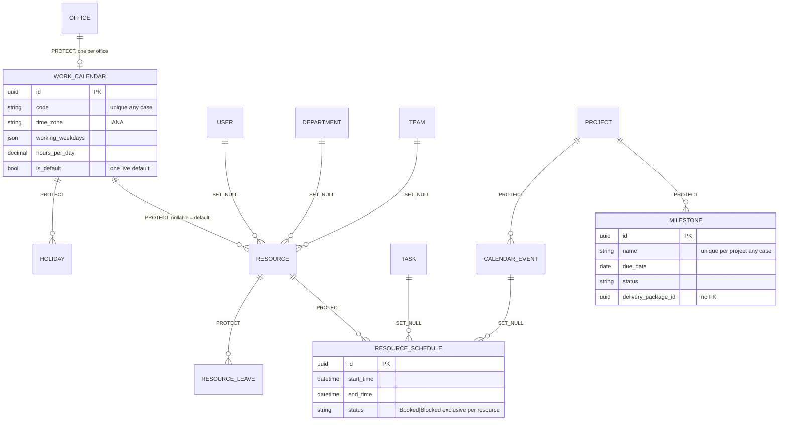

# Scheduling plan (Phases 9-11)

Phase 2 design, 2026-10-27. Branch `feature/scheduling-improvement`, created at the start of Phase 9 from `develop` (Scheduling depends on Production only; the milestone check against deliveries goes through a provider that may be absent). Contracts: `CONTRACTS.md`. Production decisions D-09, D-20, D-21, D-22 stand.

## 1. Current vs target

| Area | Today (`ANALYSIS.md`) | Target |
|---|---|---|
| Time zones | implicit UTC, UTC weeks | policy in CONTRACTS §1; calendar zone for days and weeks |
| Calendars | one holiday per date | `WorkCalendar` per office + default; holidays per calendar |
| Leave days | calendar days | working days (new requests) |
| Leave for others | anyone with `schedule.create` | own with `create`, others with `manage` |
| Leave decisions | `schedule.update` | `schedule.approve` (same roles), override for single managers |
| Bookings | overlaps allowed, no lock | no overlap (service lock + PostgreSQL exclusion constraint); over-allocation still reported |
| Capacity | ignores leave and holidays | working hours of the calendar minus approved leave and holidays |
| `Resource.status` | typed | "On Leave" derived |
| Milestones | invented by Production | `Milestone` rows; Production route reads them |
| Search / ordering leaks | reason, notes, rate | closed |
| History | not in the change log; `CASCADE` from resources | change log; `PROTECT` |
| Production imports this app | capacity endpoints | endpoints moved here, same paths |
| Utilization for Masterdata | none | `CapacitySelector.department_week` / `team_week` |
| Dependencies, recurring events, reminders | none | **LATER** (Q5) |

## 2. Target ER diagram

`OFFICE`, `DEPARTMENT`, `TEAM` are Masterdata; `USER` Identity; `PROJECT`, `TASK` Production.

## 3. Work packages

| WP | Content | Phase |
|---|---|---|
| S-1 | `domain/calendar.py` pure functions; `WorkCalendar`; holidays per calendar (data migration to a default calendar) | 9 |
| S-2 | Time policy: naive date-times refused; capacity weeks in the calendar zone | 9 |
| S-3 | DB checks for times, dates, rate; `upper(code)` on resources; `PROTECT` (Q24) | 9 |
| S-4 | `Milestone` model, service, API; Production schedule route through the provider (Q22) | 9 (model) / 10 (route) |
| S-5 | Move the capacity endpoints from Production to Scheduling at the same paths (X-05) | 9 |
| S-6 | Leave days as working days for new requests; report command for old rows | 9 |
| S-7 | Booking service with lock and overlap check; PostgreSQL exclusion constraint (stop-and-list migration) | 10 |
| S-8 | Capacity minus leave and holidays; `CapacitySelector` for departments and teams (Masterdata utilization) | 10 |
| S-9 | `Resource.status` derived; stored column read-only for "On Leave" (Q33) | 10 |
| S-10 | Close search and ordering leaks; `start` / `end` window filters | 11 |
| S-11 | Own-leave rule, `schedule.manage`, `schedule.approve`, `schedule.sod.override`; role seeding (Q34) | 11 |
| S-12 | Change log registration, `AuditLog` target, admin hardening (leave decisions read-only), OpenAPI bodies for `update-status` and `reject` | 11 |
| S-13 | `bulk-delete` for bookings (Q36) | 11 |

The brief's Phase 9 "dependency cycle prevention" is **not built** (Q5: dependencies LATER).

## 4. Phases, tests and gates

### Phase 9: calendars, dates and integrity (`scheduling(phase-9): calendars, dates and integrity`)

Migrations: `0004_work_calendar` (table + default calendar row), `0005_holiday_calendar` (FK, data step attaching existing holidays, new unique), `0006_checks_protect` (checks: **refuse and list** rows that break them first, staging S2; `PROTECT` without SQL; `upper(code)`), `0007_milestone`.

Tests:
* `domain/test_calendar.py`: working days across weekends, holidays, optional holidays, custom weekdays; week bounds in `Europe/London`, `America/Los_Angeles`, `Asia/Kolkata` (no DST), across both DST changes (frozen clock).
* `services/test_leave_days.py`: new requests count working days; old rows unchanged.
* `api/test_time_policy.py`: naive date-time 400; offset accepted and stored as UTC.
* `migrations/test_checks_stop_and_list.py`; round-trip 0004-0007.
* Production: capacity endpoints answer the same shape at the same paths after the move (existing tests in `apps/production/tests` keep passing unmodified).

#### Phase 9 as built (2026-10-27)

Status: **implemented, committed on `feature/scheduling-improvement`** (hash in the Phase 9 report). Differences from the plan above:

* **Branch base.** The branch starts from the deliveries tip (`66649be`), not from `develop` (A-43).
* **Migration tests** are `tests/migrations/test_phase9_migrations.py` (all of 0004 to 0007, including one stop-and-list case per check, the deleted-row cases, the PROTECT and enforcement cases and the reverse that refuses two calendars holding one date), not `test_checks_stop_and_list.py`. Only one round trip goes back to 0003, because PostgreSQL never reuses dropped-column slots.
* **Capacity move.** The three capacity views now live in `apps/scheduling/api/views/capacity.py` at the same paths and names `capacity`, `overbooking`, `resolve-overbooking` under `api:v1:scheduling`. Production no longer imports Scheduling (checked by an AST test, `tests/test_boundaries.py`). The one Production route that still invents milestones, `ProjectScheduleView`, is replaced in Phase 10 through the provider.
* **Capacity week** is computed per resource in its calendar's time zone; leave and holidays do not reduce capacity yet (Phase 10).
* **Writes** to calendars and milestones are gated by the existing `schedule.update` / `schedule.create` / `schedule.delete` codes until Phase 11 adds `schedule.manage` (A-45).
* **Read-only report** `manage.py report_leave_days` lists leave rows whose stored count differs from their working days. It changes nothing and prints no reasons.
* New defects found by the new checks and fixed here: a booking whose end equals its start passed the serializer and failed on the database check (a 500), and the create responses for events and resources carried no `id`.

### Phase 10: bookings and capacity (`scheduling(phase-10): bookings and capacity`)

Migration `0008_booking_exclusion`: `CREATE EXTENSION IF NOT EXISTS btree_gist` and the exclusion constraint, PostgreSQL only; refuses and lists overlapping pairs first (staging S1).

Tests:
* `services/test_booking_overlap.py`: overlap refused, adjacent allowed, Available never blocks, soft-deleted ignored, move into an overlap refused.
* `concurrency/test_booking_pg.py` (PostgreSQL, `transaction=True`): eight concurrent bookings of one slot: exactly one wins; with the service lock removed the DB constraint still stops all but one.
* `selectors/test_capacity.py`: leave and holidays reduce capacity; derived department figures equal a hand count from the rows.
* `api/test_resource_status.py`: "On Leave" derived; writing it is a 400.
* `api/test_project_schedule.py` (Production route): real milestones, same keys; empty list without milestones.

#### Phase 10 as built (2026-10-27)

Status: **implemented, committed on `feature/scheduling-improvement`** (hash in the Phase 10 report). Differences from the plan above:

* **Migration `0008_booking_exclusion` is built, after a first pass without it.** Phase 10 was first built with the service lock only (Q32 option B) because I wrongly reported `btree_gist` as missing from the database server (it was missing from a different, unused server; see `delivery-pipeline/DECISIONS.md` check 1). On the user's instruction ("Option 2, add the constraint and commit") the constraint was added: `0008` refuses and lists overlapping pairs (S1, live bookings that occupy a resource), creates `btree_gist` if missing (reusing masterdata's `EnsureBtreeGistExtension`, whose reverse leaves it installed), and adds `PostgresOnlyExclusionConstraint` `scheduling_booking_no_overlap` (reusing masterdata's class, so other engines get no SQL and keep the service check). Q32 is option A as designed (A-51 superseded by A-57).
* **Overbooked also occupies time** (A-52), so a booking flagged by triage cannot be double-booked.
* **Capacity** is scaled, not capped (A-53): see CONTRACTS section 10.
* **Providers:** `scheduling.project_milestones` (Production's schedule route) and `scheduling.capacity` (`CapacitySelector`; nothing consumes it yet because Masterdata's utilization is not part of this work).
* **Tests** are at `services/test_booking_overlap.py` (service rule and database rule), `concurrency/test_booking_pg.py` (PostgreSQL; eight threads through the service, and eight writing straight to the table: exactly one wins each time), `migrations/test_phase9_migrations.py` (0008 too), `services/test_capacity_leave_holidays.py`, `domain/test_week_capacity.py`, `api/test_resource_status.py`, `api/test_project_schedule.py`.
* **Existing test changed:** `tests/test_write_checks.py::test_a_resource_can_be_edited` set the status to "On Leave", which Q33 now refuses; it sets "Unavailable" instead (same assertions otherwise).

### Phase 11: authorization and hardening (`scheduling(phase-11): authorization and hardening`)

* `api/test_side_channels.py`: search by hidden reason and note finds nothing; ordering by rate ignored without the code.
* `api/test_leave_rules.py`: own leave with `create`; others' needs `manage` (400 otherwise); approver code; self decision refused; override with reason allowed and recorded.
* `api/test_access_matrix.py`, `test_permission_matrix.py`, admin tests, OpenAPI test, log-capture test (no reasons, notes, rates).
* `api/test_bulk_delete.py` (Q36).

Every gate: as publishing (`docs/publishing/PLAN.md` §4).

#### Phase 11 as built (2026-10-27)

Status: **implemented, committed on `feature/scheduling-improvement`** (hash in the Phase 11 report). Differences from the plan above:

* **Test files** are `api/test_side_channels.py`, `api/test_leave_rules.py`, `api/test_access_matrix.py` (every route needs exactly its code), `test_permission_matrix.py` (seeded = enforced), `api/test_bulk_delete.py`, `api/test_booking_window.py`, `api/test_audit_and_logs.py` (audit rows, change-log masking and a log-capture test), `api/test_openapi.py`, `test_admin_and_commands.py` (admin and `redact_leave_reasons`), and a PostgreSQL race test for concurrent leave requests in `concurrency/test_booking_pg.py`.
* **Search** is not switched off: bookings and leave are searchable by resource name and code, never by notes or reasons (A-60).
* **Resource creation** needs `schedule.manage`, not `schedule.create` (A-58), because lead-artist and artist now hold `create`.
* **Admin:** bookings and leave are view-only too, not only leave decisions (A-62).
* **Not built:** a leave `cancel` endpoint (the contract's service signature listed it, the API table did not) and a database constraint on leave overlap (A-59, A-61).
* **Existing tests changed:** `test_leave_workflow.py` and `test_write_checks.py` give their planner users `manage` and `approve`; Production's `test_permission_matrix.py` expects the new role grants (`schedule.create` for lead-artist and artist, `manage` and `approve` for the full roles); Production's scheduling-route and seed fixtures were changed in Phase 10.

## 5. Risks

| Risk | Mitigation |
|---|---|
| The DB role cannot create `btree_gist` | check before Phase 10 (`DECISIONS.md` checks); fallback: service check only, documented as UNVERIFIED for races outside the service |
| Existing overlapping bookings | stop-and-list migration; staging S1 |
| Capacity numbers change for leave and holiday weeks | expected; documented in API-SCH-12 |
| Projects lose the invented milestones | documented in API-SCH-11; a seed command can create milestones from the old phase names on request |
| Leave counts differ between old (calendar days) and new (working days) rows | report command lists old rows; nothing recomputed |

## 6. Role-to-code proposal (Q34)

| Code | platform-admin | org-admin | production-admin | vfx-supervisor | lead-artist | artist | org-member |
|---|---|---|---|---|---|---|---|
| `schedule.view` | Y | Y | Y | Y | Y | Y | — |
| `schedule.view_rates` | Y | Y | Y | Y | — | — | — |
| `schedule.create` | Y | Y | Y | Y | **Y** | **Y** | — |
| `schedule.update` | Y | Y | Y | Y | — | — | — |
| `schedule.delete` | Y | Y | Y | Y | — | — | — |
| **`schedule.manage`** | Y | Y | Y | Y | — | — | — |
| **`schedule.approve`** | Y | Y | Y | Y | — | — | — |
| **`schedule.sod.override`** | — | — | — | — | — | — | — |

Changes from today: lead-artist and artist gain `schedule.create` (own leave and own events only, enforced by the service); `manage` and `approve` go to the roles that hold `schedule.update` today, so no one loses an ability.
